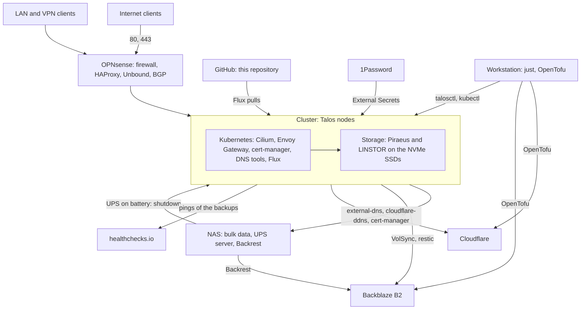

# Documentation

- [first-bootstrap.md](first-bootstrap.md): the order of the first bootstrap, linking to the `bootstrap.md` of each topic.
- [roadmap.md](roadmap.md): what is left to build and the open questions.
- [reference.md](reference.md): the names, addresses, ports, namespaces, 1Password items and schedules in one place.
- [conventions.md](conventions.md): how the repository, the manifests, Talos and the documentation are organised.
- [tofu/README.md](../tofu/README.md): the OpenTofu stacks (Cloudflare, Backblaze).

## Overview

The topics below describe each part: the machines ([nodes](nodes/README.md)), what surrounds them ([network](network/README.md)), the cluster and its storage, then what runs on it.

## Topics

### Format

Each topic has its own folder, with the same files (only those with content):

| File | Content |
| --- | --- |
| `README.md` | The architecture: what it is, why, the status and the decisions. |
| `bootstrap.md` | The first deployment: prerequisites, then the steps in order, with checkboxes. |
| `runbook.md` | The day-to-day recipes and procedures. |
| `evaluations.md` | What was tested or considered and set aside, and the open points. |

### List

| Topic | Content |
| --- | --- |
| [Nodes](nodes/README.md) | The machines: hardware, BIOS, Secure Boot, TPM disk encryption, Talos image. |
| [Network](network/README.md) | OPNsense: DHCP, router advertisements, names, firewall, BGP, IPv6 prefix change. |
| [Cluster](cluster/README.md) | Bootstrap, Cilium, network policies, Pod Security, CoreDNS, Flux, GPU, Spegel, Reloader. |
| [Secrets](secrets/README.md) | 1Password: the workstation service account, External Secrets. |
| [Storage](storage/README.md) | Piraeus/LINSTOR and NFS. |
| [Ingress](ingress/README.md) | Envoy Gateway, the Gateways, the certificate, HAProxy on OPNsense. |
| [DNS](dns/README.md) | k8s-gateway, external-dns, cloudflare-ddns, OpenTofu records. |
| [Backups](backups/README.md) | VolSync and restic on Backblaze B2, Backrest for the NAS. |
