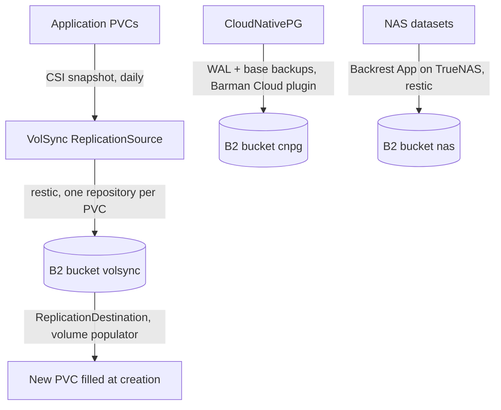

# Backups

What is backed up, where, how often, and how. Section 6 of the [roadmap](../roadmap.md) tracks the implementation.

| Document | Content |
| --- | --- |
| [bootstrap.md](bootstrap.md) | First deployment on a new cluster: resources to create first (B2, 1Password, healthchecks), deployment and tests. |
| [runbook.md](runbook.md) | Day-to-day administration: recipes, backing up an application, checks, restores, disaster recovery. |
| [evaluations.md](evaluations.md) | What was tested, considered or rejected, and the open points. |

The manifests are in `kubernetes/apps/backups` (VolSync controller, monitoring) and `kubernetes/components/volsync` (backup of an application volume). The restore recipes are in `kubernetes/mod.just` (`just kube volsync-*`). The B2 buckets and keys are in `tofu/backblaze`. The NAS data is backed up by the NAS itself, outside of the cluster.

## Status

| Part | Tool | Status |
| --- | --- | --- |
| etcd | Not backed up | [Decision](evaluations.md#etcd-not-backed-up) |
| Application volumes (SQLite, files) | VolSync (restic mover) from the `linstor` CSI snapshots, B2 | Deployed, [tested](bootstrap.md#2-test-volsync) with a throwaway application, no real application uses it yet |
| PostgreSQL (CloudNativePG) | CNPG Barman Cloud plugin | Proposed, implemented with CNPG ([options](evaluations.md#postgresql-options)) |
| NAS data (documents, photos, mail, calendar, media) | Backrest as a TrueNAS App, B2 | Decided, [to set up](bootstrap.md#3-nas-data-backrest) on the NAS |
| Monitoring | healthchecks.io (`volsync-monitor` CronJob, Backrest hooks), then Alertmanager | Deployed for VolSync |
| Restricted B2 keys | Keys without `deleteFiles` + lifecycle rule | [Tested](evaluations.md#restricted-b2-key-test) on 2026-10-25: works |
| Restores | `just kube volsync-*` recipes, [procedures](runbook.md#restores) | Tested on the test application |
| Restore tests | Automated in a throwaway namespace | [To do](evaluations.md#open-points) |

## Overview

## Objectives

| | Target |
| --- | --- |
| RPO | 24 h (daily backups). Point-in-time recovery for PostgreSQL is optional. |
| RTO, hardware failure | A few days (waiting for the parts is acceptable). |
| RTO, rebuild from scratch | One day at most: Git + 1Password + backups. |
| Scenarios | Deletion or corruption of data, loss of one or two nodes, total loss of the cluster, ransomware or stolen credentials. |
| Consistency | Crash-consistent CSI snapshots, the applications are not stopped. Same guarantee as a hard power-off of a host, and as the previous Btrfs snapshot setup. |

## What is backed up

| Data | Size | Where it lives | Backed up by |
| --- | --- | --- | --- |
| Application state (data directories, SQLite) | ~24 GiB with the databases | `replicated` volumes (LINSTOR) | VolSync |
| PostgreSQL databases | included above | CloudNativePG volumes | CNPG Barman Cloud plugin |
| Documents and photos (Nextcloud, Immich) | ~140 GiB | NAS | Backrest on the NAS |
| Mail archives and contacts/calendar (mbsync, vdirsyncer) | ~2 GiB | NAS | Backrest on the NAS |
| Irreplaceable media (`media/library`: `audiodrama`, `audiobooks`, `books`, `comics`) | ~20 GiB | NAS | Backrest on the NAS |
| etcd | small | Control plane nodes | No: everything it holds is rebuilt from Git, 1Password and the backups ([why](evaluations.md#etcd-not-backed-up)) |
| Logs and metrics | | Cluster | Undecided, depends on the volume (see [roadmap](../roadmap.md), section 8). VictoriaMetrics `vmbackup` to S3 is an option. |
| Volumes of the `local` class | | Cluster | No: this class is for disposable or application-replicated data |
| Redis / Valkey | | Cluster | No (caches and queues) |
| Manifests | | Git | No |
| Secrets, Talos secrets bundle | | 1Password | No (1Password is a SaaS, it stays available if the cluster is lost) |
| Replaceable media, downloads | | NAS | No |

Exclusions of the NAS data (the root of the shares will change, the final directory names will not):

- Immich: `encoded-video`, `thumbs`.
- Nextcloud: `files_external`, `appdata_*/preview`, `*/cache`, `*/files_trashbin`, `*/files_versions`, `*/uploads`.
- `*.log` and `*.log.[0-9]`.
- Any directory containing a `.nobackup` file.

The sources of the previous setup (Hetzner VM, `rsync_servers`, `backups/servers`) disappear with the VM. `mbsync` and `vdirsyncer` keep feeding mail and calendar archives to the NAS, but their images are obsolete: they will be replaced either by a tool with a built-in schedule or by native CronJobs, decided at migration time.

## Destination: Backblaze B2

- B2 only, existing account, new buckets, S3 API. One provider to cut the costs. About 1.5 to 2 $/month for 200 to 250 GB ($6.95/TB/month, egress free up to 3 times the stored data).
- No copy on the NAS for now. TrueNAS 27 should bring an S3 API by the end of 2026. If it comes, a copy would only be useful for the cluster state: a copy of the NAS data on the NAS protects nothing.
- Every repository is a plain restic repository, encrypted client-side, readable with the `restic` CLI whatever tool wrote it.
- One bucket, one application key and one restic password per tool, so that a key leaked by one of them gives no access to the others. The NAS key is never in the cluster.

Buckets, lifecycle rules and application keys are managed by OpenTofu (`tofu/backblaze`, [tofu/README.md](../../tofu/README.md)): `just tofu apply backblaze` creates them and pushes the keys to the 1Password items. Every bucket name ends with the same random suffix (`gz8j9y`), B2 bucket names being global to all accounts.

| Bucket | Written by | 1Password item (`kubernetes` vault) |
| --- | --- | --- |
| `kube-cluster01-volsync-gz8j9y` | VolSync, one repository per PVC under `<bucket>/<app>` | `restic-volsync` |
| To name (later) | CloudNativePG | `cnpg-b2` (later) |
| To name (later) | Backrest on the NAS | `restic-nas` (`infrastructure` vault: never synced to the cluster) |

Fields of the `restic-*` items: `repository` (`s3:https://s3.eu-central-003.backblazeb2.com/<bucket>`), `password` (restic repository password, generated when the item is created, never managed by OpenTofu), `access-key-id` and `secret-access-key` (B2 application key restricted to the bucket). OpenTofu writes `repository` and the key.

### Protection against ransomware and stolen keys

- **No Object Lock.** Restic creates and removes its own lock files, and with a default retention the deletions get *Access Denied*: `forget` and `unlock` are blocked (restic issue [#3491](https://github.com/restic/restic/issues/3491)). The restic documentation describes no supported setup.
- **Application keys without `deleteFiles`**, and a lifecycle rule on each bucket that deletes the hidden versions 30 days after they were hidden. Verified by a [test](evaluations.md#restricted-b2-key-test):
  - In B2, `deleteFiles` only allows `b2_delete_file_version` (removing a version for good), while `writeFiles` includes `b2_hide_file`. An S3 `DeleteObject` without version id becomes a hide marker.
  - Restic works normally with such a key, `forget --prune`, `unlock` and `check` included: its deletions only hide files.
  - A stolen key (or a compromised cluster) can hide everything but erase nothing: the hidden versions stay 30 days, enough to notice and [read them back](runbook.md#recovery-after-a-deletion-of-the-backups).
  - The keys have no `writeBuckets` either: the lifecycle rule cannot be shortened with them.
  - Cost: the pruned data is billed 30 more days. Small with daily backups of mostly unchanged data.
- Not covered: the compromise of the B2 account itself (master key, web interface), which can delete versions and change the lifecycle rules. Only Object Lock would cover it: keep the account behind a strong password and a second factor, and never store the master key.
- Not covered: the OpenTofu admin key (`infrastructure/backblaze-b2-tofu-admin`, readable by the workstation service account). It has no `deleteFiles` nor `deleteBuckets`, which only prevents mistakes of OpenTofu: with `writeKeys` it can create a key with any capability, `deleteFiles` included ([escalation test](../../tofu/README.md#setup)), and it can shorten the lifecycle rules. Whoever holds it can erase every backup at once, like with the master key. Accepted: it lives with the other infrastructure secrets, the workstation service account is read-only and rotated, and the admin key is revoked with it if the workstation is suspected ([ransomware procedure](runbook.md#ransomware-or-compromised-cluster), step 2).

## Retention

- Restic repositories: daily 28, weekly 8, monthly 6, no yearly (`keep-daily 28`, `keep-weekly 8`, `keep-monthly 6`). The VolSync prune runs separately, every 7 days.
- PostgreSQL: a sliding recovery window (30 days proposed) instead of snapshots.
- Hidden B2 versions: 30 days (lifecycle rule).

## Application volumes: VolSync

`kubernetes/apps/backups/volsync` (controller, chart 0.17.0, in `backups`) and `kubernetes/components/volsync` (per application, [usage](runbook.md#backing-up-an-application)).

For an application using the component:

- The component creates the PVC `${APP}` of the application, with a `dataSourceRef` to the ReplicationDestination `${APP}-dst`. The ReplicationDestination restores the latest backup once, when it is created (`manual` trigger): into a temporary volume, which it snapshots (`status.latestImage`) then deletes. When the PVC is created, the VolSync volume populator fills it from that snapshot before the application starts. With an empty repository, the restore succeeds and the volume stays empty. Afterwards the PVC is a plain PVC.
- The snapshot of the ReplicationDestination is never refreshed: a PVC created later gets the data of that first restore, not the latest backup. On a new cluster (first deployment, rebuild) both objects are new, so the latest backup is used. After deleting a PVC, delete the ReplicationDestination too ([from scratch](runbook.md#one-application-volume-from-scratch)). The snapshot stays on the thin pool meanwhile (it shares its blocks with the PVC created from it), and keeps the LINSTOR resource definition of the deleted temporary volume; both go away with the ReplicationDestination.
- The ReplicationSource `${APP}` backs the PVC up every day (01:30 UTC by default): CSI snapshot (`linstor`), clone of the snapshot into a temporary volume, `restic backup`, then `restic forget` with the retention. The prune runs every 7 days. Only the PVC of the application and the restic cache of the ReplicationSource (`volsync-src-${APP}-cache`, kept between syncs) stay between two backups.
- The temporary volumes (snapshot clones, restic caches, restored volumes) use the `replicated-temporary` StorageClass: same resource group as `replicated` (a snapshot of a `replicated` volume can be restored into it), but `reclaimPolicy: Delete`. With `Retain`, every sync would leave a released volume behind.
- One repository per PVC: `<repository of restic-volsync>/${APP}`, host `volsync`, path `/data` in the snapshots.
- The mover pods run in the namespace of the application, with the UID/GID of its files (`VOLSYNC_UID`, `VOLSYNC_GID`), not privileged.
- No exclusion patterns (only `CACHEDIR.TAG` directories can be excluded): put caches outside of the backed up volume (`emptyDir`, or a second PVC of the `local` class).
- One volume per application: an application with several volumes to back up needs a second ReplicationSource/ReplicationDestination written by hand, with `${APP}-<volume>` as repository path.

## PostgreSQL: CloudNativePG

Proposed: the **Barman Cloud plugin** (CNPG-I), with WAL archiving and base backups to a B2 bucket of its own, and a recovery-window retention. The in-tree `barmanObjectStore` is deprecated. Implemented with CloudNativePG; the other options are in [evaluations.md](evaluations.md#postgresql-options).

## NAS data: Backrest on TrueNAS

The NAS backs up its own datasets with [Backrest](https://github.com/garethgeorge/backrest) (restic with a web UI), installed as a TrueNAS App. The data does not cross the cluster nodes (single 1 Gb/s NIC), and the backups keep running while the cluster is down. Nothing is managed from the cluster.

- One repository (`restic-nas`), one plan per data set (`documents`, `groupware`, `media`), each with its own schedule and monitoring. Datasets mounted read-only.
- Daily backups at night, same retention as the cluster repositories, weekly prune, monthly check (`--read-data-subset`).
- Restores from the Backrest UI (LAN only, with authentication), to a scratch dataset or a download, never over the live data.
- The Backrest configuration (`config.json`, the plans) is kept in 1Password (`restic-nas` item).

Setup: [bootstrap.md](bootstrap.md#3-nas-data-backrest). No Backrest instance reads the cluster repositories: the [recipes](runbook.md#recipes) list and restore them from the workstation ([why](evaluations.md#rejected-options)).

## Monitoring

healthchecks.io (the online service: the self-hosted instance on the Hetzner VM goes away). One check per job, period 1 day, grace 2 hours. Ping URLs in the 1Password item `healthchecks` (`kubernetes` vault), one field per check:

| Check | Field | Pinged by |
| --- | --- | --- |
| VolSync | `kube-cluster01-volsync` | CronJob `volsync-monitor` (`backups` namespace) at 09:00: success when every ReplicationSource synced in the last 26 hours, `/fail` with the late ones otherwise (a paused ReplicationSource is late) |
| NAS documents, groupware, media | (Backrest hooks, on the NAS) | Backrest |

Alertmanager takes over once configured (VolSync exposes `volsync_volume_out_of_sync`), healthchecks may then be dropped.

Limit: these checks look at the jobs, not at the content of the repositories. A malicious `forget` (every snapshot hidden with the cluster key) leaves the next backups successful. A check reading the repositories is an [open point](evaluations.md#open-points).
