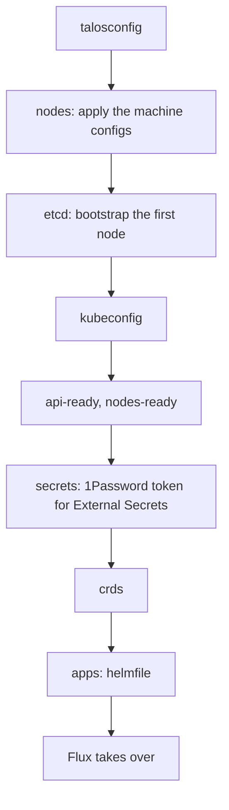

# Cluster: Kubernetes, Cilium and Flux

How the Kubernetes cluster is bootstrapped and kept up to date: the bootstrap helmfile, Cilium and its network policies, Pod Security, CoreDNS, External Secrets and Flux, which then deploys everything in `kubernetes/apps`, and the cluster-wide tools (Spegel, Reloader). The nodes are in [nodes](../nodes/README.md), the network around the cluster in [network](../network/README.md). The decisions are [below](#decisions).

| Document | Content |
| --- | --- |
| [bootstrap.md](bootstrap.md) | First deployment: cluster ranges, Git repository, dry checks, `just bootstrap cluster`, checks of the cluster, rollout of the network policies and of Pod Security. |
| [runbook.md](runbook.md) | Day-to-day: the `just kube` recipes, the upgrades by hand, diagnosing Flux, diagnosing a flow dropped by the network policies, a pod refused by Pod Security, recovering Flux on the wrong branch. |
| [evaluations.md](evaluations.md) | The choices considered, and the points to check or watch. |

## Status

| Part | Tool | Status |
| --- | --- | --- |
| Bootstrap (`bootstrap/`, `just bootstrap cluster`) | `talosctl`, helmfile | Done: Cilium (+ BGP and LB pools), CoreDNS, External Secrets, Flux |
| GitOps (`kubernetes/apps`) | Flux, Kustomize, Renovate | In use, Renovate and the upgrades by tuppr [to deploy](../roadmap.md#upgrades) |
| CNI, kube-proxy replacement | Cilium | In use ([below](#cilium)) |
| Network policies, Hubble Relay | Cilium | Deployed in audit mode, nothing dropped: enforced after the observability stack, [checks](bootstrap.md#network-policies) in progress ([below](#network-policies)) |
| Pod Security | Pod Security Admission | `restricted` by default, to apply (Talos and Flux), [checks](bootstrap.md#pod-security) in progress ([below](#pod-security)) |
| Cluster DNS | CoreDNS | In use ([below](#coredns)) |
| GPU | Intel device plugin | In use on kube-01 ([below](#gpu)) |
| Registry mirror between the nodes | Spegel | Deployed by the bootstrap and Flux, [checks](bootstrap.md#spegel) not run yet ([below](#spegel)) |
| Restart on configuration change | Reloader | Deployed by Flux, [checks](bootstrap.md#reloader) not run yet ([below](#reloader)) |
| First bootstrap | | In progress, with kube-01 and kube-03 only ([test phase](../nodes/README.md#test-phase-2-nodes)) |

## Overview

`just bootstrap cluster` takes nodes booted in maintenance mode up to Flux, in stages (each one can be run alone, e.g. `just bootstrap apps`):

The `apps` stage installs, in this order, the minimum needed for Flux to take over:

1. **Cilium**, then its BGP sessions and LoadBalancer pools (`kubernetes/apps/kube-system/cilium/networking`). The nodes stay `NotReady` until the CNI runs: Flannel, kube-proxy and the CoreDNS of Talos are disabled in the Talos configuration. The `observability` namespace is created just before: the chart puts its Grafana dashboards there ([observability](../observability/README.md#the-release-of-the-stack)). Flux adopts both later.
2. **CoreDNS**.
3. **Spegel**, in parallel with External Secrets and before Flux, so that the images pulled by Flux already go through it ([below](#spegel)).
4. **External Secrets** and the `onepassword` ClusterSecretStore ([secrets](../secrets/README.md)).
5. **flux-operator** and **flux-instance**.

The chart source and version of each release come from its `OCIRepository`, and the values from its `HelmRelease`, in `kubernetes/apps/<namespace>/<release>/app`: `kubernetes/apps` stays the single source of truth, and the only place Renovate updates. Everything else (cert-manager, the Intel GPU device plugin, Reloader, Envoy Gateway, the DNS tools, the storage, the backups) is deployed by Flux once it has taken over.

## Decisions

- GitOps with Flux (flux-operator + flux-instance), Kustomize + `HelmRelease` with charts from `OCIRepository`. The bootstrap helmfile reads the chart, version and values from `kubernetes/apps`.
- kustomize-controller runs with the `CancelHealthCheckOnNewRevision` feature gate (a patch in the flux-instance values): a Kustomization waits for what it deploys (`wait: true`) up to its timeout, which defaults to its `interval` (1h). Without the gate, a Kustomization waiting on a broken release ignores the commit that fixes it until the wait ends; with it, a new revision cancels the wait and is applied at once. No `timeout` in the `ks.yaml`: it would not unblock a fix sooner, it would fail the slow first starts (image pulls, VolSync restores) and retry them only an `interval` later, and the failures of a `HelmRelease` are already reported by its own events.
- Updates: Renovate, run from the cluster. Talos and Kubernetes upgrades: tuppr (both [to deploy](../roadmap.md#upgrades)).
- Tools pinned in `mise.toml` (kubectl and talosctl follow the cluster versions).
- Secrets: External Secrets Operator with a read-only service account on the `kubernetes` vault ([secrets](../secrets/README.md)).
- Pod Security: `restricted` by default, a lower level only for the namespaces that need it ([below](#pod-security)).
- No registry cache: Docker Hub credentials in containerd avoid the rate limit. Spegel shares the images already on the nodes between them, it is not a cache ([below](#spegel)).

## Cluster ranges

| | IPv4 | IPv6 |
| --- | --- | --- |
| Pods | `10.244.0.0/16` | `fd1b:654d:9afe:100::/56` |
| Services | `10.96.0.0/12` | `fd1b:654d:9afe:200::/112` |

These ranges are **permanent**: they cannot be changed once the cluster is created. The IPv6 ones are carved out of a ULA /48 dedicated to the cluster and never routed outside of it. They are set in `talos/vars.yaml` and repeated in the Cilium and CoreDNS values (`kubernetes/apps/kube-system/{cilium,coredns}/app/helmrelease.yaml`): keep them in sync if they are changed before the bootstrap.

**IPv4 is the primary family** (first in the lists): single-stack Services get an IPv4 ClusterIP, and the primary pod IP is the IPv4 one, so the kubelet probes use IPv4 and applications listening on `0.0.0.0` only keep working. A Service that must be reachable over IPv6 sets `ipFamilyPolicy: PreferDualStack` (the application must then listen on `::` too).

## Cilium

- Native routing, no overlay.
- kube-proxy replacement through KubePrism.
- **iptables masquerading**, not `bpf.masquerade`: its IPv6 support is beta and always uses the GUA as source, even towards ULA destinations ([evaluations](../network/evaluations.md#rejected-options)). A pod reaching an IPv6 ULA destination is masqueraded behind the ULA address of its node.
- The BGP control plane advertises the LoadBalancer IPs to OPNsense, from the `internal` and `external` pools ([network](../network/README.md#bgp)).
- Cilium network policies, with the host firewall, replace the Talos ingress firewall that was dropped ([below](#network-policies)).
- Cilium Gateway API stays disabled: Envoy Gateway is used ([ingress](../ingress/evaluations.md#rejected-options)).

## CoreDNS

The CoreDNS of Talos is disabled, replaced by the Helm chart: 2 replicas, forwarding to the Talos host DNS. The service is dual-stack, with the cluster DNS addresses given to the kubelet (the 10th address of each service subnet): `10.96.0.10` then `fd1b:654d:9afe:200::a`.

## Network policies

Cilium policies, fail-closed: every pod is in default deny, and every flow it needs is allowed explicitly. The manifests are in `kubernetes/apps/kube-system/cilium/policies` (clusterwide), `kubernetes/components/network-policies` (per namespace) and next to the applications (exceptions).

- **How Cilium evaluates them**: a pod selected by a policy drops, in that direction (ingress or egress), whatever no policy allows. The policies only add allowed flows, there is no deny rule here. A flow between two pods must be allowed on both sides: egress of the client, ingress of the server.
- **Identities, not addresses**: the rules select pods by their labels, and the rest by *entities*: `host` (the local node), `remote-node` (the other nodes), `kube-apiserver`, `world` (outside of the cluster), `cluster` (all of the above except `world`). The Services and LoadBalancer addresses are translated to the pods before the policies apply.
- **Host firewall** (`hostFirewall`, `host.yaml`): the policies with a `nodeSelector` apply to the nodes themselves: the Talos services, and the `hostNetwork` pods (Cilium agent, LINSTOR satellites, CSI node plugin). Ingress only, by port: everything from outside (OPNsense filters it) and between the nodes, but from the pods only the API server (6443), the Talos host DNS (53), the LINSTOR satellites (3366, from the controller) and the Hubble server (4244, from Relay). The Talos API, the kubelet and etcd are out of reach of the pods. Ports in [reference](../reference.md#ports).
- **Baseline of the pods** (`baseline.yaml`): selects every pod. Ingress from the local kubelet (probes), the API server (webhooks) and the Envoy proxies of the Gateways (any backend). Egress to the whole cluster and to the internet, but not to the private networks (RFC 1918, ULA) nor the public IPv6 prefix of the LAN: a pod reaches neither the NAS, OPNsense nor the other LAN devices, except by an exception by name (`toFQDNs`, [conventions](../conventions.md#network-policies)). The pods leave through the GUA of their node (masquerading), so without the GUA prefix in the list, the GUA of the other nodes would be `world` and bypass the host firewall. This prefix is a manual step of the [prefix change](../network/runbook.md#2-repository-external-lb-pool).
- **Same namespace** (`kubernetes/components/network-policies`, included by every namespace): the pods of a namespace reach each other. A clusterwide policy cannot express it (an empty selector there means the whole cluster), hence a namespaced policy in each one.
- **Exceptions**: a `ciliumnetworkpolicy.yaml` next to the application, which selects the peers (entities or labels), not the ports ([conventions](../conventions.md#network-policies)). Today: the Envoy proxies and k8s-gateway (from `world` and `cluster`), Spegel (from `remote-node`: containerd of another node through the NodePort), the LINSTOR controller (from `remote-node`: the CSI node plugin is `hostNetwork`). CoreDNS (from `cluster`) is with the baseline, in `cilium/policies`: Flux reaches its source-controller through a Service name, so a baseline applied without DNS would block Flux before it applies the missing policy.
- **No exemption**: `kube-system`, `piraeus-datastore` and `flux-system` are covered like the others. The NetworkPolicies of Flux are disabled (`cluster.networkPolicy: false` in flux-instance, `web.networkPolicy.create: false` in flux-operator): Cilium adds the Kubernetes NetworkPolicies to its own, so their `allow-egress` and the one of the web UI would open the namespace over the baseline. No Kubernetes `NetworkPolicy` is used: disable the ones a chart creates.
- **Audit mode** (`policyAuditMode`) to roll out or to diagnose: the denied flows are reported by Hubble with the verdict `AUDIT`, nothing is dropped. It applies to the whole cluster ([runbook](runbook.md#network-policies)).
- **Hubble Relay** collects the flows of every node for the `hubble` CLI (`mise.toml`), through a port-forward. No UI for now. Its certificates are regenerated every 4 months by a CronJob (`hubble.tls.auto.method: cronJob`): with the default `helm` method, Helm reuses them and they expire after a year.
- **Export of the denied flows**: Hubble only keeps the last 4095 flows of each node in memory, minutes on a busy node. The flows `AUDIT` and `DROPPED` are also written as JSON lines to `/var/run/cilium/hubble/events.log` on each node (`hubble.export.static`, 5 rotated files of 10 MB, in tmpfs on Talos so lost at reboot), for the log collector of the [observability stack](../roadmap.md#observability), and read by hand until then ([runbook](runbook.md#network-policies)).
- **Bootstrap**: `just bootstrap apps` installs Cilium without the policies, Flux applies them later (`cilium-policies` Kustomization). Until then, nothing is filtered.

## Pod Security

[Pod Security Admission](https://kubernetes.io/docs/concepts/security/pod-security-admission/), built into the API server, checks every new pod against the profile of its namespace: `privileged` (nothing checked), `baseline` (no access to the host) or `restricted` (`baseline`, plus a hardened non-root container). Each namespace has three modes: `enforce` refuses the pod, `audit` records the violation in the audit log of the API server, `warn` returns it to the client (`kubectl`, Flux).

- **`restricted` by default, fail-closed**: it is the default of the cluster, for every namespace without labels (`KubeAdmissionControlConfig` in `talos/patches/security.yaml`). A new namespace, or one whose labels were forgotten, is `restricted`. On top of `baseline` (no host namespaces, ports or paths, no privileged container), a pod must:
  - run as non-root: `runAsNonRoot: true`, and a non-zero `runAsUser` if the image runs as root;
  - set `allowPrivilegeEscalation: false` and drop every capability (`drop: ["ALL"]`, only `NET_BIND_SERVICE` may be added back);
  - use the `RuntimeDefault` (or `Localhost`) seccomp profile;
  - only use `configMap`, `secret`, `emptyDir`, `persistentVolumeClaim`, `projected`, `downwardAPI`, `ephemeral` and `csi` volumes: no `hostPath`, no inline `nfs`.

  The security context to start from is in the [conventions](../conventions.md#pod-security).
- **Labels only for the exceptions**: a `restricted` namespace has no Pod Security label, it gets the default. A namespace below `restricted` sets `enforce`, `audit` and `warn` to its level, with a comment naming the pods and the reason ([conventions](../conventions.md#namespaces)). Today:
  - `piraeus-datastore`, `privileged`: the LINSTOR satellites, the CSI node plugin and the HA controller (host devices, DRBD, LVM, mounts);
  - `debug`, `privileged`: the throwaway test pods (the `kubectl run` of the docs, which run as root) and `kubectl debug node`. Nothing permanent runs there.
- **`flux-system`** is owned by flux-operator, which sets `warn: restricted` on it: the same as the default, nothing to add.
- **Version `latest`** (no `-version` label): the profiles follow the version of the API server. A Kubernetes minor can make a profile stricter; with the automated upgrades (tuppr), a pod accepted the day before would then be refused at its next restart. Read the changes of the [Pod Security Standards](https://kubernetes.io/docs/concepts/security/pod-security-standards/) in the release notes, and check the running pods after a minor ([runbook](runbook.md#upgrading-kubernetes-by-hand)). A refused pod shows up as a `FailedCreate` event ([runbook](runbook.md#pod-security)).
- **`kube-system` is exempt** (the Talos default, kept): Cilium, Spegel and the GPU plugin need privileged pods, and the namespace is created by Kubernetes, not managed by the repository. `default`, `kube-public`, `kube-node-lease` and `cilium-secrets` get the default, `restricted`.
- **Applications**: in their own namespace, or one shared with the applications that need the same level. An application that cannot run `restricted` gets a namespace at the lowest level that works (`baseline` before `privileged`). The images that start as root to drop their privileges themselves (s6-overlay, linuxserver.io) need `baseline`.
- **NAS shares**: `restricted` forbids the inline `nfs` volumes. A share is mounted through a static PersistentVolume and its PersistentVolumeClaim ([storage](../storage/README.md#decisions)).
- **Refused pods**: only the pods are enforced. A Deployment, StatefulSet, DaemonSet or Job is accepted (with a warning), but its pods are refused: they never exist, and only show up as `FailedCreate` events on the ReplicaSet, StatefulSet, DaemonSet or Job. The HelmRelease or Kustomization then waits until its timeout ([runbook](runbook.md#pod-security)).
- **Running pods are not checked again**: a new level or version only applies to the next pods, at their next restart.
- **User namespaces** (`hostUsers: false`, stable since Kubernetes 1.36): root in the container is mapped to an unprivileged UID of the node, like rootless Podman. Pod Security then skips the non-root checks (`runAsNonRoot`, `runAsUser`), the rest of `restricted` still applies. Not usable with NFS volumes (no idmapped mounts) nor with `hostNetwork`; fine with the LINSTOR volumes (ext4) and tmpfs. Not tested with a real pod yet ([open point](evaluations.md#open-points)), evaluated per application at the [migration](../roadmap.md#migration).

## GPU

The Intel device plugin is deployed through the operator, with `sharedDevNum: 3` (Plex, Immich), on the nodes labeled `shelltopia.net/intel-gpu` (kube-01 and kube-02, [nodes](../nodes/README.md#decisions)). Containerd sets `device_ownership_from_security_context` (`talos/patches/containerd.yaml.j2`) so that a non-root pod owns the render node. DRA is rejected for now ([evaluations](evaluations.md#intel-dra-driver)).

## Spegel

[Spegel](https://spegel.dev) (`kube-system/spegel`) is a registry mirror between the nodes: a node pulls the layers of an image from another node that already has it, and falls back to the upstream registry when no node has it. Pulls are faster after a reschedule (drain, reboot, upgrade), and the upstream registries see fewer of them. It is not a pull-through cache: it only serves what the nodes already hold, and stores nothing of its own.

- **Talos side**: containerd keeps the unpacked layers (`discard_unpacked_layers = false` in `talos/patches/containerd.yaml.j2`), otherwise a node could not serve them. The scheduler no longer scores `ImageLocality` (`talos/patches/kubernetes.yaml.j2`): with Spegel, a pull is cheap, there is no reason to pile up pods on the nodes that already have their images.
- **Mirror configuration**: an init container of the DaemonSet moves the content of `/etc/cri/conf.d/hosts` (the registry config path of the CRI containerd of Talos) to `_backup`, then writes `_default/hosts.toml`: **every registry** is mirrored, through the local Spegel first (`http://<node IP>:30020`, a NodePort with `trafficDistribution: PreferSameNode`), then the upstream registry. The upstream pulls keep the Docker Hub credentials of containerd; the requests to a mirror carry none.
- **Tags resolved by the peers** (`resolveTags`, the default): a pod can start while its registry is down, as long as a node has the image. The flip side: a reused tag stays on the first digest present in the cluster. The images of the repository are pinned to a version (Renovate), and the `latest` tags are always resolved upstream (`registryFilters: [":latest$"]`).
- **In `kube-system`**: it mounts the containerd socket, its content store, the registry config path and `/var/lib/spegel` (P2P identity kept across restarts) from the host, which the `restricted` default of [Pod Security](#pod-security) forbids; `kube-system` is exempt. `system-node-critical` priority (chart default), on every node.
- **Installed at bootstrap** after CoreDNS (the peers find each other through the headless Service `spegel-bootstrap`) and before Flux, then adopted by Flux.
- **Ports**: NodePort TCP 30020 (containerd → local Spegel), TCP 5000 (registry), TCP and UDP 5001 (libp2p router, between the Spegel pods), TCP 9090 (metrics, scraped by `VMAgent` through its ServiceMonitor).
- **Not for Talos itself**: the installer and system images are pulled by the containerd of Talos, which does not use these mirrors.
- **Multi-tenancy**: any pod can get an image held by a node without credentials. Acceptable in a single-tenant cluster, to keep in mind for a private image.

## Reloader

Kubernetes does not restart a pod when a ConfigMap or Secret it uses changes: environment variables are never updated, mounted files only eventually (never with `subPath`), and most applications only read their configuration at startup. [Reloader](https://github.com/stakater/Reloader) (`kube-system/reloader`) does a rolling restart of the workload instead, mainly for the Secrets synced by External Secrets when a token is rotated in 1Password.

- **Opt-in per workload** (`autoReloadAll: false`): `reloader.stakater.com/auto: "true"` on the `metadata` of the Deployment, StatefulSet or DaemonSet (not on the pod template) follows every ConfigMap and Secret its pods reference (`env`, `envFrom`, volumes). To leave out one the application already reloads by itself, add `secrets.exclude.reloader.stakater.com/reload: "<name>,..."` (or `configmaps.exclude.…`); `secret.reloader.stakater.com/reload: "<name>,..."` (or `configmap.…`) instead of `auto` follows only the listed ones. Rule in [conventions](../conventions.md#reloads).
- Watching everything (`autoReloadAll`) was rejected ([evaluations](evaluations.md#rejected-options)).
- **`reloadStrategy: annotations`**: the hash of the configuration is written in an annotation of the pod template (`reloader.stakater.com/last-reloaded-from`), not in an env var injected into the containers, which stay as Flux and Helm applied them.
- Only the content counts: an ExternalSecret refresh that writes the same value restarts nothing.
- **A single replica, the defaults `reloadOnCreate` and `syncAfterRestart` kept off**: a change made while Reloader is down is not caught up when it comes back. Rare enough to restart the workload by hand ([secrets runbook](../secrets/runbook.md#replacing-a-token-synced-to-the-cluster)).
- Not needed for Jobs and CronJobs (each run reads the current values), nor for the tools that read the Secret at each use (cert-manager and its issuers, the VolSync movers).
- Blind spot: a Secret read through the Kubernetes API (by an operator) is not a reference of the pod spec, `auto` does not see it.
- Opted in today: external-dns and cloudflare-ddns (Cloudflare tokens in env vars).
