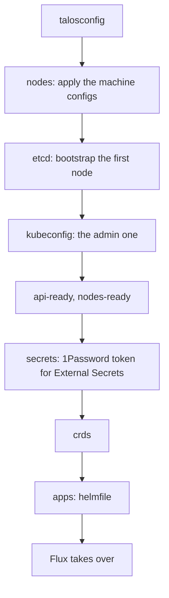

# Cluster: Kubernetes, Cilium and Flux

How the Kubernetes cluster is bootstrapped and kept up to date: the bootstrap helmfile, Cilium and its network policies, Pod Security, the resources and priorities, CoreDNS, External Secrets and Flux, which then deploys everything in `kubernetes/apps`, the login of `kubectl` with the Pocket ID, the Flux web UI and Headlamp, and the cluster-wide tools (Spegel, Reloader, the approver of the kubelet serving certificates, metrics-server, the VPA recommender, Goldilocks). The nodes are in [nodes](../nodes/README.md), the network around the cluster in [network](../network/README.md). The decisions are [below](#decisions).

| Document | Content |
| --- | --- |
| [bootstrap.md](bootstrap.md) | First deployment: cluster ranges, Git repository, dry checks, `just bootstrap cluster`, checks of the cluster, rollout of the network policies and of Pod Security. |
| [runbook.md](runbook.md) | Day-to-day: the login, the `just kube` recipes, the upgrades by hand, diagnosing Flux, diagnosing a flow dropped by the network policies, a pod refused by Pod Security, recovering Flux on the wrong branch, the break-glass. |
| [evaluations.md](evaluations.md) | The choices considered, and the points to check or watch. |

## Status

| Part | Tool | Status |
| --- | --- | --- |
| Bootstrap (`bootstrap/`, `just bootstrap cluster`) | `talosctl`, helmfile | Done: Cilium (+ BGP and LB pools), CoreDNS, External Secrets, Flux |
| GitOps (`kubernetes/apps`) | Flux, Kustomize, Renovate | In use, Renovate and the upgrades by tuppr [to deploy](../roadmap.md#upgrades) |
| CNI, kube-proxy replacement | Cilium | In use ([below](#cilium)) |
| Network policies, Hubble Relay and UI | Cilium | Enforced since 2026-11-13 ([below](#network-policies)). Hubble UI deployed |
| Pod Security | Pod Security Admission | `restricted` by default, to apply (Talos and Flux), [checks](bootstrap.md#pod-security) in progress ([below](#pod-security)) |
| Resources and priorities | `PriorityClass`, alerts on kube-state-metrics | Convention written, class `infrastructure` and alerts deployed on 2026-11-13 ([checks](bootstrap.md#resources-and-priorities)). Every component sized and classed on 2026-11-14, a check of the usage two weeks later ([plan](../cluster-tools.md#3-sizing), [below](#resources-and-priorities)) |
| Login of `kubectl` | OIDC with the Pocket ID, kubelogin | In use since 2026-11-14, [checked](bootstrap.md#oidc-authentication) ([below](#oidc-authentication)) |
| Flux web UI | flux-operator | In use since 2026-11-14, [checked](bootstrap.md#flux-web-ui) with an admin; the login of a viewer and the notification link to check ([below](#flux-web-ui)) |
| Web UI of the cluster | Headlamp | In use since 2026-11-14, [checked](bootstrap.md#headlamp) with an admin; the login of a viewer to check ([below](#headlamp)) |
| Cluster DNS | CoreDNS | In use ([below](#coredns)) |
| GPU | Intel device plugin | In use on kube-01 ([below](#gpu)) |
| Registry mirror between the nodes | Spegel | Deployed by the bootstrap and Flux, [checks](bootstrap.md#spegel) not run yet ([below](#spegel)) |
| Restart on configuration change | Reloader | Deployed by Flux, [checks](bootstrap.md#reloader) not run yet ([below](#reloader)) |
| Kubelet serving certificates | kubelet-csr-approver | Approver deployed by the bootstrap and Flux, `serverTLSBootstrap` and the verification by the API server in the Talos config, [checked](bootstrap.md#kubelet-serving-certificates) on 2026-11-13 ([below](#kubelet-serving-certificates)) |
| Resource metrics API (`kubectl top`) | metrics-server | Deployed by Flux, [checked](bootstrap.md#metrics-server) on 2026-11-13 ([below](#metrics-server)) |
| Recommendations of requests | VPA recommender | Deployed by Flux, [checked](bootstrap.md#vpa-recommender) on 2026-11-13 ([below](#vpa-recommender)) |
| Dashboard of the recommendations | Goldilocks | Deployed by Flux, [checked](bootstrap.md#goldilocks) on 2026-11-13 ([below](#goldilocks)) |
| First bootstrap | | In progress, with kube-01 and kube-03 only ([test phase](../nodes/README.md#test-phase-2-nodes)) |

## Overview

`just bootstrap cluster` takes nodes booted in maintenance mode up to Flux, in stages (each one can be run alone, e.g. `just bootstrap apps`):

The `apps` stage installs, in this order, the minimum needed for Flux to take over:

1. **Cilium**, then its BGP sessions and LoadBalancer pools (`kubernetes/apps/kube-system/cilium/networking`). The nodes stay `NotReady` until the CNI runs: Flannel, kube-proxy and the CoreDNS of Talos are disabled in the Talos configuration. The `observability` namespace is created just before: the chart puts its Grafana dashboards there ([observability](../observability/README.md#the-release-of-the-stack)). The priority classes of the repository too, for the releases that name them ([below](#resources-and-priorities)). Flux adopts both later.
2. **CoreDNS**, and in parallel **kubelet-csr-approver**, which needs no DNS: until it approves their serving certificates, the kubelets serve no logs nor exec ([below](#kubelet-serving-certificates)).
3. **Spegel**, in parallel with External Secrets and before Flux, so that the images pulled by Flux already go through it ([below](#spegel)).
4. **External Secrets** and the `onepassword` ClusterSecretStore ([secrets](../secrets/README.md)).
5. **flux-operator** and **flux-instance**.

The chart source and version of each release come from its `OCIRepository`, and the values from its `HelmRelease`, in `kubernetes/apps/<namespace>/<release>/app`: `kubernetes/apps` stays the single source of truth, and the only place Renovate updates. Everything else (cert-manager, the Intel GPU device plugin, Reloader, Envoy Gateway, the DNS tools, the storage, the backups) is deployed by Flux once it has taken over.

## Decisions

- GitOps with Flux (flux-operator + flux-instance), Kustomize + `HelmRelease` with charts from `OCIRepository`. The bootstrap helmfile reads the chart, version and values from `kubernetes/apps`.
- kustomize-controller runs with the `CancelHealthCheckOnNewRevision` feature gate (a patch in the flux-instance values): a Kustomization waits for what it deploys (`wait: true`) up to its timeout, which defaults to its `interval` (1h). Without the gate, a Kustomization waiting on a broken release ignores the commit that fixes it until the wait ends; with it, a new revision cancels the wait and is applied at once. No `timeout` in the `ks.yaml`: it would not unblock a fix sooner, it would fail the slow first starts (image pulls, VolSync restores) and retry them only an `interval` later, and the failures of a `HelmRelease` are already reported by its own events. The class and the resources of the controllers are patches of the same values ([below](#resources-and-priorities)).
- Updates: Renovate, run from the cluster. Talos and Kubernetes upgrades: tuppr (both [to deploy](../roadmap.md#upgrades)).
- Tools pinned in `mise.toml` (kubectl and talosctl follow the cluster versions).
- Secrets: External Secrets Operator with a read-only service account on the `kubernetes` vault ([secrets](../secrets/README.md)).
- Pod Security: `restricted` by default, a lower level only for the namespaces that need it ([below](#pod-security)).
- Resources: CPU requests without limits, memory requests and limits, a priority class for each component of the platform ([below](#resources-and-priorities)).
- `kubectl` logs in with the Pocket ID, the rights come from its groups. The admin kubeconfig only for the bootstrap and the break-glass ([below](#oidc-authentication)).
- No registry cache: Docker Hub credentials in containerd avoid the rate limit. Spegel shares the images already on the nodes between them, it is not a cache ([below](#spegel)).

## Cluster ranges

| | IPv4 | IPv6 |
| --- | --- | --- |
| Pods | `10.244.0.0/16` | `fd1b:654d:9afe:100::/56` |
| Services | `10.96.0.0/12` | `fd1b:654d:9afe:200::/112` |

These ranges are **permanent**: they cannot be changed once the cluster is created. The IPv6 ones are carved out of a ULA /48 dedicated to the cluster and never routed outside of it. They are set in `talos/vars.yaml` and repeated in the Cilium and CoreDNS values (`kubernetes/apps/kube-system/{cilium,coredns}/app/helmrelease.yaml`): keep them in sync if they are changed before the bootstrap.

**IPv4 is the primary family** (first in the lists): single-stack Services get an IPv4 ClusterIP, and the primary pod IP is the IPv4 one, so the kubelet probes use IPv4 and applications listening on `0.0.0.0` only keep working. A Service that must be reachable over IPv6 sets `ipFamilyPolicy: PreferDualStack` (the application must then listen on `::` too).

## Cilium

- Native routing, no overlay.
- kube-proxy replacement through KubePrism.
- **iptables masquerading**, not `bpf.masquerade`: its IPv6 support is beta and always uses the GUA as source, even towards ULA destinations ([evaluations](../network/evaluations.md#rejected-options)). A pod reaching an IPv6 ULA destination is masqueraded behind the ULA address of its node.
- The BGP control plane advertises the LoadBalancer IPs to OPNsense, from the `internal` and `external` pools ([network](../network/README.md#bgp)).
- Cilium network policies, with the host firewall, replace the Talos ingress firewall that was dropped ([below](#network-policies)).
- Cilium Gateway API stays disabled: Envoy Gateway is used ([ingress](../ingress/evaluations.md#rejected-options)).

## CoreDNS

The CoreDNS of Talos is disabled, replaced by the Helm chart: 2 replicas, forwarding to the Talos host DNS. The service is dual-stack, with the cluster DNS addresses given to the kubelet (the 10th address of each service subnet): `10.96.0.10` then `fd1b:654d:9afe:200::a`.

## Network policies

Cilium policies, fail-closed: every pod is in default deny, and every flow it needs is allowed explicitly. The manifests are in `kubernetes/apps/kube-system/cilium/policies` (clusterwide), `kubernetes/components/network-policies` (per namespace) and next to the applications (exceptions).

- **How Cilium evaluates them**: a pod selected by a policy drops, in that direction (ingress or egress), whatever no policy allows. The policies only add allowed flows, there is no deny rule here. A flow between two pods must be allowed on both sides: egress of the client, ingress of the server.
- **Identities, not addresses**: the rules select pods by their labels, and the rest by *entities*: `host` (the local node), `remote-node` (the other nodes), `kube-apiserver`, `world` (outside of the cluster), `cluster` (all of the above except `world`). The Services and LoadBalancer addresses are translated to the pods before the policies apply.
- **Host firewall** (`hostFirewall`, `host.yaml`): the policies with a `nodeSelector` apply to the nodes themselves: the Talos services, and the `hostNetwork` pods (Cilium agent, LINSTOR satellites, CSI node plugin). Ingress only, by port: everything from outside (OPNsense filters it) and between the nodes, but from the pods only the API server (6443), the Talos host DNS (53), the LINSTOR satellites (3366, from the controller), the Hubble server (4244, from Relay), the kubelet (10250, from metrics-server) and the ports scraped by `VMAgent` ([observability](../observability/README.md#network-and-pod-security)). The Talos API is out of reach of the pods, the kubelet and etcd of the others. Ports in [reference](../reference.md#ports).
- **Baseline of the pods** (`baseline.yaml`): selects every pod. Ingress from the local kubelet (probes), the API server (webhooks) and the Envoy proxies of the Gateways (any backend). Egress to the whole cluster and to the internet, but not to the private networks (RFC 1918, ULA) nor the public IPv6 prefixes of the LAN (ISP /56) and of the nodes (Milkywan /48): a pod reaches neither the NAS, OPNsense nor the other LAN devices, except by an exception by name (`toFQDNs`, [conventions](../conventions.md#network-policies)). The pods leave through the GUA of their node (masquerading), so without the GUA prefixes in the list, the GUA of the other nodes would be `world` and bypass the host firewall. The ISP prefix is a manual step of the [prefix change](../network/runbook.md#1-repository-pod-baseline).
- **Same namespace** (`kubernetes/components/network-policies`, included by every namespace): the pods of a namespace reach each other. A clusterwide policy cannot express it (an empty selector there means the whole cluster), hence a namespaced policy in each one.
- **Exceptions**: a `ciliumnetworkpolicy.yaml` next to the application, which selects the peers (entities or labels), not the ports ([conventions](../conventions.md#network-policies)). Today: the Envoy proxies and k8s-gateway (from `world` and `cluster`), Spegel (from `remote-node`: containerd of another node through the NodePort), the LINSTOR controller (from `remote-node`: the CSI node plugin is `hostNetwork`). CoreDNS (from `cluster`) is with the baseline, in `cilium/policies`: Flux reaches its source-controller through a Service name, so a baseline applied without DNS would block Flux before it applies the missing policy.
- **No exemption**: `kube-system`, `piraeus-datastore` and `flux-system` are covered like the others. The NetworkPolicies of Flux are disabled (`cluster.networkPolicy: false` in flux-instance, `web.networkPolicy.create: false` in flux-operator): Cilium adds the Kubernetes NetworkPolicies to its own, so their `allow-egress` and the one of the web UI would open the namespace over the baseline. No Kubernetes `NetworkPolicy` is used: disable the ones a chart creates.
- **Enforced**: a denied flow is dropped. The audit mode (`policyAuditMode: true`) reports the denied flows with the verdict `AUDIT` and drops nothing: to roll out a change of the policies or to diagnose. It applies to the whole cluster ([runbook](runbook.md#network-policies)). The policies were first deployed in audit mode, then enforced once the audited flows were read and the observability stack showed the drops.
- **Hubble Relay** collects the flows of every node for the `hubble` CLI (`mise.toml`), through a port-forward. Its certificates are regenerated every 4 months by a CronJob (`hubble.tls.auto.method: cronJob`): with the default `helm` method, Helm reuses them and they expire after a year.
- **Hubble UI** shows the flows of Relay by namespace, as `hubble.shelltopia.org` on the `internal` Gateway only. It has no login of its own: Envoy logs in on the Pocket ID in front of it (`SecurityPolicy` with `oidc` on its route), and the client only lets the group `kubernetes_admins` in. Its backend reads Relay and the API server with its own ServiceAccount (read-only `ClusterRole` of the chart), so the OIDC login of Kubernetes changes nothing for it. The UI comes from the release of Cilium; its route, its login and the `ExternalSecret` of the client (item `pocket-id-hubble`) are in `cilium/hubble-ui`, a separate Kustomization (`cilium-hubble-ui`): they need Envoy Gateway and External Secrets, installed after Cilium.
- **Export of the denied flows**: Hubble only keeps the last 4095 flows of each node in memory, minutes on a busy node. The flows `AUDIT` and `DROPPED` are also written as JSON lines to `/var/run/cilium/hubble/events.log` on each node (`hubble.export.static`, 5 rotated files of 10 MB, in tmpfs on Talos so lost at reboot), for the log collector of the [observability stack](../roadmap.md#observability), and read by hand until then ([runbook](runbook.md#network-policies)).
- **Router Solicitations dropped**: the kernel of each pod (and of the health endpoint of Cilium) sends an ICMPv6 Router Solicitation from its link-local address to `ff02::2`, retried up to once an hour while no router answers. The datapath of Cilium only accepts the link-local source for neighbor discovery (NS, NA): it drops them as `INVALID_SOURCE_IP` (`Invalid source ip` in Hubble), audit mode or not ([cilium/cilium#47645](https://github.com/cilium/cilium/issues/47645), closed without a fix). Harmless, nothing in the cluster answers them: they are not exported (`denyList` of the export), not alerted, and hidden from `hubble observe` with `--not --drop-reason-desc INVALID_SOURCE_IP` ([evaluations](evaluations.md#rejected-options)).
- **Bootstrap**: `just bootstrap apps` installs Cilium without the policies, Flux applies them later (`cilium-policies` Kustomization). Until then, nothing is filtered.

## Pod Security

[Pod Security Admission](https://kubernetes.io/docs/concepts/security/pod-security-admission/), built into the API server, checks every new pod against the profile of its namespace: `privileged` (nothing checked), `baseline` (no access to the host) or `restricted` (`baseline`, plus a hardened non-root container). Each namespace has three modes: `enforce` refuses the pod, `audit` records the violation in the audit log of the API server, `warn` returns it to the client (`kubectl`, Flux).

- **`restricted` by default, fail-closed**: it is the default of the cluster, for every namespace without labels (`KubeAdmissionControlConfig` in `talos/patches/security.yaml`). A new namespace, or one whose labels were forgotten, is `restricted`. On top of `baseline` (no host namespaces, ports or paths, no privileged container), a pod must:
  - run as non-root: `runAsNonRoot: true`, and a non-zero `runAsUser` if the image runs as root;
  - set `allowPrivilegeEscalation: false` and drop every capability (`drop: ["ALL"]`, only `NET_BIND_SERVICE` may be added back);
  - use the `RuntimeDefault` (or `Localhost`) seccomp profile;
  - only use `configMap`, `secret`, `emptyDir`, `persistentVolumeClaim`, `projected`, `downwardAPI`, `ephemeral` and `csi` volumes: no `hostPath`, no inline `nfs`.

  The security context to start from is in the [conventions](../conventions.md#pod-security).
- **Labels only for the exceptions**: a `restricted` namespace has no Pod Security label, it gets the default. A namespace below `restricted` sets `enforce`, `audit` and `warn` to its level, with a comment naming the pods and the reason ([conventions](../conventions.md#namespaces)). Today:
  - `piraeus-datastore`, `privileged`: the LINSTOR satellites, the CSI node plugin and the HA controller (host devices, DRBD, LVM, mounts);
  - `debug`, `privileged`: the throwaway test pods (the `kubectl run` of the docs, which run as root) and `kubectl debug node`. Nothing permanent runs there.
- **`flux-system`** is owned by flux-operator, which sets `warn: restricted` on it: the same as the default, nothing to add.
- **Version `latest`** (no `-version` label): the profiles follow the version of the API server. A Kubernetes minor can make a profile stricter; with the automated upgrades (tuppr), a pod accepted the day before would then be refused at its next restart. Read the changes of the [Pod Security Standards](https://kubernetes.io/docs/concepts/security/pod-security-standards/) in the release notes, and check the running pods after a minor ([runbook](runbook.md#upgrading-kubernetes-by-hand)). A refused pod shows up as a `FailedCreate` event ([runbook](runbook.md#pod-security)).
- **`kube-system` is exempt** (the Talos default, kept): Cilium, Spegel and the GPU plugin need privileged pods, and the namespace is created by Kubernetes, not managed by the repository. `default`, `kube-public`, `kube-node-lease` and `cilium-secrets` get the default, `restricted`.
- **`cluster-tools`**, `restricted`: the cluster-wide tools that need no access to the host (kubelet-csr-approver, metrics-server, the VPA recommender, Goldilocks, Headlamp, Reloader, snapshot-controller, [plan](../cluster-tools.md)). Out of `kube-system`: Pod Security refuses a chart that turns privileged, and the same-namespace policy does not let an exposed UI reach Hubble Relay or the other pods of `kube-system`. `kube-system` keeps Cilium, Spegel and the Intel device plugin, which need the host, and CoreDNS.
- **Applications**: in their own namespace, or one shared with the applications that need the same level. An application that cannot run `restricted` gets a namespace at the lowest level that works (`baseline` before `privileged`). The images that start as root to drop their privileges themselves (s6-overlay, linuxserver.io) need `baseline`.
- **NAS shares**: `restricted` forbids the inline `nfs` volumes. A share is mounted through a static PersistentVolume and its PersistentVolumeClaim ([storage](../storage/README.md#decisions)).
- **Refused pods**: only the pods are enforced. A Deployment, StatefulSet, DaemonSet or Job is accepted (with a warning), but its pods are refused: they never exist, and only show up as `FailedCreate` events on the ReplicaSet, StatefulSet, DaemonSet or Job. The HelmRelease or Kustomization then waits until its timeout ([runbook](runbook.md#pod-security)).
- **Running pods are not checked again**: a new level or version only applies to the next pods, at their next restart.
- **User namespaces** (`hostUsers: false`, stable since Kubernetes 1.36): root in the container is mapped to an unprivileged UID of the node, like rootless Podman. Pod Security then skips the non-root checks (`runAsNonRoot`, `runAsUser`), the rest of `restricted` still applies. Not usable with NFS volumes (no idmapped mounts) nor with `hostNetwork`; fine with the LINSTOR volumes (ext4) and tmpfs. Not tested with a real pod yet ([open point](evaluations.md#open-points)), evaluated per application at the [migration](../roadmap.md#migration).

## Resources and priorities

The nodes have 16 GiB, of which about 14 GiB allocatable: `systemReserved` (the Talos services, cgroups `init` and `system`) 500m and 1 GiB, `kubeReserved` (etcd, the kubelet and containerd, cgroup `podruntime`) 250m and 512 MiB, eviction under 500 MiB available (`talos/patches/kubernetes.yaml.j2`). The kubelet only subtracts the reservations from the allocatable, it limits the pods alone: their sum counts, not their split. On 2026-11-13, about 1.1 GiB of these cgroups was not reclaimable on kube-01 (`anon` of `memory.stat`), for 1.5 GiB reserved; the rest is page cache (up to 4 GiB in containerd, the image layers). The rules are in the [conventions](../conventions.md#resources-and-priorities).

How Kubernetes uses them:

- **Scheduling**: the requests only. A pending pod preempts pods of a lower priority to find room.
- **Eviction by the kubelet**, under memory pressure: first the pods that use more than their request, then the lowest priority, then the largest use above the request. Never the static pods, nor the pods at `system-cluster-critical` or above.
- **OOM killer of the kernel**, when the memory runs out before the kubelet acts: by QoS class, not by priority (`BestEffort` first, `Guaranteed` last, `Burstable` by the share of its request in the memory of the node).
- **Limits**: past its memory limit, a container is killed, whatever the state of the node. Past its CPU limit, it is throttled, even on an idle node.

A component wins under memory pressure with a request that covers its real use, and a high priority. The decisions:

- **No CPU limit**: CPU is compressible. Under contention, the requests share it; a limit would only throttle a container on an idle node.
- **A memory limit everywhere**, about twice the request, the critical classes included: the kubelet never evicts them, so the limit bounds a leak. A limit equal to the request for the databases (their memory is set by their configuration, a kill costs a recovery) and for the tools that size their caches from their limit (VictoriaMetrics and VictoriaLogs take 60 % of the memory they see, to check in their usage). Not for the agents of the network and the storage, whose usage has peaks: a kill costs more there than a use above the request.
- **Classes**: the built-in `system-node-critical` and `system-cluster-critical`, and one class of the repository, `infrastructure` (1 000 000), in `kubernetes/apps/kube-system/priority-classes`. The applications have none (0). No `globalDefault`, no class below the applications. The values stay far apart, so that a level can be added between them; a class of the repository is at most 1 000 000 000, the values above are for the system classes.

  | Class | Components |
  | --- | --- |
  | `system-node-critical` | Cilium agent and Envoy, LINSTOR satellites, CSI node plugin |
  | `system-cluster-critical` | CoreDNS, Cilium operator, LINSTOR controller, CSI controller, HA controller |
  | `infrastructure` | Flux, External Secrets, cert-manager, Envoy Gateway and the Envoy proxies of the Gateways, VolSync, snapshot-controller, Spegel, Reloader, kubelet-csr-approver, metrics-server, the VPA recommender, Goldilocks, Headlamp, external-dns, k8s-gateway, cloudflare-ddns, Hubble Relay and UI, the Piraeus operator and the LINSTOR affinity controller, the Intel device plugin operator, the observability (`VMSingle`, `VLSingle`, `VMAgent`, `VMAlert`, Alertmanager, Grafana, Vector, kube-state-metrics, node-exporter, the VictoriaMetrics operator) and the exporters of the devices, `volsync-monitor` |
  | None (0) | The applications. The Intel GPU plugin: its operator sets no class |

- **The class of the convention, not the default of the chart or operator**: the system classes only for what the network or the volumes of the running pods depend on. The charts take the highest class that exists everywhere; here, `infrastructure` already puts a component above the applications, and a system class only adds that the kubelet never evicts it (a leak then evicts the others) and that it preempts `infrastructure`. So the Flux controllers, the Piraeus operator, the affinity controller and metrics-server, `system-cluster-critical` upstream, and Spegel, `system-node-critical` upstream, are in `infrastructure`: the cluster keeps running without them. Within the system classes too, the convention wins (the LINSTOR controller and the CSI controller, `system-node-critical` from the operator), so that the class reads in the table.

- **The Envoy proxies in `infrastructure`**, not `system-cluster-critical`: the cluster does not depend on them (`kubectl` and Flux do not go through the Gateways), their two replicas are spread over the nodes, and `infrastructure` already puts them above the applications.
- **Capacity**: sized for the two nodes up, about 28 GiB allocatable. Until kube-02 joins, the loss of a node may leave pods `Pending`: nothing is critical before the [migration](../roadmap.md#migration). `KubeMemoryOvercommit` stays disabled until then ([observability](../observability/README.md#the-release-of-the-stack)).
- **Sizing**: from the usage in VictoriaMetrics, cross-checked with the recommendations of Goldilocks (VPA recommender). Done for the existing components on 2026-11-14, about 14.6 GiB of requests ([plan](../cluster-tools.md#3-sizing)).
- **Checks**: the alerts `ContainerWithoutMemoryLimit` and `ContainerOOMKilled` ([observability](../observability/README.md#alerting)). Not an admission policy ([evaluations](evaluations.md#rejected-options)). The finished pods are left out: Kubernetes keeps them, those of a node shutdown included ([open points](evaluations.md#open-points)).
- **Bootstrap**: `just bootstrap apps` applies the classes before its first release, so that the releases it installs can name them; Flux adopts them later.

## GPU

The Intel device plugin is deployed through the operator, with `sharedDevNum: 3` (Plex, Immich), on the nodes labeled `shelltopia.net/intel-gpu` (kube-01 and kube-02, [nodes](../nodes/README.md#decisions)). Containerd sets `device_ownership_from_security_context` (`talos/patches/containerd.yaml.j2`) so that a non-root pod owns the render node. DRA is rejected for now ([evaluations](evaluations.md#intel-dra-driver)).

## Spegel

[Spegel](https://spegel.dev) (`kube-system/spegel`) is a registry mirror between the nodes: a node pulls the layers of an image from another node that already has it, and falls back to the upstream registry when no node has it. Pulls are faster after a reschedule (drain, reboot, upgrade), and the upstream registries see fewer of them. It is not a pull-through cache: it only serves what the nodes already hold, and stores nothing of its own.

- **Talos side**: containerd keeps the unpacked layers (`discard_unpacked_layers = false` in `talos/patches/containerd.yaml.j2`), otherwise a node could not serve them. The scheduler no longer scores `ImageLocality` (`talos/patches/kubernetes.yaml.j2`): with Spegel, a pull is cheap, there is no reason to pile up pods on the nodes that already have their images.
- **Mirror configuration**: an init container of the DaemonSet moves the content of `/etc/cri/conf.d/hosts` (the registry config path of the CRI containerd of Talos) to `_backup`, then writes `_default/hosts.toml`: **every registry** is mirrored, through the local Spegel first (`http://<node IP>:30020`, a NodePort with `trafficDistribution: PreferSameNode`), then the upstream registry. The upstream pulls keep the Docker Hub credentials of containerd; the requests to a mirror carry none.
- **Tags resolved by the peers** (`resolveTags`, the default): a pod can start while its registry is down, as long as a node has the image. The flip side: a reused tag stays on the first digest present in the cluster. The images of the repository are pinned to a version (Renovate), and the `latest` tags are always resolved upstream (`registryFilters: [":latest$"]`).
- **In `kube-system`**: it mounts the containerd socket, its content store, the registry config path and `/var/lib/spegel` (P2P identity kept across restarts) from the host, which the `restricted` default of [Pod Security](#pod-security) forbids; `kube-system` is exempt. `infrastructure` priority, on every node: not the `system-node-critical` of the chart, a node keeps pulling from the upstream registries without it ([resources and priorities](#resources-and-priorities)).
- **Installed at bootstrap** after CoreDNS (the peers find each other through the headless Service `spegel-bootstrap`) and before Flux, then adopted by Flux.
- **Ports**: NodePort TCP 30020 (containerd → local Spegel), TCP 5000 (registry), TCP and UDP 5001 (libp2p router, between the Spegel pods), TCP 9090 (metrics, scraped by `VMAgent` through its ServiceMonitor).
- **Not for Talos itself**: the installer and system images are pulled by the containerd of Talos, which does not use these mirrors.
- **Multi-tenancy**: any pod can get an image held by a node without credentials. Acceptable in a single-tenant cluster, to keep in mind for a private image.

## OIDC authentication

`kubectl` logs in with the Pocket ID (`https://id.shelltopia.org`): the API servers verify its ID tokens, and the rights come from the groups of the user. The admin kubeconfig (`system:masters`) is only for the bootstrap and the break-glass ([runbook](runbook.md#break-glass)).

- **The API server**: a `KubeAuthenticationConfig` document (`talos/patches/authentication.yaml.j2`, [talos](../../talos/README.md#gotchas)). The issuer and the client ids of `kubelogin` and Headlamp come from `talos/vars.yaml` (`oidc`). A client id is not a secret: it is in every authorization URL.
- **Claims**: the user is `preferred_username` (set by the admins of the Pocket ID, the users cannot change it), the groups `groups`, both prefixed `oidc:`: they cannot match a user or a group of Kubernetes (`system:`). The uid is `sub`, stable when the username changes. Pocket ID sends every group of the user, it cannot limit them per client: only the `kubernetes_*` groups are bound.
- **Rights**: the app `kube-system/oidc`. `oidc:kubernetes_admins` to `cluster-admin`; `oidc:kubernetes_viewers` to `view`: read only, the logs and the events included, no Secrets, no write nor restart. Groups only, never a user. The same groups give the roles of Grafana ([observability](../observability/README.md#grafana)).
- **What `view` lacks**, for the viewers of the UIs: the `ClusterRole` `oidc:cluster-view`, read only, bound to `oidc:kubernetes_viewers`. The nodes, PVs, StorageClasses, CSI nodes, volume attachments, priority classes, CRDs, and the `FluxInstance` and `FluxReport` of flux-operator. Not the other CRDs (Gateway API, cert-manager, Cilium…): RBAC has no "all but the Secrets", each new CRD would have to be listed.
- **Never bind a component of the cluster** (Flux, External Secrets) to an OIDC identity: it would depend on the Pocket ID. They keep their ServiceAccounts.
- **One client per tool**: `kubelogin` (public, PKCE), the Flux web UI (confidential, [below](#flux-web-ui)), Headlamp (confidential, PKCE, [below](#headlamp)). The `audiences` are the clients that send their ID token to the API server, `kubelogin` and Headlamp, with `audienceMatchPolicy: MatchAny`: a token is accepted when its `aud` holds one of them. The ID token of the Flux UI never reaches the API server: no audience for it.
- **Tokens**: the defaults of the client, an ID token of 1 h, a refresh token valid 30 days of inactivity. `kubelogin` caches both in `~/.kube/cache/oidc-login` and refreshes without the browser.
- **The kubeconfigs**, at the root, ignored by Git: `kubeconfig` (OIDC), written without the cluster by `just talos kubeconfig`, and `kubeconfig-admin`, written by `just bootstrap kubeconfig` and deleted after use. At the bootstrap, Flux has not created the bindings yet: the bootstrap module uses `kubeconfig-admin`. Its certificate stays valid until it expires (a year): Kubernetes revokes no certificate, deleting the file is the only mitigation.
- **A change restarts the API server** of the node: Talos includes the version of the authentication config in the one of its static pod. It does not start with an invalid config (`KubeAPIDown`): apply one node at a time, and check the login through it before the other ([talos](../../talos/README.md#gotchas)). No alert of its own: the reload of the file by the API server never happens here. The Pocket ID is checked by the blackbox exporter (`HTTPProbeFailed`). The API server fetches its keys on demand only (the first token, an unknown key): its JWKS metrics only tell about the last login.
- **The health endpoints** (`/livez`, `/readyz`, `/healthz`) stay open without credentials: the default of Talos, repeated in the patch.

## Flux web UI

The Flux Status web UI of flux-operator, served by the operator pod (port 9080 of the `flux-operator` Service), on `flux.shelltopia.org`, `internal` Gateway only: the Kustomizations, the HelmReleases and their sources, with reconcile, suspend and resume.

- **Login with the Pocket ID**, by flux-operator itself: a confidential client (flux-operator requires the secret), item `pocket-id-flux`, groups `kubernetes_admins` and `kubernetes_viewers` allowed. It checks the ID token itself (audience its client id): no audience in Talos. Sessions of a week, the claims read again at each refresh.
- **The rights of the user**: the UI impersonates `oidc:<preferred_username>` and the groups prefixed `oidc:`, the identities of the API server ([above](#oidc-authentication)): the bindings of `kube-system/oidc` apply. `userActions.access: Impersonated`: an action needs its own verb (`reconcile`, `suspend`…) and the native one (`patch`): `kubernetes_admins` (`cluster-admin`) has both, `kubernetes_viewers` (`view`) reads, without the Secrets.
- **No roles of the chart** (`web.rbac.createRoles: false`): `flux-web-user` reads every Secret, and a binding to it would not be limited to the UI; `flux-web-admin` adds nothing to `cluster-admin`.
- **The config in a Secret** (`web.configSecretName`), rendered by an `ExternalSecret` with the client of 1Password. The operator watches it: missing or invalid, the error is logged, the operator keeps running, the UI answers 503; a change applies without a restart. Not `web.config` nor `valuesFrom`: the bootstrap helmfile reads `spec.values` only, and an OAuth2 config without its client in a file stops the operator.
- **A second Kustomization**, `flux-operator-web` (`web/`): the `ExternalSecret` and the `HTTPRoute`, `dependsOn` `external-secrets-stores` and `gateways`. The operator itself never waits for ESO nor 1Password. Not the route of the chart: the bootstrap helmfile installs the operator before the Gateway API CRDs ([conventions](../conventions.md#routes-and-names)).
- **Links in the notifications**: `FluxResourceNotReady` links the failed resources of its namespace (`/resources?namespace=<namespace>&status=Failed`), the last line of the Pushover message ([observability](../observability/README.md#alerting)).
- **No network policy** of its own: the baseline lets the Gateways in and the pod out to the Pocket ID (`web.networkPolicy.create: false`, [above](#network-policies)).

## Headlamp

[Headlamp](https://headlamp.dev) (`cluster-tools/headlamp`): the web UI of the cluster, on `headlamp.shelltopia.org`, `internal` Gateway only. The workloads, their logs and events, the nodes and the volumes, and the restarts.

- **Login with the Pocket ID**, by Headlamp itself: a confidential client with PKCE, item `pocket-id-headlamp`, groups `kubernetes_admins` and `kubernetes_viewers` allowed. Scopes `profile email groups offline_access`.
- **The token of the user**: Headlamp sends the ID token to the API server, which checks it as the one of `kubelogin`. Its client id is an audience of the authentication config ([above](#oidc-authentication)): it is in `talos/vars.yaml` (`oidc.headlamp_client_id`) and in 1Password, to keep in sync. The bindings of `kube-system/oidc` apply: `kubernetes_admins` restarts, `kubernetes_viewers` reads, without the Secrets.
- **No rights for its ServiceAccount** (`clusterRoleBinding.create: false`, the chart binds it to `cluster-admin` by default): a request without the token of a user is refused. Its token stays mounted: `-in-cluster` reads the address and the CA of the API server from it.
- **No plugin**: the bundled ones (Prometheus) disabled. Never the Flux plugin: the [Flux web UI](#flux-web-ui) does it.
- **The client in a Secret**, `headlamp-oidc`, rendered by an `ExternalSecret`: the client id, the secret and the issuer, read at the start only (Reloader). The settings that are not secret, the callback, the scopes and PKCE, are arguments of the HelmRelease (`config.extraArgs`), visible in Git: the values of the chart for them would read them from the Secret.
- **Sessions** of 24 h. The refresh tokens are kept in the memory of the pod: a restart, by Reloader too, asks every user to log in again.
- **The route of the chart** (`httpRoute`), no `SecurityPolicy`: Headlamp logs in itself.
- **A single replica**, no PDB. Class `infrastructure`, `restricted` securityContext (the chart sets a partial one), a read-only root filesystem: the chart mounts an emptyDir on `/tmp`, where Headlamp copies its frontend. The probes of the chart start at once: an `Unhealthy` event at each start of the pod, harmless. First requests before any usage, to size after a week ([conventions](../conventions.md#resources-and-priorities)).
- **No network policy** of its own: the baseline lets the Gateways in and the pod out to the API server and the Pocket ID ([above](#network-policies)).
- **Alerts**: the generic rules (`KubePodCrashLooping`, `FluxResourceNotReady`).

## Reloader

Kubernetes does not restart a pod when a ConfigMap or Secret it uses changes: environment variables are never updated, mounted files only eventually (never with `subPath`), and most applications only read their configuration at startup. [Reloader](https://github.com/stakater/Reloader) (`cluster-tools/reloader`) does a rolling restart of the workload instead, mainly for the Secrets synced by External Secrets when a token is rotated in 1Password.

- **Opt-in per workload** (`autoReloadAll: false`): `reloader.stakater.com/auto: "true"` on the `metadata` of the Deployment, StatefulSet or DaemonSet (not on the pod template) follows every ConfigMap and Secret its pods reference (`env`, `envFrom`, volumes). To leave out one the application already reloads by itself, add `secrets.exclude.reloader.stakater.com/reload: "<name>,..."` (or `configmaps.exclude.…`); `secret.reloader.stakater.com/reload: "<name>,..."` (or `configmap.…`) instead of `auto` follows only the listed ones. Rule in [conventions](../conventions.md#reloads).
- Watching everything (`autoReloadAll`) was rejected ([evaluations](evaluations.md#rejected-options)).
- **`reloadStrategy: annotations`**: the hash of the configuration is written in an annotation of the pod template (`reloader.stakater.com/last-reloaded-from`), not in an env var injected into the containers, which stay as Flux and Helm applied them.
- Only the content counts: an ExternalSecret refresh that writes the same value restarts nothing.
- **A single replica, the defaults `reloadOnCreate` and `syncAfterRestart` kept off**: a change made while Reloader is down is not caught up when it comes back. Rare enough to restart the workload by hand ([secrets runbook](../secrets/runbook.md#replacing-a-token-synced-to-the-cluster)).
- Not needed for Jobs and CronJobs (each run reads the current values), nor for the tools that read the Secret at each use (cert-manager and its issuers, the VolSync movers).
- Blind spot: a Secret read through the Kubernetes API (by an operator) is not a reference of the pod spec, `auto` does not see it.
- Opted in today: external-dns and cloudflare-ddns (Cloudflare tokens in env vars).

## Kubelet serving certificates

The kubelet serves its API (TCP 10250: logs, exec, metrics) with a self-signed certificate by default, which nobody can verify. With `serverTLSBootstrap` (`KubeletConfig`, `talos/patches/kubernetes.yaml.j2`), it asks for a certificate signed by the cluster CA instead, through a CSR (signer `kubernetes.io/kubelet-serving`), and renews it before it expires. Kubernetes never approves these CSRs by itself: their names and addresses come from the node, which could ask for any.

- **kubelet-csr-approver** ([postfinance](https://github.com/postfinance/kubelet-csr-approver), `cluster-tools/kubelet-csr-approver`) approves a CSR after checking it: the signer, the user `system:node:<node>`, a single DNS name, the node name, matching `^kube-0[1-9]$`, and the IP addresses in the nodes subnets, IPv4 and ULA (the InternalIPs, `nodeIP.validSubnets`). It denies the others: without the subnets, a node could get a certificate for any address, the ClusterIP of the API server included, which the pods trust through the cluster CA.
- **No DNS check** (`bypassDnsResolution`): the node names are short and the nodes have no search domain, `kube-01` does not resolve from a pod. The subnets check the addresses instead.
- **Until its CSR is approved**, a kubelet has no serving certificate: it serves no logs, exec nor metrics, and `VMAgent` sees its targets down. At a restart, it reuses the certificate it already has (`/var/lib/kubelet/pki`): only a new node waits for the approver.
- **Verified by the API server** (`kubelet-certificate-authority` in `talos/patches/kubernetes.yaml.j2`), with the bundle of the CAs it accepts, written by Talos (`/system/secrets/kubernetes/kube-apiserver/ca.crt`). It reaches a kubelet by its InternalIP first (`kubelet-preferred-address-types`, Talos default), one of the addresses of the certificate. Applied once both nodes had their certificate: before, the API server would have refused the self-signed one of the other node.
- **Verified by metrics-server and `VMAgent`** too, with the cluster CA of their ServiceAccount, on the InternalIP ([below](#metrics-server), [observability](../observability/README.md#the-release-of-the-stack)).
- **A single replica**, without leader election: while it is down, a CSR waits. A kubelet keeps its certificate until it expires (a year), and asks for the next one well before.
- **Installed at bootstrap**, after Cilium and before Flux, then adopted by Flux ([above](#overview)).
- **Alerts**: the kube-prometheus rules of the stack, `KubeletServerCertificateRenewalErrors` (a CSR not approved) and `KubeletServerCertificateExpiration`.
- `alex1989hu/kubelet-serving-cert-approver` was rejected ([evaluations](evaluations.md#rejected-options)).

## metrics-server

[metrics-server](https://github.com/kubernetes-sigs/metrics-server) (`cluster-tools/metrics-server`) reads the CPU and memory usage of the pods and nodes from each kubelet (`/metrics/resource`), and serves it as the `metrics.k8s.io` API, an aggregated API behind the API server: `kubectl top`, the VPA recommender, Headlamp and later the descheduler ([plan](../cluster-tools.md)). It keeps only the last values in memory. Not a source of the monitoring: `VMAgent` scrapes the kubelets itself ([observability](../observability/README.md#metrics)).

- **Verified both ways.** metrics-server verifies the kubelets with the cluster CA of its ServiceAccount (no `--kubelet-insecure-tls`), on their InternalIP, one of the addresses of their certificate ([above](#kubelet-serving-certificates)). The API server verifies metrics-server: `tls.type: cert-manager` creates a self-signed `Issuer` and a `Certificate` in `cluster-tools`, cainjector writes its CA in the `caBundle` of the `APIService` (`insecureSkipTLSVerify: false`). The Kustomization depends on cert-manager.
- **Host firewall**: TCP 10250 of the nodes from its pods (`host.yaml`, [above](#network-policies)). The API server reaches it through the baseline.
- **A `RoleBinding` in `kube-system`**, fixed by the chart: to `extension-apiserver-authentication-reader`, which every aggregated API needs to authenticate the requests of the API server.
- **Class `infrastructure`**, not `system-cluster-critical` (chart default): `kubectl top` and the VPA can wait ([above](#resources-and-priorities)).
- **A single replica**, no PDB: while it restarts, `kubectl top` fails and the VPA recommender skips a cycle.
- **Alerts**: the kube-prometheus rules of the stack, `KubeAggregatedAPIDown` and `KubeAggregatedAPIErrors`.

## VPA recommender

The recommender of the [Vertical Pod Autoscaler](https://github.com/kubernetes/autoscaler/tree/master/vertical-pod-autoscaler) (`cluster-tools/vertical-pod-autoscaler`, Deployment `vpa-recommender`) reads the usage of the pods from metrics-server every minute, and writes a recommendation of requests (target, lower and upper bounds) in the status of each `VerticalPodAutoscaler`. Goldilocks creates these objects and shows their recommendations ([plan](../cluster-tools.md)). They cross-check the requests and limits of the [convention](../conventions.md#resources-and-priorities), sized from the usage in VictoriaMetrics and always written in Git.

- **The recommender alone**: the updater (evicts the pods to resize them) and the admission controller (rewrites the requests of the pods at creation) are disabled. Nothing changes a pod: the requests in the cluster stay those of Git, Flux would revert them otherwise.
- **History in checkpoints** (`VerticalPodAutoscalerCheckpoint`, default storage), next to each `VerticalPodAutoscaler`: a restart does not lose it. Not read from VictoriaMetrics (`--storage=prometheus`): VictoriaMetrics stays the cross-check of the recommendations ([plan](../cluster-tools.md#3-sizing)).
- **Lower minimums**: 5m of CPU and 16 MiB of memory per pod, split between its containers (`--pod-recommendation-min-*`, defaults 25m and 250 MiB). With the defaults, every small component would get 250 MiB. The CPU target never goes below about 11m anyway: the first bucket of the CPU histogram (10m), plus the margin of 15 %.
- **CRDs** in the templates of the chart: they follow its upgrades, and stay at an uninstall (`crds.keep`, chart default), with the objects of Goldilocks.
- **A single replica**, no PDB, no leader election: while it restarts, the recommendations are not updated.
- **Class `infrastructure`**, `restricted` securityContext (the chart sets none on the container).
- **Alerts**: the generic rules (`KubePodCrashLooping`, `FluxResourceNotReady`).

## Goldilocks

[Goldilocks](https://github.com/FairwindsOps/goldilocks) (`cluster-tools/goldilocks`) creates a `VerticalPodAutoscaler` for each workload, filled by the [VPA recommender](#vpa-recommender), and shows their recommendations in a dashboard, with the requests and limits to copy. A permanent tool: the sizing of the existing components ([plan](../cluster-tools.md#3-sizing)), then of each new service.

- **Every namespace** (`on-by-default`, on the controller and the dashboard): a namespace is left out with the label `goldilocks.fairwinds.com/enabled: "false"`. Its VPAs (`goldilocks-<workload>`) are in `updateMode: Off`: nothing is applied, the requests stay in Git.
- **The highest owner it can read**, for each pod: a Deployment, a StatefulSet, a DaemonSet or a CronJob. Its `ClusterRole` reads `apps` and `batch`: the resource of an operator above them (VMSingle, LINSTOR, the Intel GPU plugin) is logged as an error at each event of a pod of its namespace, and the workload below it is the target. A pod without such an owner (the static pods, a pod owned by an operator directly) gets no VPA.
- **The `VMAgent`, readable too** (`rbac.extraRules`, controller and dashboard): the VPA recommender wants the topmost owner with a `scale` subresource as the target, and among the resources of the operators here, only `VMAgent` has one. Not the rest of `operator.victoriametrics.com`: without `scale`, their Deployment or StatefulSet must stay the target. A new resource of an operator with `scale` shows up as a VPA with `ConfigUnsupported`.
- **No VPA for the Jobs** without a CronJob (`ignore-controller-kind: Job`): the hook of Cilium (`hubble-generate-certs-<hash>`, kept with its finished pod) and the VolSync movers. Their pods end before a recommendation, and the VPA goes with the Job. Their usage is read in VictoriaMetrics. The CronJobs keep theirs.
- **Dashboard** on `goldilocks.shelltopia.org`, `internal` Gateway only. It has no login of its own: Envoy logs in on the Pocket ID (`SecurityPolicy` with `oidc` on its route), and the client only lets the group `kubernetes_admins` in (item `pocket-id-goldilocks`, [pattern](../ingress/runbook.md#a-ui-without-a-login-of-its-own)). Its backend reads the VPAs and the workloads with its own ServiceAccount (read-only `ClusterRole` of the chart).
- **No cost data** (`enable-cost: false`): it comes from Fairwinds Insights, on the internet. Both pods only talk to the API server.
- **No Argo rule** in the `ClusterRole`s (`rbac.enableArgoproj: false`): there is no Argo Rollouts in the cluster.
- **One replica each**, no PDB. While the controller restarts, no VPA is created nor deleted; the recommender keeps working.
- **Class `infrastructure`** by a `postRenderers` patch: the chart has no value for it. Its securityContext is already `restricted`.
- **Alerts**: the generic rules (`KubePodCrashLooping`, `FluxResourceNotReady`).
