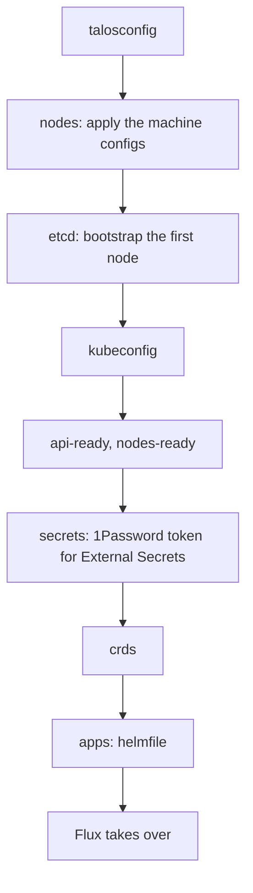

# Cluster: Kubernetes, Cilium and Flux

How the Kubernetes cluster is bootstrapped and kept up to date: the bootstrap helmfile, Cilium, CoreDNS, External Secrets and Flux, which then deploys everything in `kubernetes/apps`, and the cluster-wide tools (Reloader). The nodes are in [nodes](../nodes/README.md), the network around the cluster in [network](../network/README.md). The decisions are [below](#decisions).

| Document | Content |
| --- | --- |
| [bootstrap.md](bootstrap.md) | First deployment: cluster ranges, Git repository, dry checks, `just bootstrap cluster`, checks of the cluster. |
| [runbook.md](runbook.md) | Day-to-day: the `just kube` recipes, the upgrades by hand, diagnosing Flux, recovering it on the wrong branch. |
| [evaluations.md](evaluations.md) | The choices considered, and the points to check or watch. |

## Status

| Part | Tool | Status |
| --- | --- | --- |
| Bootstrap (`bootstrap/`, `just bootstrap cluster`) | `talosctl`, helmfile | Done: Cilium (+ BGP and LB pools), CoreDNS, External Secrets, Flux |
| GitOps (`kubernetes/apps`) | Flux, Kustomize, Renovate | In use, Renovate and the upgrades by tuppr [to deploy](../roadmap.md#upgrades) |
| CNI, kube-proxy replacement | Cilium | In use ([below](#cilium)) |
| Cluster DNS | CoreDNS | In use ([below](#coredns)) |
| GPU | Intel device plugin | In use on kube-01 ([below](#gpu)) |
| Restart on configuration change | Reloader | Deployed by Flux, [checks](bootstrap.md#reloader) not run yet ([below](#reloader)) |
| First bootstrap | | In progress, with kube-01 and kube-03 only ([test phase](../nodes/README.md#test-phase-2-nodes)) |

## Overview

`just bootstrap cluster` takes nodes booted in maintenance mode up to Flux, in stages (each one can be run alone, e.g. `just bootstrap apps`):

The `apps` stage installs, in this order, the minimum needed for Flux to take over:

1. **Cilium**, then its BGP sessions and LoadBalancer pools (`kubernetes/apps/kube-system/cilium/networking`). The nodes stay `NotReady` until the CNI runs: Flannel, kube-proxy and the CoreDNS of Talos are disabled in the Talos configuration.
2. **CoreDNS**.
3. **External Secrets** and the `onepassword` ClusterSecretStore ([secrets](../secrets/README.md)).
4. **flux-operator** and **flux-instance**.

The chart source and version of each release come from its `OCIRepository`, and the values from its `HelmRelease`, in `kubernetes/apps/<namespace>/<release>/app`: `kubernetes/apps` stays the single source of truth, and the only place Renovate updates. Everything else (cert-manager, the Intel GPU device plugin, Reloader, Envoy Gateway, the DNS tools, the storage, the backups) is deployed by Flux once it has taken over.

## Decisions

- GitOps with Flux (flux-operator + flux-instance), Kustomize + `HelmRelease` with charts from `OCIRepository`. The bootstrap helmfile reads the chart, version and values from `kubernetes/apps`.
- Updates: Renovate, run from the cluster. Talos and Kubernetes upgrades: tuppr (both [to deploy](../roadmap.md#upgrades)).
- Tools pinned in `mise.toml` (kubectl and talosctl follow the cluster versions).
- Secrets: External Secrets Operator with a read-only service account on the `kubernetes` vault ([secrets](../secrets/README.md)).
- No registry cache: Docker Hub credentials in containerd avoid the rate limit.

## Cluster ranges

| | IPv4 | IPv6 |
| --- | --- | --- |
| Pods | `10.244.0.0/16` | `fd1b:654d:9afe:100::/56` |
| Services | `10.96.0.0/12` | `fd1b:654d:9afe:200::/112` |

These ranges are **permanent**: they cannot be changed once the cluster is created. The IPv6 ones are carved out of a ULA /48 dedicated to the cluster and never routed outside of it. They are set in `talos/vars.yaml` and repeated in the Cilium and CoreDNS values (`kubernetes/apps/kube-system/{cilium,coredns}/app/helmrelease.yaml`): keep them in sync if they are changed before the bootstrap.

**IPv4 is the primary family** (first in the lists): single-stack Services get an IPv4 ClusterIP, and the primary pod IP is the IPv4 one, so the kubelet probes use IPv4 and applications listening on `0.0.0.0` only keep working. A Service that must be reachable over IPv6 sets `ipFamilyPolicy: PreferDualStack` (the application must then listen on `::` too).

## Cilium

- Native routing, no overlay.
- kube-proxy replacement through KubePrism.
- **iptables masquerading**, not `bpf.masquerade`: its IPv6 support is beta and always uses the GUA as source, even towards ULA destinations ([evaluations](../network/evaluations.md#rejected-options)). A pod reaching an IPv6 ULA destination is masqueraded behind the ULA address of its node.
- The BGP control plane advertises the LoadBalancer IPs to OPNsense, from the `internal` and `external` pools ([network](../network/README.md#bgp)).
- Cilium network policies are to come, to replace the Talos ingress firewall that was dropped ([roadmap](../roadmap.md#security)).
- Cilium Gateway API stays disabled: Envoy Gateway is used ([ingress](../ingress/evaluations.md#rejected-options)).

## CoreDNS

The CoreDNS of Talos is disabled, replaced by the Helm chart: 2 replicas, forwarding to the Talos host DNS. The service is dual-stack, with the cluster DNS addresses given to the kubelet (the 10th address of each service subnet): `10.96.0.10` then `fd1b:654d:9afe:200::a`.

## GPU

The Intel device plugin is deployed through the operator, with `sharedDevNum: 3` (Plex, Immich), on the nodes labeled `shelltopia.net/intel-gpu` (kube-01 and kube-02, [nodes](../nodes/README.md#decisions)). Containerd sets `device_ownership_from_security_context` (`talos/patches/containerd.yaml.j2`) so that a non-root pod owns the render node. DRA is rejected for now ([evaluations](evaluations.md#intel-dra-driver)).

## Reloader

Kubernetes does not restart a pod when a ConfigMap or Secret it uses changes: environment variables are never updated, mounted files only eventually (never with `subPath`), and most applications only read their configuration at startup. [Reloader](https://github.com/stakater/Reloader) (`kube-system/reloader`) does a rolling restart of the workload instead, mainly for the Secrets synced by External Secrets when a token is rotated in 1Password.

- **Opt-in per workload** (`autoReloadAll: false`): `reloader.stakater.com/auto: "true"` on the `metadata` of the Deployment, StatefulSet or DaemonSet (not on the pod template) follows every ConfigMap and Secret its pods reference (`env`, `envFrom`, volumes). To leave out one the application already reloads by itself, add `secrets.exclude.reloader.stakater.com/reload: "<name>,..."` (or `configmaps.exclude.…`); `secret.reloader.stakater.com/reload: "<name>,..."` (or `configmap.…`) instead of `auto` follows only the listed ones. Rule in [conventions](../conventions.md#reloads).
- Watching everything (`autoReloadAll`) was rejected ([evaluations](evaluations.md#rejected-options)).
- **`reloadStrategy: annotations`**: the hash of the configuration is written in an annotation of the pod template (`reloader.stakater.com/last-reloaded-from`), not in an env var injected into the containers, which stay as Flux and Helm applied them.
- Only the content counts: an ExternalSecret refresh that writes the same value restarts nothing.
- **A single replica, the defaults `reloadOnCreate` and `syncAfterRestart` kept off**: a change made while Reloader is down is not caught up when it comes back. Rare enough to restart the workload by hand ([secrets runbook](../secrets/runbook.md#replacing-a-token-synced-to-the-cluster)).
- Not needed for Jobs and CronJobs (each run reads the current values), nor for the tools that read the Secret at each use (cert-manager and its issuers, the VolSync movers).
- Blind spot: a Secret read through the Kubernetes API (by an operator) is not a reference of the pod spec, `auto` does not see it.
- Opted in today: external-dns and cloudflare-ddns (Cloudflare tokens in env vars).
