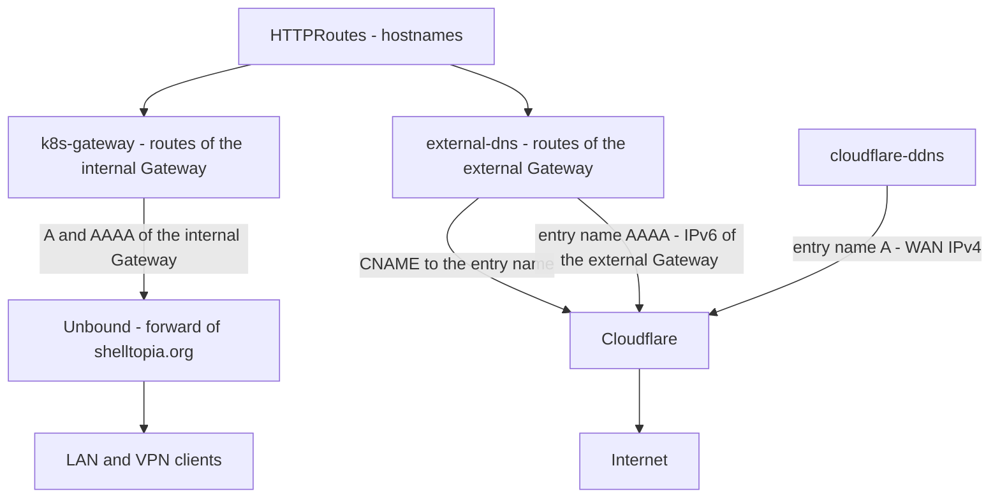

# DNS

How the DNS records of the applications are created: from their HTTPRoutes, by k8s-gateway for the LAN and by external-dns and cloudflare-ddns for the internet. The implementation is tracked in the [status](#status) below.

| Document | Content |
| --- | --- |
| [bootstrap.md](bootstrap.md) | First deployment: Cloudflare tokens, checks, Unbound on OPNsense, the OpenTofu stack of the other records. |
| [runbook.md](runbook.md) | Day-to-day: where to create a record, a name that does not resolve, external-dns dry run, the addresses of k8s-gateway. |
| [evaluations.md](evaluations.md) | What was considered or accepted, and the open points. |

Migrating a name from `home` is in the [ingress runbook](../ingress/runbook.md#migrating-a-name-from-home).

The manifests are in `kubernetes/apps/network/{k8s-gateway,external-dns,cloudflare-ddns}`. The records that nothing in the cluster owns are in `tofu/cloudflare` ([tofu/README.md](../../tofu/README.md#cloudflare)). The internal zone is forwarded by Unbound on OPNsense.

## Status

| Part | Tool | Status |
| --- | --- | --- |
| Internal names | k8s-gateway, forward of `shelltopia.org` in Unbound | Deployed |
| Public names | external-dns (CNAMEs and `AAAA` of the entry name), cloudflare-ddns (`A`) | Deployed |
| Other records (mail, CAA, PikaPods, SSL settings, DNSSEC) | OpenTofu, `tofu/cloudflare` | Applied |
| Cloudflare tokens | One per tool, `kubernetes` vault | Created |

## Overview

The records of the applications follow their HTTPRoutes: nothing is created by hand for a name served by the cluster. One GatewayClass per Gateway (`internal`, `external`) so that the tools can tell them apart ([ingress](../ingress/README.md#overview)).

| Name | Records | Managed by |
| --- | --- | --- |
| `<app>.shelltopia.org`, internal (Unbound) | `A` + `AAAA` → `internal` Gateway (IPv4, ULA) | k8s-gateway, from the routes attached to the `internal` Gateway |
| `<app>.shelltopia.org`, public (Cloudflare) | `CNAME` → `gateway-external.kube-cluster01.shelltopia.net` | external-dns, from the routes attached to the `external` Gateway |
| `gateway-external.kube-cluster01.shelltopia.net` (Cloudflare) | `A` → WAN IPv4 (HAProxy, then port forwarding) | cloudflare-ddns |
| | `AAAA` → IPv6 of the `external` Gateway | external-dns, from the Envoy Service (hostname annotation in `envoyproxy-external.yaml`) |
| Everything else in `shelltopia.net` and `shelltopia.org` (Cloudflare): mail, CAA, applications hosted by PikaPods | | OpenTofu (`tofu/cloudflare`, [README](../../tofu/README.md#cloudflare)) |
| `A` and `AAAA` of `shelltopia.net` (hosts, firewall, WireGuard endpoints), historical CNAMEs of `shelltopia.org` to the Ansible hosts (Cloudflare) | | ddns-updater or by hand; the historical CNAMEs are removed during the migration |

A public route is attached to both Gateways: Unbound never asks Cloudflare for `shelltopia.org`, so the LAN clients get the internal Gateway and the internet gets the external one. An internal-only route never shows up in Cloudflare.

Rules:

- A route must list its `hostnames`. k8s-gateway ignores a route without hostname. external-dns would fall back to the hostname of the listener and publish a wildcard `*.shelltopia.org`: the HTTPS redirect route of the external Gateway carries `external-dns.kubernetes.io/gateway-hostname-source: defined-hosts-only` for that reason.
- external-dns only changes or deletes the records it owns: ownership TXT records `cname-<name>` and `aaaa-<name>`, owner `kube-cluster01`. Policy `sync`: removing a route from the external Gateway removes its CNAME.
- external-dns ignores the `A` records (`exclude-record-types`): it never publishes any, and the `A` of the entry name belongs to cloudflare-ddns. Without that, this `A` would block the `AAAA`: external-dns creates nothing on a name that has a record owned by someone else, whatever its type.
- A CNAME cannot coexist with another record of the same name. A name that already has records (created by hand, by OpenTofu, or still pointing to `home`) must lose them first. Otherwise: an existing `CNAME` or `AAAA` makes external-dns skip the name silently (only visible with `--log-level=debug`); any other record (`A`, `TXT`, ...) makes Cloudflare reject the CNAME, and external-dns logs an error every minute.
- OpenTofu never manages the records of external-dns and cloudflare-ddns (the CNAMEs of the applications, the `cname-*`/`aaaa-*` TXT records, the `A` and `AAAA` of the entry name): never add them to `tofu/cloudflare`.

## Internal: k8s-gateway

- Release `k8s-gateway` in `network`: CoreDNS with the k8s_gateway plugin, 2 replicas. Authoritative for `shelltopia.org` only, from the HTTPRoutes whose parent Gateway has the `internal` class, TTL 60 s. No recursion: a name without route gets `NXDOMAIN`.
- LoadBalancer Service in the `internal` pool with **pinned addresses** `192.168.19.53` and `fd38:4c4d:8f66:13::53` (`lbipam.cilium.io/ips`), TCP and UDP 53. An exception to the "everything dynamic" rule: Unbound only accepts addresses as forward targets. To change them: the annotation in `kubernetes/apps/network/k8s-gateway/app/helmrelease.yaml`, then the Unbound query forwarding.
- When the cluster is down, `shelltopia.org` no longer resolves on the LAN (`SERVFAIL`). Accepted: everything in this zone is served by the cluster, except the names still on `home`, which are host overrides ([Unbound](bootstrap.md#2-opnsense-unbound)).
- No external-dns webhook for OPNsense/Unbound.

## Public: external-dns and cloudflare-ddns

- external-dns (`network`, Cloudflare provider, every minute) reads two sources: the HTTPRoutes attached to the `external` Gateway of `network` (`gateway-httproute`), and the LoadBalancer Services with a hostname annotation (`service`: the Envoy Service of the `external` Gateway). Its regex domain filter only lets it touch `shelltopia.org` and the entry name in `shelltopia.net`. The private addresses (RFC 1918, ULA) are never published. Records not proxied, with the comment `managed by external-dns (kube-cluster01)`.
- Entry name `gateway-external.kube-cluster01.shelltopia.net`, target of every public CNAME (`external-dns.kubernetes.io/target` annotation of the Gateway):
  - `A`: the WAN IPv4, detected through Cloudflare (`cloudflare.trace`) every 5 minutes by cloudflare-ddns (`network`), comment `managed by cloudflare-ddns (kube-cluster01)`. `IP6_PROVIDER=none`: it leaves the `AAAA` alone;
  - `AAAA`: the IPv6 of the Envoy Service, published by external-dns. A new delegated prefix or a recreated Gateway is followed automatically.
- With the stable IPv4 of the Milkywan tunnel, cloudflare-ddns is removed and the `A` record becomes static in OpenTofu.
- Cloudflare tokens, one per tool and distinct from the cert-manager and OpenTofu ones, in the `kubernetes` vault (field `credential`), with *Zone → Zone → Read* and *Zone → DNS → Edit*:
  - `cloudflare-external-dns`: restricted to `shelltopia.org` and `shelltopia.net`;
  - `cloudflare-ddns`: restricted to `shelltopia.net`.
- Replaces the `ddns-updater` instances of the Ansible hosts for the migrated names.

The public hybrid keeps the zones, the infrastructure records and the names of `home` in OpenTofu. The list of the public names is visible in the zone: accepted.
