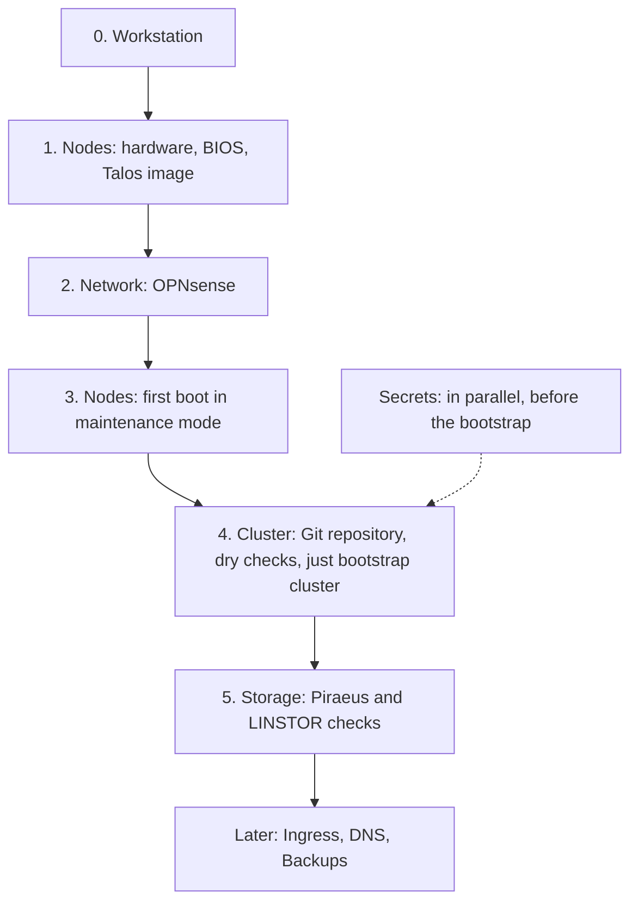

# First cluster bootstrap

The order of the manual steps to complete before the first `just bootstrap cluster`, each one detailed in the `bootstrap.md` of its topic. What comes next and the open questions are in the [roadmap](roadmap.md).



The network (DHCP reservations, DNS records) is prepared before the first boot, so that the nodes are reachable by name from maintenance mode on.

| Phase | Topic | Content |
| --- | --- | --- |
| [0](#phase-0--workstation) | Workstation | Tools and environment, below. |
| 1 | [Nodes](nodes/bootstrap.md) | [Hardware and BIOS](nodes/bootstrap.md#1-hardware-and-bios), then the [Talos image](nodes/bootstrap.md#2-talos-image). |
| 2 | [Network](network/bootstrap.md) | OPNsense: DHCP and router advertisements, DNS, firewall, BGP. |
| 3 | [Nodes](nodes/bootstrap.md#3-first-boot-in-maintenance-mode) | First boot in maintenance mode. |
| in parallel | [Secrets](secrets/bootstrap.md) | The service accounts, the Talos secrets, the Docker Hub, NUT and Flux credentials. |
| 4 | [Cluster](cluster/bootstrap.md) | [Git repository](cluster/bootstrap.md#1-git-repository), [dry checks](cluster/bootstrap.md#2-dry-checks), then [`just bootstrap cluster`](cluster/bootstrap.md#3-bootstrap) and the checks of the cluster and of the [nodes](nodes/bootstrap.md#4-checks-after-the-bootstrap). |
| 5 | [Storage](storage/bootstrap.md) | Piraeus/LINSTOR: the checks and the tests of the volumes. |
| later | [Ingress](ingress/bootstrap.md), [DNS](dns/bootstrap.md), [Backups](backups/bootstrap.md) | Deployed by Flux, each with its own checks and OPNsense configuration. The Cloudflare records of [OpenTofu](dns/bootstrap.md#3-opentofu-the-other-records) are independent from the cluster and can wait. |

During the first bootstrap, the cluster only has two nodes: see the [test phase](nodes/README.md#test-phase-2-nodes).

## Phase 0 — Workstation

- [x] **Tools.** At the root of the repository:

  ```sh
  mise trust
  mise install
  ```

- [x] **1Password.** Check that `just` and `op` are available, and that the personal account sees the vaults (the workstation service account comes with the [secrets](secrets/bootstrap.md) and is scoped to these vaults):

  ```sh
  host-spawn op vault list
  ```

  Expected: the `infrastructure` and `kubernetes` vaults. Create the missing ones:

  ```sh
  host-spawn op vault create <name>
  ```

- [x] **Environment.** Open a new shell in the repository and check that `KUBECONFIG` and `TALOSCONFIG` point to the root of the repository (set by the `[env]` section of `mise.toml`):

  ```sh
  echo $KUBECONFIG $TALOSCONFIG
  ```
