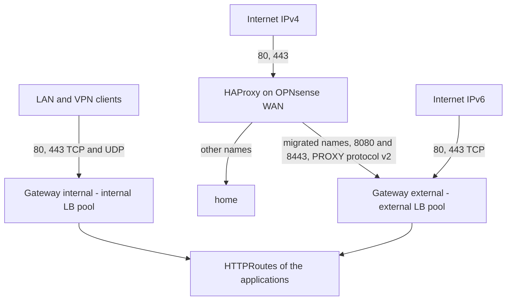

# Ingress

How the HTTP(S) traffic reaches the applications: Envoy Gateway, two Gateways, and what OPNsense does in front of them. The manifests are in `kubernetes/apps/envoy-gateway-system` (controller) and `kubernetes/apps/network/gateways` (Gateways, certificate, policies).

## Overview



- Envoy Gateway runs in `envoy-gateway-system`, the Envoy proxies of both Gateways too (2 replicas each, spread over the nodes, `minAvailable: 1`).
- Each Gateway gets one IPv4 and one IPv6 address from its Cilium LB pool, advertised with BGP by the nodes running one of its proxies (`externalTrafficPolicy: Local`, which also keeps the client address).
- One wildcard certificate `*.shelltopia.org` (Secret `shelltopia-org-tls` in `network`), served by both Gateways. No apex.
- TLS 1.3 only, with the hybrid post-quantum key exchange `X25519MLKEM768` first. HTTP/2 everywhere, HTTP/3 on the internal Gateway only (HAProxy cannot forward QUIC).
- Port 80 only redirects to HTTPS (301).
- Every response gets HSTS (2 years, `includeSubDomains`, `preload`), `X-Content-Type-Options`, `X-Robots-Tag: noindex, nofollow`, and `X-Frame-Options`/`Referrer-Policy` unless the application sets them. `Server` and `X-Powered-By` are removed.
- No route timeout and 1 h idle timeouts: long downloads, streams and websockets are not cut.

| Gateway | LB pool | Listeners | Routes accepted from |
| --- | --- | --- | --- |
| `internal` | `internal` (`192.168.19.0/25`, `fd38:4c4d:8f66:13::/64`) | `http` 80, `https` 443 (+ UDP 443, HTTP/3) | every namespace. Clients outside RFC 1918 and `fd00::/8` get a 403 (`SecurityPolicy`). |
| `external` | `external` (`192.168.19.128/25`, `2a02:8434:f003:d113::/64`) | `http` 80, `https` 443, `http-proxy` 8080, `https-proxy` 8443 | namespaces labeled `shelltopia.net/gateway-external: "true"` |

The `http` and `http-proxy` listeners only accept the redirect routes of `network`: a route without `sectionName` is never served in plain HTTP.

## Exposing an application

Internal only:

```yaml
apiVersion: gateway.networking.k8s.io/v1
kind: HTTPRoute
metadata:
  name: app
spec:
  parentRefs:
    - name: internal
      namespace: network
  hostnames:
    - app.shelltopia.org
  rules:
    - backendRefs:
        - name: app
          port: 80
```

Public: label the namespace of the application with `shelltopia.net/gateway-external: "true"` (in its `namespace.yaml`), and attach the route to **both** Gateways. The LAN clients then stay on the internal Gateway (Unbound override, see [DNS](#dns)) and get HTTP/3:

```yaml
  parentRefs:
    - name: internal
      namespace: network
    - name: external
      namespace: network
```

Without `sectionName`, the route attaches to every HTTPS listener of the external Gateway (`https` and `https-proxy`), so it is reachable both directly over IPv6 and through HAProxy over IPv4.

Check with `kubectl get httproute app -o yaml`: each parent has `Accepted: True` and `ResolvedRefs: True`. On the external Gateway, the `http` and `http-proxy` listeners refuse the route (`NotAllowedByListeners`) but `Accepted` stays `True` thanks to the HTTPS listeners.

Per-route settings (later, at migration time): basic authentication with a `SecurityPolicy` targeting the `HTTPRoute`, specific timeouts in the route rules, TLS to an HTTPS backend with a `Backend` resource or a `BackendTLSPolicy`.

## Certificate

The `Certificate` `shelltopia-org` is issued by `letsencrypt-production`. It was first tested with `letsencrypt-staging`: switch `issuerRef.name` back to it in `kubernetes/apps/network/gateways/app/certificate.yaml` to test a change of the issuers or of the Cloudflare token without touching the rate limits of production (served certificate checked with `curl -kv`, issuer `(STAGING)`). cert-manager issues the new certificate right away.

## OPNsense

### Firewall

- [x] Client subnets (LAN, VPN) → `internal` pool (`192.168.19.0/25`, `fd38:4c4d:8f66:13::/64`): TCP 80 and 443, UDP 443 (HTTP/3).
- [x] WAN → `external` pool IPv6 (`2a02:8434:f003:d113::/64`): **TCP 80 and 443 only**. The Service also exposes 8080 and 8443, which must never be reachable from the internet: Envoy trusts any PROXY protocol header on them, a client could spoof its address.
- [x] No rule is needed for HAProxy → `external` pool IPv4 (8080, 8443): the traffic comes from the firewall itself.
- [x] Do not open 8080 and 8443 of the `external` pool to the LAN either, for the same reason. The tests of these ports run from a pod.

### HAProxy (IPv4, during the migration)

There is no IPv4 port forwarding on 80/443: HAProxy listens on the WAN address with a `http` frontend (port 80, routing on the Host header) and a `https` frontend (port 443, TCP mode, routing on the SNI without terminating TLS). Each name has a rule: the names still served by `home` go to it, the names migrated to the cluster go to the `external` Gateway, with the PROXY protocol so that Envoy sees the client address. A name without rule gets its connection closed (no default backend):

- [x] Real servers: the `external` Gateway (`kubectl -n network get gateway external`), with PROXY protocol v2 (`send-proxy-v2`). Two real servers: port `8080` for HTTP, port `8443` for HTTPS. Set the **port of the real server** itself, not only the health check port: a server without port receives the connections on the port the client used (80 or 443, the direct listeners, which do not expect the PROXY header), while the health checks on 8080/8443 keep it UP. With an FQDN, set the resolution preference to IPv4 (`resolve-prefer ipv4`, HAProxy prefers IPv6 by default): HAProxy only receives IPv4 clients.
- [x] Backend pools: one for HTTP (8080), one for HTTPS (8443, TCP mode).
- [x] Conditions and rules:
  - frontend `https`: SNI matches a migrated name (`req.ssl_sni`) → HTTPS backend;
  - frontend `http`: Host matches a migrated name → HTTP backend.
- [x] The names still served by `home` keep their own rules and backends.

The address of the Gateway comes from the pool: it stays the same as long as its Service exists. If the Gateway is recreated, check it again and update the real servers.

After the migration, when `home` no longer serves anything, HAProxy is removed:

- [ ] Port forwarding WAN IPv4 TCP 80 and 443 → `external` Gateway IPv4, same ports (direct listeners, no PROXY protocol).
- [ ] Remove the `http-proxy` and `https-proxy` listeners (`gateway-external.yaml`), the `external-proxy-protocol` `ClientTrafficPolicy` and the matching `parentRefs` of the redirect route.

### DNS

The records are created by hand for now (step 4 of the [roadmap](roadmap.md)).

- Public names (Cloudflare): `A` → public IPv4 of the WAN (HAProxy), `AAAA` → IPv6 address of the `external` Gateway.
- Unbound host overrides: `A` and `AAAA` → addresses of the `internal` Gateway, for the internal applications and for the public ones (their routes are attached to both Gateways).

### HSTS preload

The header carries `preload`, which is harmless on its own. Submitting `shelltopia.org` to [hstspreload.org](https://hstspreload.org) would also require the apex to serve HTTPS with this header, and would force HTTPS on every subdomain in the browsers, permanently. Not planned.

## Checks

- `flux get ks -A`: `envoy-gateway` and `gateways` are `Ready`. `flux get hr -n envoy-gateway-system`: `envoy-gateway` is `Ready`.
- `kubectl get gatewayclass envoy`: `ACCEPTED` is `True`.
- `kubectl -n network get gateway`: both Gateways are `PROGRAMMED`, with an IPv4 address from their pool (the IPv6 one is in `status.addresses`).
- `kubectl -n network get certificate`: `shelltopia-org` is `Ready`.
- `kubectl -n network get clienttrafficpolicy,backendtrafficpolicy,securitypolicy -o wide`, then `kubectl -n network describe` on each: `Accepted`, and no conflict between `external` and `external-proxy-protocol` (the section policy overrides the Gateway one).
- `kubectl -n envoy-gateway-system get svc -o wide`: one LoadBalancer Service per Gateway, two addresses each, with UDP 443 on the internal one.
- `kubectl -n envoy-gateway-system logs deploy/envoy-gateway | grep -i -E 'error|nack'`: no rejected configuration. An unknown curve name in `ecdhCurves` would show here (and in the logs of the Envoy pods) while the policy stays `Accepted`: fall back to `[X25519, P-256]`.
