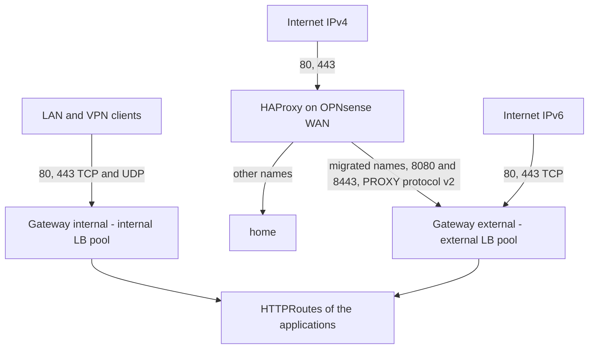
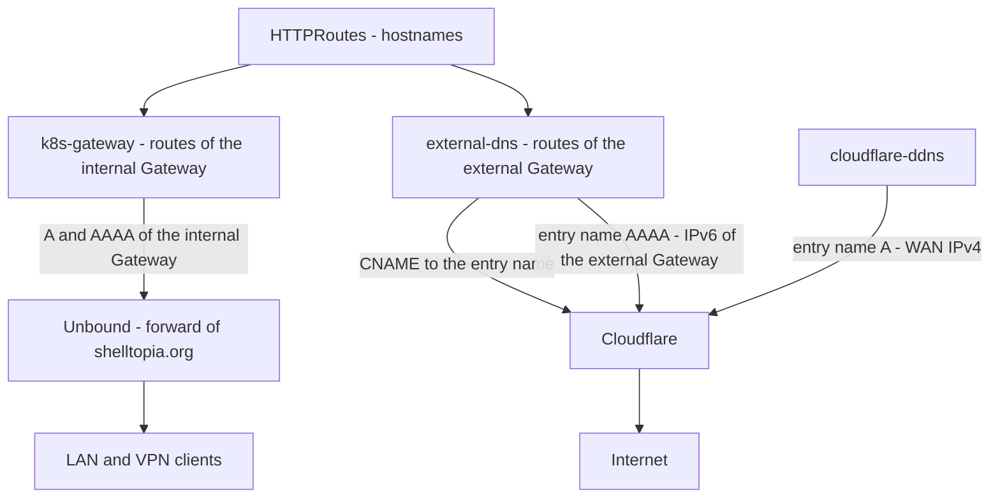

# Ingress

How the HTTP(S) traffic reaches the applications: Envoy Gateway, two Gateways, their DNS records, and what OPNsense does in front of them. The manifests are in `kubernetes/apps/envoy-gateway-system` (controller), `kubernetes/apps/network/gateways` (Gateways, certificate, policies) and `kubernetes/apps/network/{k8s-gateway,external-dns,cloudflare-ddns}` (DNS).

## Overview



- Envoy Gateway runs in `envoy-gateway-system`, the Envoy proxies of both Gateways too (2 replicas each, spread over the nodes, `minAvailable: 1`).
- One GatewayClass per Gateway (`internal` and `external`, same Envoy Gateway controller): the DNS tools tell the Gateways apart by their class.
- Each Gateway gets one IPv4 and one IPv6 address from its Cilium LB pool, advertised with BGP by the nodes running one of its proxies (`externalTrafficPolicy: Local`, which also keeps the client address).
- One wildcard certificate `*.shelltopia.org` (Secret `shelltopia-org-tls` in `network`), served by both Gateways. No apex.
- TLS 1.3 only, with the hybrid post-quantum key exchange `X25519MLKEM768` first. HTTP/2 everywhere, HTTP/3 on the internal Gateway only (HAProxy cannot forward QUIC).
- Port 80 only redirects to HTTPS (301).
- Every response gets HSTS (2 years, `includeSubDomains`, `preload`), `X-Content-Type-Options`, `X-Robots-Tag: noindex, nofollow`, and `X-Frame-Options`/`Referrer-Policy` unless the application sets them. `Server` and `X-Powered-By` are removed.
- No route timeout and 1 h idle timeouts: long downloads, streams and websockets are not cut.

| Gateway | LB pool | Listeners | Routes accepted from |
| --- | --- | --- | --- |
| `internal` | `internal` (`192.168.19.0/25`, `fd38:4c4d:8f66:13::/64`) | `http` 80, `https` 443 (+ UDP 443, HTTP/3) | every namespace. Clients outside RFC 1918 and `fd00::/8` get a 403 (`SecurityPolicy`). |
| `external` | `external` (`192.168.19.128/25`, `2a02:8434:f003:d113::/64`) | `http` 80, `https` 443, `http-proxy` 8080, `https-proxy` 8443 | namespaces labeled `shelltopia.net/gateway-external: "true"` |

The `http` and `http-proxy` listeners only accept the redirect routes of `network`: a route without `sectionName` is never served in plain HTTP.

## Exposing an application

Internal only:

```yaml
apiVersion: gateway.networking.k8s.io/v1
kind: HTTPRoute
metadata:
  name: app
spec:
  parentRefs:
    - name: internal
      namespace: network
  hostnames:
    - app.shelltopia.org
  rules:
    - backendRefs:
        - name: app
          port: 80
```

The route must list its `hostnames`: the DNS records are created from them (see [DNS](#dns)), a route without hostname gets none.

Public: label the namespace of the application with `shelltopia.net/gateway-external: "true"` (in its `namespace.yaml`), and attach the route to **both** Gateways. The LAN clients then stay on the internal Gateway (internal DNS, see [DNS](#dns)) and get HTTP/3, the internet gets a CNAME to the external Gateway:

```yaml
  parentRefs:
    - name: internal
      namespace: network
    - name: external
      namespace: network
```

Without `sectionName`, the route attaches to every HTTPS listener of the external Gateway (`https` and `https-proxy`), so it is reachable both directly over IPv6 and through HAProxy over IPv4.

Check with `kubectl get httproute app -o yaml`: each parent has `Accepted: True` and `ResolvedRefs: True`. On the external Gateway, the `http` and `http-proxy` listeners refuse the route (`NotAllowedByListeners`) but `Accepted` stays `True` thanks to the HTTPS listeners.

Per-route settings (later, at migration time): basic authentication with a `SecurityPolicy` targeting the `HTTPRoute`, specific timeouts in the route rules, TLS to an HTTPS backend with a `Backend` resource or a `BackendTLSPolicy`.

## Certificate

The `Certificate` `shelltopia-org` is issued by `letsencrypt-production`. It was first tested with `letsencrypt-staging`: switch `issuerRef.name` back to it in `kubernetes/apps/network/gateways/app/certificate.yaml` to test a change of the issuers or of the Cloudflare token without touching the rate limits of production (served certificate checked with `curl -kv`, issuer `(STAGING)`). cert-manager issues the new certificate right away.

## OPNsense

### Firewall

- [x] Client subnets (LAN, VPN) → `internal` pool (`192.168.19.0/25`, `fd38:4c4d:8f66:13::/64`): TCP 80 and 443, UDP 443 (HTTP/3).
- [x] WAN → `external` pool IPv6 (`2a02:8434:f003:d113::/64`): **TCP 80 and 443 only**. The Service also exposes 8080 and 8443, which must never be reachable from the internet: Envoy trusts any PROXY protocol header on them, a client could spoof its address.
- [x] No rule is needed for HAProxy → `external` pool IPv4 (8080, 8443): the traffic comes from the firewall itself.
- [x] Do not open 8080 and 8443 of the `external` pool to the LAN either, for the same reason. The tests of these ports run from a pod.

### HAProxy (IPv4, during the migration)

There is no IPv4 port forwarding on 80/443: HAProxy listens on the WAN address with a `http` frontend (port 80, routing on the Host header) and a `https` frontend (port 443, TCP mode, routing on the SNI without terminating TLS). Each name has a rule: the names still served by `home` go to it, the names migrated to the cluster go to the `external` Gateway, with the PROXY protocol so that Envoy sees the client address. A name without rule gets its connection closed (no default backend):

- [x] Real servers: the `external` Gateway (`kubectl -n network get gateway external`), with PROXY protocol v2 (`send-proxy-v2`). Two real servers: port `8080` for HTTP, port `8443` for HTTPS. Set the **port of the real server** itself, not only the health check port: a server without port receives the connections on the port the client used (80 or 443, the direct listeners, which do not expect the PROXY header), while the health checks on 8080/8443 keep it UP. With an FQDN, set the resolution preference to IPv4 (`resolve-prefer ipv4`, HAProxy prefers IPv6 by default): HAProxy only receives IPv4 clients.
- [x] Backend pools: one for HTTP (8080), one for HTTPS (8443, TCP mode).
- [x] Conditions and rules:
  - frontend `https`: SNI matches a migrated name (`req.ssl_sni`) → HTTPS backend;
  - frontend `http`: Host matches a migrated name → HTTP backend.
- [x] The names still served by `home` keep their own rules and backends.

The address of the Gateway comes from the pool: it stays the same as long as its Service exists. If the Gateway is recreated, or after a change of its `GatewayClass` (the split of the `envoy` class into `internal` and `external`), check it again and update the real servers.

After the migration, when `home` no longer serves anything, HAProxy is removed:

- [ ] Port forwarding WAN IPv4 TCP 80 and 443 → `external` Gateway IPv4, same ports (direct listeners, no PROXY protocol).
- [ ] Remove the `http-proxy` and `https-proxy` listeners (`gateway-external.yaml`), the `external-proxy-protocol` `ClientTrafficPolicy` and the matching `parentRefs` of the redirect route.

### Unbound

See [DNS](#opnsense-unbound).

### HSTS preload

The header carries `preload`, which is harmless on its own. Submitting `shelltopia.org` to [hstspreload.org](https://hstspreload.org) would also require the apex to serve HTTPS with this header, and would force HTTPS on every subdomain in the browsers, permanently. Not planned.

## DNS

The records of the applications follow their HTTPRoutes: nothing is created by hand for a name served by the cluster.



| Name | Records | Managed by |
| --- | --- | --- |
| `<app>.shelltopia.org`, internal (Unbound) | `A` + `AAAA` → `internal` Gateway (IPv4, ULA) | k8s-gateway, from the routes attached to the `internal` Gateway |
| `<app>.shelltopia.org`, public (Cloudflare) | `CNAME` → `gateway-external.kube-cluster01.shelltopia.net` | external-dns, from the routes attached to the `external` Gateway |
| `gateway-external.kube-cluster01.shelltopia.net` (Cloudflare) | `A` → WAN IPv4 (HAProxy, then port forwarding) | cloudflare-ddns |
| | `AAAA` → IPv6 of the `external` Gateway | external-dns, from the Envoy Service (hostname annotation in `envoyproxy-external.yaml`) |
| Everything else in `shelltopia.net` and `shelltopia.org` (Cloudflare): mail, CAA, applications hosted by PikaPods | | OpenTofu (`tofu/cloudflare`, [README](../tofu/README.md#cloudflare)) |
| `A` and `AAAA` of `shelltopia.net` (hosts, firewall, WireGuard endpoints), historical CNAMEs of `shelltopia.org` to the Ansible hosts (Cloudflare) | | ddns-updater or by hand; the historical CNAMEs are removed during the migration |

A public route is attached to both Gateways: Unbound never asks Cloudflare for `shelltopia.org`, so the LAN clients get the internal Gateway and the internet gets the external one. An internal-only route never shows up in Cloudflare.

Rules:

- A route must list its `hostnames`. k8s-gateway ignores a route without hostname. external-dns would fall back to the hostname of the listener and publish a wildcard `*.shelltopia.org`: the HTTPS redirect route of the external Gateway carries `external-dns.kubernetes.io/gateway-hostname-source: defined-hosts-only` for that reason.
- external-dns only changes or deletes the records it owns: ownership TXT records `cname-<name>` and `aaaa-<name>`, owner `kube-cluster01`. Policy `sync`: removing a route from the external Gateway removes its CNAME.
- external-dns ignores the `A` records (`exclude-record-types`): it never publishes any, and the `A` of the entry name belongs to cloudflare-ddns. Without that, this `A` would block the `AAAA`: external-dns creates nothing on a name that has a record owned by someone else, whatever its type.
- A CNAME cannot coexist with another record of the same name. A name that already has records (created by hand, by OpenTofu, or still pointing to `home`) must lose them first. Otherwise: an existing `CNAME` or `AAAA` makes external-dns skip the name silently (only visible with `--log-level=debug`); any other record (`A`, `TXT`, ...) makes Cloudflare reject the CNAME, and external-dns logs an error every minute.
- OpenTofu never manages the records of external-dns and cloudflare-ddns (the CNAMEs of the applications, the `cname-*`/`aaaa-*` TXT records, the `A` and `AAAA` of the entry name): never add them to `tofu/cloudflare`.

### Internal: k8s-gateway

- Release `k8s-gateway` in `network`: CoreDNS with the k8s_gateway plugin, 2 replicas. Authoritative for `shelltopia.org` only, from the HTTPRoutes whose parent Gateway has the `internal` class, TTL 60 s. No recursion: a name without route gets `NXDOMAIN`.
- LoadBalancer Service in the `internal` pool with **pinned addresses** `192.168.19.53` and `fd38:4c4d:8f66:13::53` (`lbipam.cilium.io/ips`), TCP and UDP 53. An exception to the "everything dynamic" rule: Unbound only accepts addresses as forward targets. To change them: the annotation in `kubernetes/apps/network/k8s-gateway/app/helmrelease.yaml`, then the Unbound query forwarding.
- When the cluster is down, `shelltopia.org` no longer resolves on the LAN (`SERVFAIL`). Accepted: everything in this zone is served by the cluster, except the names still on `home`, which are host overrides (below).

### OPNsense (Unbound)

- [x] *Services → Unbound DNS → Query Forwarding*: domain `shelltopia.org`, servers `192.168.19.53` and `fd38:4c4d:8f66:13::53`, port 53.
- [x] Remove the host overrides of `shelltopia.org` for the names served by the cluster. Keep those of the names still served by `home` until they are migrated: the host overrides (`local-data`) win over the forward.
- [x] Firewall: the queries come from the firewall itself, no rule is needed. Optional, for the tests with `dig`: administration subnets → `192.168.19.53` and `fd38:4c4d:8f66:13::53`, TCP and UDP 53.
- DNSSEC: `shelltopia.org` is signed on Cloudflare, but Unbound does not validate (its upstream does), so the unsigned answers of k8s-gateway are accepted. If validation is ever enabled on Unbound, add `shelltopia.org` to its insecure domains (`domain-insecure`).

### Public: external-dns and cloudflare-ddns

- external-dns (`network`, Cloudflare provider, every minute) reads two sources: the HTTPRoutes attached to the `external` Gateway of `network` (`gateway-httproute`), and the LoadBalancer Services with a hostname annotation (`service`: the Envoy Service of the `external` Gateway). Its regex domain filter only lets it touch `shelltopia.org` and the entry name in `shelltopia.net`. The private addresses (RFC 1918, ULA) are never published. Records not proxied, with the comment `managed by external-dns (kube-cluster01)`.
- Entry name `gateway-external.kube-cluster01.shelltopia.net`, target of every public CNAME (`external-dns.kubernetes.io/target` annotation of the Gateway):
  - `A`: the WAN IPv4, detected through Cloudflare (`cloudflare.trace`) every 5 minutes by cloudflare-ddns (`network`), comment `managed by cloudflare-ddns (kube-cluster01)`. `IP6_PROVIDER=none`: it leaves the `AAAA` alone;
  - `AAAA`: the IPv6 of the Envoy Service, published by external-dns. A new delegated prefix or a recreated Gateway is followed automatically.
- With the stable IPv4 of the Milkywan tunnel, cloudflare-ddns is removed and the `A` record becomes static in OpenTofu.
- Cloudflare tokens, distinct from the cert-manager and OpenTofu ones, in the `Kubernetes` vault (field `credential`), with *Zone → Zone → Read* and *Zone → DNS → Edit*:
  - [x] `cloudflare-external-dns`: restricted to `shelltopia.org` and `shelltopia.net`;
  - [x] `cloudflare-ddns`: restricted to `shelltopia.net`.

### Migrating a name from `home`

1. Deploy the application with its route (`hostnames`, attached to the right Gateway(s)).
2. Public name: remove its current records from the Cloudflare dashboard (the historical names are not managed by OpenTofu; if one is, remove it from `tofu/cloudflare` then `just tofu apply cloudflare`). external-dns creates the CNAME within a minute. Update HAProxy ([above](#haproxy-ipv4-during-the-migration)).
3. Internal name: remove its Unbound host override, the forward to k8s-gateway takes over.

## Checks

- `flux get ks -A`: `envoy-gateway` and `gateways` are `Ready`. `flux get hr -n envoy-gateway-system`: `envoy-gateway` is `Ready`.
- `kubectl get gatewayclass`: `internal` and `external` are `ACCEPTED`.
- `kubectl -n network get gateway`: both Gateways are `PROGRAMMED`, with an IPv4 address from their pool (the IPv6 one is in `status.addresses`).
- `kubectl -n network get certificate`: `shelltopia-org` is `Ready`.
- `kubectl -n network get clienttrafficpolicy,backendtrafficpolicy,securitypolicy -o wide`, then `kubectl -n network describe` on each: `Accepted`, and no conflict between `external` and `external-proxy-protocol` (the section policy overrides the Gateway one).
- `kubectl -n envoy-gateway-system get svc -o wide`: one LoadBalancer Service per Gateway, two addresses each, with UDP 443 on the internal one.
- `kubectl -n envoy-gateway-system logs deploy/envoy-gateway | grep -i -E 'error|nack'`: no rejected configuration. An unknown curve name in `ecdhCurves` would show here (and in the logs of the Envoy pods) while the policy stays `Accepted`: fall back to `[X25519, P-256]`.

DNS:

- `flux get ks -n network`: `k8s-gateway`, `external-dns` and `cloudflare-ddns` are `Ready`. `kubectl -n network get externalsecret`: `external-dns-cloudflare` and `cloudflare-ddns` are `SecretSynced`.
- `kubectl -n network get svc k8s-gateway -o wide`: `192.168.19.53` and `fd38:4c4d:8f66:13::53`. Without address, another Service already holds one of them.
- `dig +short app.shelltopia.org @192.168.19.53`, `dig +short +tcp AAAA app.shelltopia.org @fd38:4c4d:8f66:13::53`: the addresses of the `internal` Gateway. A name without route: `NXDOMAIN`. Then the same through Unbound.
- First deployment of external-dns: to see what it would do without changing anything, add `dry-run: true` to its `extraArgs` and read `kubectl -n network logs deploy/external-dns`. Then remove it. In dry-run, a planned change is logged again at every cycle: a change logged once only came from a transient state.
- `CREATE` of `gateway-external.kube-cluster01.shelltopia.net` `AAAA` (and its `aaaa-` TXT record) on the first deployment. Never a `*.shelltopia.org` record.
- `dig +short CNAME app.shelltopia.org @1.1.1.1` and `dig +short A gateway-external.kube-cluster01.shelltopia.net @1.1.1.1` (and `AAAA`): the CNAME, the WAN IPv4 and the IPv6 of the `external` Gateway.
- `kubectl -n network logs deploy/cloudflare-ddns`: the detected IPv4 and the record update, no error.
