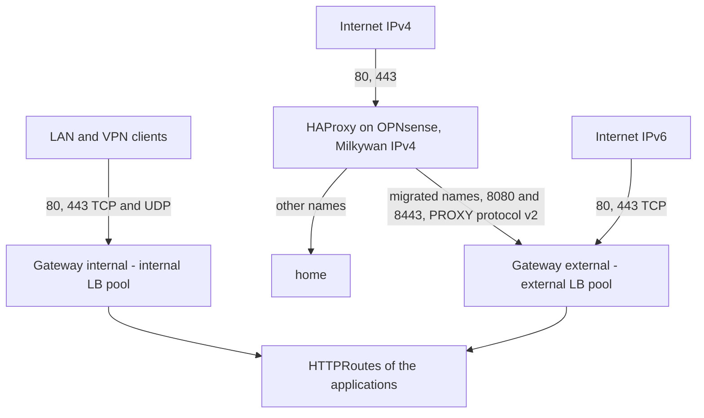

# Ingress

How the HTTP(S) traffic reaches the applications: Envoy Gateway, two Gateways, their certificate, and what OPNsense does in front of them. The implementation is tracked in the [status](#status) below. The DNS records of the applications are in [dns](../dns/README.md).

| Document | Content |
| --- | --- |
| [bootstrap.md](bootstrap.md) | First deployment: prerequisites, the checks of the Gateways, the OPNsense firewall and HAProxy. |
| [runbook.md](runbook.md) | Day-to-day: exposing an application, the staging certificate, a certificate that is not issued, migrating a name from `home`, removing HAProxy. |
| [evaluations.md](evaluations.md) | What was considered or rejected, and the open points. |

The manifests are in `kubernetes/apps/envoy-gateway-system` (controller), `kubernetes/apps/network/gateways` (Gateways, certificate, policies) and `kubernetes/apps/cert-manager` (issuers). The DNS tools (`kubernetes/apps/network/{k8s-gateway,external-dns,cloudflare-ddns}`) are described in [dns](../dns/README.md).

## Status

| Part | Tool | Status |
| --- | --- | --- |
| Certificates | cert-manager, Let's Encrypt (DNS-01 with Cloudflare), wildcard `*.shelltopia.org` | Deployed, [issued by production](#certificate) |
| Gateways | Envoy Gateway, `internal` and `external` Gateways | Deployed and [checked](bootstrap.md#1-deploy-and-check) |
| OPNsense, firewall and HAProxy (IPv4) | Rules, HAProxy sending the migrated names to the `external` Gateway | Done, [checklist](bootstrap.md#2-opnsense) |
| Port forwarding instead of HAProxy | OPNsense | To do once `home` is migrated, [procedure](runbook.md#removing-haproxy) |
| HSTS preload | | [Not planned](evaluations.md#hsts-preload) |

## Overview

- Envoy Gateway runs in `envoy-gateway-system`, the Envoy proxies of both Gateways too (2 replicas each, spread over the nodes, `minAvailable: 1`).
- One GatewayClass per Gateway (`internal` and `external`, same Envoy Gateway controller): the DNS tools tell the Gateways apart by their class.
- Each Gateway gets one IPv4 and one IPv6 address from its Cilium LB pool, advertised with BGP by the nodes running one of its proxies (`externalTrafficPolicy: Local`, which also keeps the client address).
- One wildcard certificate `*.shelltopia.org` (Secret `shelltopia-org-tls` in `network`), served by both Gateways. No apex.
- TLS 1.3 only, with the hybrid post-quantum key exchange `X25519MLKEM768` first. HTTP/2 everywhere, HTTP/3 on the internal Gateway only (HAProxy cannot forward QUIC).
- Port 80 only redirects to HTTPS (301).
- Every response gets HSTS (2 years, `includeSubDomains`, `preload`), `X-Content-Type-Options`, `X-Robots-Tag: noindex, nofollow`, and `X-Frame-Options`/`Referrer-Policy` unless the application sets them. `Server` and `X-Powered-By` are removed.
- No route timeout and 1 h idle timeouts: long downloads, streams and websockets are not cut.

| Gateway | LB pool | Listeners | Routes accepted from |
| --- | --- | --- | --- |
| `internal` | `internal` (`192.168.19.0/25`, `fd38:4c4d:8f66:13::/64`) | `http` 80, `https` 443 (+ UDP 443, HTTP/3) | every namespace |
| `external` | `external` (`192.168.19.128/25`, `2a0e:e701:2132:13::/64`) | `http` 80, `https` 443, `http-proxy` 8080, `https-proxy` 8443 | namespaces labeled `shelltopia.net/gateway-external: "true"` |

The `http` and `http-proxy` listeners only accept the redirect routes of `network`: a route without `sectionName` is never served in plain HTTP.

Each application chooses its Gateway(s), [how](runbook.md#exposing-an-application). Only the namespaces labeled `shelltopia.net/gateway-external: "true"` can use the external one, so that exposing an application on the internet is explicit. Internet exposure is still decided by OPNsense.

The `internal` Gateway does not filter its clients: its addresses are private, only the LAN and the VPN reach them. A route attached to it by mistake while its name is public is a risk accepted ([evaluations](evaluations.md#rejected-options)).

An application without a login of its own (Hubble UI, [cluster](../cluster/README.md#network-policies)) gets one from Envoy, on the `internal` Gateway only: a `SecurityPolicy` with `oidc` on its route logs in on the Pocket ID ([how](runbook.md#a-ui-without-a-login-of-its-own)). Each one has its own confidential client, whose allowed groups are the only check: no `jwt` nor `authorization` rules in Envoy, nothing to keep in sync. Envoy refreshes the tokens (`refreshToken: true`), so a long-lived page keeps working. No `SecurityPolicy` on the Gateways: the one of a route replaces the one of its Gateway.

## Envoy Gateway

Envoy Gateway (Gateway API) is the implementation, the Cilium Gateway API stays disabled: Envoy Gateway is more complete (client, backend and security policies, PROXY protocol, HTTP/3) and its proxies are separate from the CNI ([evaluations](evaluations.md#rejected-options)). Two Gateways in `network`, `internal` and `external`, one per LB pool, each with its own Envoy proxies (`EnvoyProxy`, 2 replicas, `externalTrafficPolicy: Local`) and the same wildcard certificate.

## Certificate

- Let's Encrypt only, with two permanent `ClusterIssuer`s (`letsencrypt-staging` and `letsencrypt-production`, each `Certificate` picks one) and DNS-01 through Cloudflare.
- All the services live in `shelltopia.org` (`shelltopia.net` stays for the infrastructure), served by a wildcard `*.shelltopia.org` so that the application names do not appear in the Certificate Transparency logs.
- One Cloudflare token (*Zone → DNS → Edit*, *Zone → Zone → Read*), created by hand and distinct from the OpenTofu one: 1Password item `cloudflare-cert-manager`, field `credential`, synced by an `ExternalSecret` in `cert-manager`.
- The internal DNS is split-horizon (Unbound overrides `shelltopia.net`): `dns01RecursiveNameservers` (public resolvers of Cloudflare, over plain DNS) and `dns01RecursiveNameserversOnly: true` are set in the cert-manager values, otherwise the propagation check may query Unbound and never succeed. The nodes are allowed to reach these resolvers ([network](../network/bootstrap.md#3-firewall)).
- The `Certificate` `shelltopia-org` is issued by `letsencrypt-production`, in the namespace of the Gateways (`network`). It was first tested with `letsencrypt-staging`: [how to switch back to it](runbook.md#testing-a-change-with-the-staging-issuer).

## IPv4 from the internet

HAProxy on OPNsense (listening on the Milkywan IPv4 `45.13.104.160`, shared with `home`; SNI on 443, Host on 80) keeps sending the names of `home` to it and sends the migrated names to the `external` Gateway on 8080/8443 with the PROXY protocol, until `home` is migrated. Then a plain port forwarding to 80/443 of the Gateway replaces it and the PROXY protocol listeners are removed ([procedure](runbook.md#removing-haproxy)). IPv6 reaches the Gateway directly. The setup is in [bootstrap.md](bootstrap.md#haproxy-ipv4-during-the-migration).
