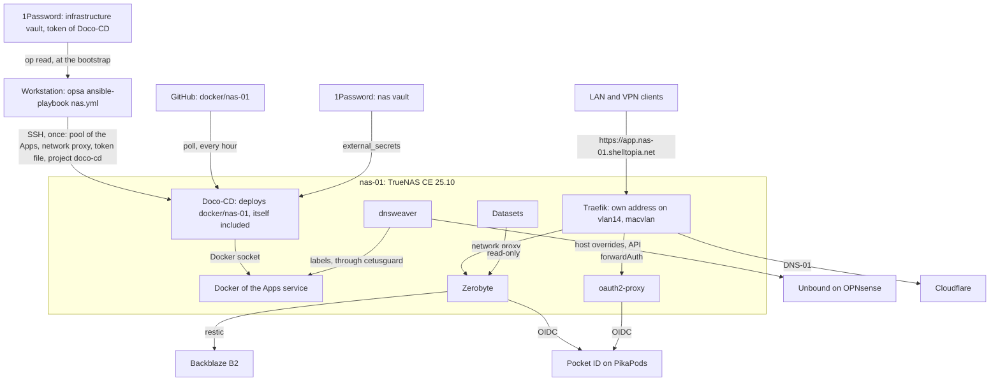

# NAS: TrueNAS and its containers

How the containers of the NAS (`nas-01`, TrueNAS CE 25.10) are deployed from Git, the way Flux deploys the cluster, and how their web UIs are reached. The implementation is tracked in the [status](#status) below.

| Document | Content |
| --- | --- |
| [bootstrap.md](bootstrap.md) | First deployment: 1Password, the files of the repository, the bootstrap of Doco-CD by Ansible, the web UI stacks (Traefik, dnsweaver, oauth2-proxy), then Zerobyte. |
| [runbook.md](runbook.md) | Day-to-day: adding or removing a stack, a name that does not resolve, the certificate, reaching Zerobyte without Traefik, updating Doco-CD, rotating its token, after a TrueNAS upgrade, rebuilding the NAS. |
| [evaluations.md](evaluations.md) | The other ways to deploy containers on the NAS, to bootstrap Doco-CD and to reach their web UIs, and the open points. |

The Compose files are in `docker/nas-01`, one folder per stack. The bootstrap is the playbook `ansible/nas.yml` and its roles `ansible/roles/truenas_docker` and `ansible/roles/doco_cd`, next to the playbooks of the Fedora CoreOS hosts. TrueNAS itself (pools, datasets, shares, NUT, syslog) is configured by hand in its web interface. Why the NAS backs its data up with Zerobyte rather than with the tasks of TrueNAS: [backups](../backups/evaluations.md#rejected-options).

## Status

| Part | Tool | Status |
| --- | --- | --- |
| Base system: pools, datasets, NFS shares | TrueNAS CE 25.10, web interface | In use |
| Container runtime | Docker of the Apps service, its pool set by the playbook | Pool of the Apps to choose |
| Deployments from Git | Doco-CD, `docker/nas-01` | Decided, [to set up](bootstrap.md) |
| Bootstrap of Doco-CD | Ansible, `ansible/nas.yml` | Decided, to write |
| Secrets of the stacks | 1Password, `nas` vault | Vault to create |
| Reverse proxy of the web UIs | Traefik, on its own address (macvlan on `vlan14`), wildcard `*.nas-01.shelltopia.net` | Decided, [to set up](bootstrap.md#4-web-uis-traefik-dnsweaver-oauth2-proxy) |
| Names of the web UIs | dnsweaver, host overrides in Unbound | Decided, [to set up](bootstrap.md#4-web-uis-traefik-dnsweaver-oauth2-proxy) |
| Login | Pocket ID: native OIDC, or oauth2-proxy in front | Decided, [to set up](bootstrap.md#4-web-uis-traefik-dnsweaver-oauth2-proxy) |
| Backups of the NAS data | Zerobyte | Decided, [to set up](bootstrap.md#5-zerobyte) |
| Metrics | `node_exporter`, `smartctl_exporter` | Later ([observability](../observability/README.md#external-devices)) |
| Logs | Remote syslog to the cluster | Done ([observability](../observability/bootstrap.md#5-external-devices)) |
| UPS | NUT server, `upsmon` on the nodes | In use ([secrets](../secrets/bootstrap.md#4-nut)) |

## Overview



## Decisions

### Containers from Git: Doco-CD

- [Doco-CD](https://doco.cd) deploys the Compose files of `docker/nas-01`: one container, the Docker socket, no database. Git is the only source, as for Flux: a change is a commit. Model: the NAS of [bjw-s-labs/home-ops](https://github.com/bjw-s-labs/home-ops). The alternatives are in [evaluations.md](evaluations.md#deploying-containers-on-the-nas).
- It runs on the Docker of the Apps service, outside of the middleware: its containers do not show in *Apps* and TrueNAS does not manage them. The Apps service needs a pool, which starts Docker; the middleware owns the configuration of the daemon (`daemon.json`), never changed by hand. The root filesystem of TrueNAS is read-only: nothing is installed on the host, every file is on a dataset or in a Docker volume.
- **Polling, every hour**, of the branch Flux follows (`migrate-to-k8s` until the merge, then `main`): GitHub cannot reach the NAS, so no webhook. The repository is public: no Git token.
- `DEPLOY_CONFIG_BASE_DIR: docker/nas-01/`: Doco-CD reads `docker/nas-01/.doco-cd.yml` only. The `working_dir` of that file stays relative to the root of the repository.
- **Auto-discovery** (`depth: 1`, `delete: true`): every folder of `docker/nas-01` with a `compose.yaml` is a stack, a Compose project named after the folder. Removing the folder removes the stack, as the prune of Flux. Its named volumes are kept (`remove_volumes: false`, the default).
- A container that turns unhealthy is restarted (reconciliation, on by default), a missing one is created again at the next poll.
- Images pinned as `<version>@sha256:<digest>`: Renovate updates them with its `docker-compose` manager, on with `config:recommended`.

### Bootstrap: Ansible, then Doco-CD updates itself

Doco-CD cannot deploy itself before it runs. As for the cluster, where `just bootstrap cluster` installs Flux and Flux takes over ([cluster](../cluster/README.md#overview)), the workstation starts it once, then the repository is the only source:

1. `opsa ansible-playbook --inventory=inventories/nas.yml nas.yml`, from `ansible/`, connects to `nas-01.shelltopia.net` as `truenas_admin`, with `become`.
2. Role `truenas_docker`: it sets the pool of the Apps service through the middleware when none is set (`midclt`), which starts Docker, and creates the bridge network `proxy` of the web UIs ([reverse proxy](#reverse-proxy-traefik-on-its-own-address)).
3. Role `doco_cd`: it reads the token of Doco-CD on the workstation (`op read`, `no_log`) and writes it to a file (`0600`) on the dataset of Doco-CD.
4. It starts `docker/nas-01/doco-cd/compose.yaml`, read from the repository on the workstation, as the Compose project `doco-cd` (`community.docker.docker_compose_v2`), and waits for the container to be healthy.
5. Doco-CD deploys `docker/nas-01`, its own stack included. With `SELF_UPDATE_ENABLED=true`, it finds its own container in the project `doco-cd` (same project and service name) and replaces it with one created from the repository: the *Migrating an existing instance* case of the [self-update](https://doco.cd/v0.134/Advanced/Self-Updating/). From then on, an update of Doco-CD is a commit, like for any stack.

The Compose file of Doco-CD follows the rules of the self-update:

- A restart policy and a healthcheck (`/doco-cd healthcheck`).
- No published port and no `container_name`: the `scale_out` strategy starts the new container next to the old one, without downtime. With either, it would be the `applier` strategy, a short restart.
- The named volume `data` (cache of the repository, journal of the handovers) is never renamed nor changed: a rollback cannot restore it.
- A failed self-update is rolled back, and not retried for that commit.

The playbook runs again only to repair: Doco-CD gone, or a new token ([runbook](runbook.md)). It follows `ansible/gladius/playbook.yaml` of bjw-s, whose Doco-CD does not manage itself; the self-update now allows it. Ansible stays for this: the playbooks of the Fedora CoreOS hosts go away with them, the inventory, playbook and roles of the NAS stay in `ansible/`, unencrypted (no `ansible-vault`). `community.docker` joins `ansible/requirements.yml`.

### Independent of the cluster

- The containers of the NAS depend on nothing in the cluster: not their names, their reverse proxy, their certificate nor their login. The backups must keep running and stay restorable while the cluster is down, which is when a restore matters most.
- Hence no name in `shelltopia.org`, served on the LAN by k8s-gateway ([dns](../dns/README.md#internal-k8s-gateway)), and not the Envoy of the cluster ([evaluations](evaluations.md#web-uis-of-the-nas)).
- What stays outside of the NAS: OPNsense (Unbound, the routes), Cloudflare and Let's Encrypt (the renewals only), Pocket ID on PikaPods (the logins, with a local account as fallback), GitHub and 1Password (the deployments, not the running containers).

### Names: `<app>.nas-01.shelltopia.net`, by dnsweaver

- One name per web UI under `nas-01.shelltopia.net`, as `<service>.kubecluster-01.shelltopia.net` for the cluster ([conventions](../conventions.md#loadbalancer-addresses)). Resolved on the LAN and the VPN only: `A` and `AAAA` host overrides in Unbound, nothing in Cloudflare.
- [dnsweaver](https://github.com/maxfield-allison/dnsweaver) creates them from the `Host()` rules of the Traefik labels (source `traefik`), and removes them with the container. Two instances of its `opnsense` provider, `ENGINE=unbound`, `DOMAINS=*.nas-01.shelltopia.net`: one for the `A`, one for the `AAAA`, both to the addresses of Traefik. Every name points to Traefik, not to the containers.
- It only touches the host overrides whose description starts with `dnsweaver:<instance>`: the ones created by hand stay.
- It calls the API of OPNsense on `fw-01.shelltopia.net:8443` (public certificate, verified), as a user `dnsweaver` without login, item `fw-01-dnsweaver`. OPNsense has no fine-grained API rights: the privilege of Unbound grants all its settings, its query forwarding included.
- Each change reloads Unbound (`RECONFIGURE_MODE=per_write`, the default): its cache is flushed and the LAN loses its DNS for a moment. Acceptable with a few changes a month ([open point](evaluations.md#open-points)).
- It reads the labels through its own cetusguard ([Docker socket](#docker-socket)).

### Reverse proxy: Traefik on its own address

- Traefik terminates the TLS of every web UI of the NAS, on ports 80 (redirect) and 443 of **its own address** in VLAN 14: `192.168.14.<x>` and `fd38:4c4d:8f66:e::<x>`, the same host part, to allocate ([reference](../reference.md#addresses)). The web UI of TrueNAS keeps port 443 of the address of the NAS, untouched.
- The address comes from a **macvlan** network on `vlan14`, declared in the stack of Traefik. Its own MAC: OPNsense sees a host of its own, the firewall rules target its address. The `ip_range` of the network is this address only, so Docker never hands out another one; it is outside the DHCP pool of OPNsense.
- Its default route is on the macvlan (`gw_priority`): the answers to the clients of the other VLANs leave through `vlan14`, not through the NAT of a bridge. Same rule as for the NAS itself ([network](../network/README.md#nas-no-asymmetric-path)).
- A macvlan address cannot talk to its own host: Traefik cannot reach the addresses of the NAS, nor the NAS the address of Traefik. The backends are on a bridge network, so nothing is lost; a service with `network_mode: host`, or the web UI of TrueNAS, cannot be put behind Traefik.
- The backends join the bridge network `proxy`, created by the playbook: no project owns it, so the order of the stacks does not matter and removing Traefik does not remove it. Their ports are never published.
- Configured by its command line and its labels, without a file: Doco-CD only deploys the Compose file ([open point](evaluations.md#open-points)). Docker provider through its cetusguard, `exposedByDefault=false`, `network=proxy`.

### Certificate

- A wildcard `*.nas-01.shelltopia.net` from Let's Encrypt, DNS-01 on Cloudflare, where `shelltopia.net` is hosted: one certificate for every web UI, and the names of the services stay out of the CT logs. Same resolver as on the Fedora CoreOS hosts (`ansible/roles/traefik/templates/traefik.toml.j2`).
- Token `cloudflare-traefik` (`nas` vault), *Zone: DNS: Edit* on `shelltopia.net`. Cloudflare cannot restrict it to a subdomain: a token stolen on the NAS can change the whole zone. Accepted.
- `acme.json` on a dataset: `/var/lib` is reset by the upgrades of TrueNAS.

### Login

- Pocket ID (`https://id.shelltopia.org`, on PikaPods, not in the cluster), group `nas_admins`.
- An application with OIDC uses it directly: Zerobyte, through its SSO settings, client `pocket-id-zerobyte`. Its local account stays, as the fallback for a restore without internet (item `nas-01-zerobyte`).
- The others go through **oauth2-proxy**: one instance, the `forwardAuth` middleware `oauth2-proxy@docker` of Traefik, the cookie on `.nas-01.shelltopia.net`, client `pocket-id-oauth2-proxy`. First user: the dashboard of Traefik, `traefik.nas-01.shelltopia.net`. Without Pocket ID, the dashboard is out of reach; SSH stays.
- Never both on one application: two logins in a row.

### Backups: Zerobyte

- [Zerobyte](https://github.com/nicotsx/zerobyte) (restic with a web UI) backs the datasets up to B2, at `https://zerobyte.nas-01.shelltopia.net`: jobs and retention in [backups](../backups/README.md#nas-data-zerobyte-on-truenas).
- Its repository and its volumes are in Git, in its provisioning file, the secrets as `env://` references. Its backup jobs, schedules and notifications are not (the provisioning does not support them): they live in its SQLite database, on a dataset, and their settings are in the [checklist](../backups/bootstrap.md#3-nas-data-zerobyte) to create them again.
- The repository password is `restic-nas/password` (`customPassword`), not one generated by Zerobyte: the repository can be restored with `restic` alone, without Zerobyte nor its `APP_SECRET`.
- Without `SYS_ADMIN` nor `/dev/fuse`: local datasets only, no remote mounts.
- Young (0.x, breaking changes announced between versions): read the release notes before merging an update.

### Docker socket

- Doco-CD mounts the socket: root on the NAS.
- Traefik and dnsweaver read it through a [cetusguard](https://github.com/hectorm/cetusguard) in their own stack, on an `internal` network of the stack: the events, the list and the inspection of the containers, the rules of `ansible/roles/traefik/templates/cetusguard.container.j2`. Never in the project of Doco-CD: the self-update recreates it.

### Secrets

- Doco-CD holds one secret: the token of its 1Password service account, as a file (`SECRET_PROVIDER=1password`, `SECRET_PROVIDER_ACCESS_TOKEN_FILE`). No API key nor webhook secret: neither is used.
- The service account `nas-doco-cd` reads the `nas` vault only: a token stolen on the NAS gives the secrets of the NAS, not the Talos PKI of `infrastructure`. Its token is the item `1password-doco-cd` (field `credential`) of the `infrastructure` vault, read by the workstation at the bootstrap only.
- A stack lists its secrets in a `.doco-cd.yml` next to its `compose.yaml` (`external_secrets`, `VAR: op://nas/<item>/<field>`), one by one: the 1Password provider has no bulk fetch (`external_secrets_paths`). They are variables of the interpolation of the Compose file.
- `restic-nas` moves from `infrastructure` to `nas`: the `vault` of its entry in `restic_repositories` (`tofu/backblaze/main.tf`).
- The workstation service account reads `nas` too: `just tofu apply backblaze` reads the items it updates. The permissions of a service account cannot change: it is a new one, created at a [rotation](../secrets/runbook.md#rotating-the-workstation-token).

The items of the `nas` vault:

| Item | Fields read by Doco-CD | Stack |
| --- | --- | --- |
| `restic-nas` | `password`, `access-key-id`, `secret-access-key` (managed by OpenTofu) | `zerobyte` |
| `nas-01-zerobyte` | `app-secret`; `username` and `password` are its local account, read by hand only | `zerobyte` |
| `pocket-id-zerobyte` | None: the client id and secret are entered in the SSO settings of Zerobyte | `zerobyte` |
| `cloudflare-traefik` | `credential` | `traefik` |
| `fw-01-dnsweaver` | `username` (the API key), `credential` (its secret) | `dnsweaver` |
| `pocket-id-oauth2-proxy` | `username` (the client id), `credential` (the secret), `cookie-secret` | `oauth2-proxy` |

Doco-CD shares the 1,000 requests a day of the account with External Secrets and the workstation, about 3 per field resolved ([rate limits](../secrets/README.md#rate-limits)). 10 fields: about 30 requests at each resolution, 720 a day with a resolution at every poll. The cache of the resolved secrets is on (`SECRET_PROVIDER_CACHE_ENABLED`, `SECRET_PROVIDER_CACHE_TTL: 12h`, the refresh of the ExternalSecrets): about 60 a day, plus one resolution at each restart. Measured at the bootstrap ([open point](evaluations.md#open-points)).

### Layout

```text
docker/nas-01/
├── .doco-cd.yml              # auto-discovery of the folders below
├── doco-cd/
│   └── compose.yaml          # Doco-CD itself, started once by Ansible
├── traefik/                  # Traefik, its cetusguard, the macvlan network
├── dnsweaver/                # dnsweaver, its cetusguard
├── oauth2-proxy/
└── zerobyte/
    ├── .doco-cd.yml          # its external_secrets, merged with the file above
    └── compose.yaml          # the provisioning file inline (configs)
ansible/
├── nas.yml                   # the playbook of the bootstrap
├── inventories/nas.yml       # nas-01, unencrypted
└── roles/
    ├── truenas_docker/       # pool of the Apps service, network proxy
    └── doco_cd/
```

One folder per Docker host under `docker/`: another host would get its own folder and its own Doco-CD.
