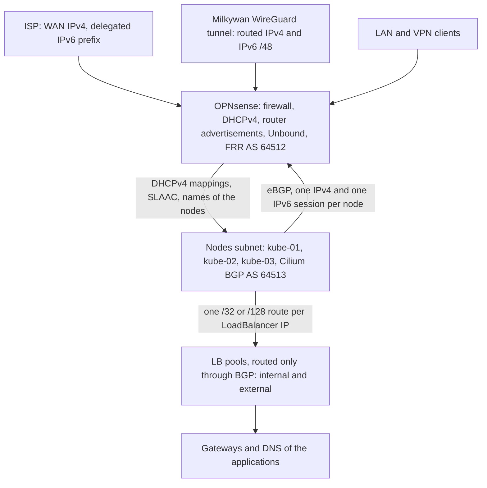

# Network

How the nodes are addressed and reached, and how OPNsense routes the cluster: DHCP and router advertisements, the names of the nodes, the firewall rules and the BGP sessions that advertise the LoadBalancer IPs. OPNsense is configured by hand, the cluster side is in `kubernetes/apps/kube-system/cilium/networking` (BGP sessions and LB pools) and `talos/` (the dynamic network of the nodes). The principles are [below](#principles).

| Document | Content |
| --- | --- |
| [bootstrap.md](bootstrap.md) | First configuration of OPNsense for the cluster (DHCP, DNS, firewall, BGP) and the network tests after the bootstrap. |
| [milkywan.md](milkywan.md) | Plan for the Milkywan WireGuard tunnel (stable public IPv4 and IPv6 /48) and the move of the `external` pool to it. |
| [lte-backup.md](lte-backup.md) | Plan for the LTE failover (Mikrotik modem, SIM, OPNsense gateway group) and for what the cluster does while it runs on it. |
| [runbook.md](runbook.md) | Day-to-day: what to update when the ISP delegates a new IPv6 prefix. |
| [evaluations.md](evaluations.md) | The choices considered, and the points to check or watch. |

## Status

| Part | Tool | Status |
| --- | --- | --- |
| DHCP, router advertisements, names of the nodes | OPNsense (DHCPv4, RA, Unbound) | Done for kube-01 and kube-03, [kube-02](../nodes/runbook.md#adding-kube-02) when `home` is migrated |
| Firewall | OPNsense | Done, the rules of the Gateways are in [ingress](../ingress/bootstrap.md#firewall) |
| BGP | FRR on OPNsense, Cilium BGP control plane | In use, [checklist](bootstrap.md#4-bgp-frr) |
| IPv6 prefix change | Procedure | [Written](runbook.md#ipv6-prefix-change), the prefix may change at any time (LAN only) |
| Stable public prefix | Milkywan WireGuard tunnel | Tunnel in place, the nodes subnet and the `external` pool use its /48 ([plan](milkywan.md)). Left: DNS ([open points](evaluations.md#open-points)) |
| LTE backup | Mikrotik modem, OPNsense gateway group | Planned ([plan](lte-backup.md)) |

## Overview

The nodes get their addresses from OPNsense and open the BGP sessions towards it. OPNsense then knows which node to send the traffic of each LoadBalancer IP to, whether it comes from the LAN or from the internet ([ingress](../ingress/README.md#overview)).

## Principles

- **Everything dynamic, FQDN wherever possible**: DHCPv4 static mappings, SLAAC with EUI-64 addresses, `ntp-01.shelltopia.net`, `ups-01-dmz.shelltopia.net`. The only exception is the LoadBalancer addresses of the cluster, all pinned and listed in the [reference](../reference.md#pinned-loadbalancer-addresses): Unbound only forwards to addresses (k8s-gateway), the OPNsense rules of the device VLANs target them (syslog), and a Service left dynamic could take the address that another one pins ([conventions](../conventions.md#loadbalancer-addresses)).
- **The ISP GUA prefix may change**: only the LAN subnets use it, and it is never used in the configs of the cluster. The nodes subnet and the `external` LB pool use the stable Milkywan /48 ([Milkywan](milkywan.md)), everything else the ULA prefix ([prefix change](runbook.md#ipv6-prefix-change)).
- Node names have **A and AAAA records** (IPv4 and ULA) with their PTR. Clients prefer IPv4 (RFC 6724 ranks ULA below IPv4) until the nodes get a stable GUA.
- Cluster endpoint: DNS round-robin `kubecluster-01.shelltopia.net` (one AAAA per node).
- OPNsense filters everything entering the nodes subnet: no Talos ingress firewall ([nodes](../nodes/README.md#decisions)). The traffic of the pods to the nodes and to the LAN is filtered by the Cilium network policies ([cluster](../cluster/README.md#network-policies)).

## Nodes subnet

Nodes subnet: `192.168.15.0/24`, `fd38:4c4d:8f66:f::/64` (ULA) and `2a0e:e701:2132:f::/64` (GUA, from the Milkywan /48, static on OPNsense). Talos configures it dynamically, no address is hardcoded in the machine configuration:

- DHCPv4: IPv4 address, gateway, DNS server and domain name;
- router advertisements: SLAAC with EUI-64 addresses for the ULA and GUA prefixes, RDNSS.

The nodes have **no search domain**: Talos drops the domain name of DHCP and does not derive one from its FQDN (`ResolverConfig` in `talos/patches/network.yaml.j2`). The kubelet copies the search domains of the node into every pod, and `shelltopia.net` there broke the Alpine images ([DNS](../dns/README.md#search-domain-and-musl)). Every name is used as an FQDN anyway.

The nodes are reached by name (`kube-0X.shelltopia.net`, `kubecluster-01.shelltopia.net`): the node names have A and AAAA records (IPv4 and ULA), the cluster endpoint AAAA records only. Inside the cluster, IPv4 is the primary family: the primary Kubernetes node IPs are the IPv4 addresses, the ULA addresses come second. etcd peers use both.

| Node | MAC address | Reserved IPv4 | ULA address (EUI-64) | Interface identifier (GUA alias) |
| --- | --- | --- | --- | --- |
| `kube-01` | `00:be:43:ef:c8:c9` | `192.168.15.11` | `fd38:4c4d:8f66:f:2be:43ff:feef:c8c9` | `::2be:43ff:feef:c8c9` |
| `kube-02` | `6c:3c:8c:18:d9:1b` | `192.168.15.12` | `fd38:4c4d:8f66:f:6e3c:8cff:fe18:d91b` | `::6e3c:8cff:fe18:d91b` |
| `kube-03` | `00:4e:01:98:9b:db` | `192.168.15.13` | `fd38:4c4d:8f66:f:24e:1ff:fe98:9bdb` | `::24e:1ff:fe98:9bdb` |

The IPv6 addresses are derived from the MAC addresses (EUI-64: `ff:fe` inserted in the middle, 7th bit of the first byte flipped). They are checked at the [first boot](../nodes/bootstrap.md#3-first-boot-in-maintenance-mode).

kube-02 is still the `home` host, which already uses this MAC address: create its records when it is migrated ([adding kube-02](../nodes/runbook.md#adding-kube-02)).

### Names

- Host overrides `kube-01` and `kube-03` in `shelltopia.net`: an **A record** (reserved IPv4) and an **AAAA record** (ULA address) of the table, with their PTR. The A records came with the first design of the Talos logs, which named the node from the PTR of the sender ([observability](../observability/evaluations.md#to-verify)); no longer needed for that, they stay: the IPv4 address of a node resolves back to its name.
- Host overrides **with the same name** `kubecluster-01.shelltopia.net`, one AAAA record per node (ULA address). This DNS round-robin is the `cluster.endpoint`.
- **Not** on Cloudflare: the Kubernetes and Talos APIs must stay internal.

The cluster endpoint needs no A record:

- `kubectl` and Flux connect to it from the workstation, over IPv6;
- on the nodes, the cluster endpoint is only resolved by KubePrism, through the Talos resolver, and the nodes have their ULA address;
- etcd, the kubelet and the pods use addresses, never these names.

`talosctl` reaches the nodes by their own names, which resolve to IPv4 first: the IPv4 rule of the administration subnets is then the one used ([firewall](bootstrap.md#3-firewall)).

Known limitation: when a node is down, `kubectl` may pick its address and wait for a timeout before retrying. Inside the cluster, KubePrism is used, so it is not affected.

## What does not change with a new prefix

The configuration was designed so that a prefix change has almost no impact:

- the ULA prefix `fd38:4c4d:8f66::/48` and every ULA address: node names, cluster endpoint, etcd, BGP sessions, `internal` LB pool, NAS, NTP, DNS;
- the cluster ranges (`fd1b:654d:9afe::/48`), never routed outside the cluster;
- the subnet IDs: OPNsense keeps the same prefix ID on each interface, only the first 56 bits change;
- the nodes subnet and the `external` LB pool, in the Milkywan /48 (`2a0e:e701:2132::/48`), which does not depend on the ISP.

What does change is listed in the [runbook](runbook.md#ipv6-prefix-change).

## BGP

The LoadBalancer IPs of the Services are advertised by every node to OPNsense with BGP (Cilium BGP control plane, `kubernetes/apps/kube-system/cilium/networking`):

- eBGP: OPNsense is AS **64512**, all the nodes share AS **64513**;
- one session per address family: IPv4 between the IPv4 addresses, IPv6 between the ULA addresses. The IPv6 peer is written as is (`fd38:4c4d:8f66:f::1`): the router advertisement gateways are link-local, which Cilium cannot use;
- the nodes open the sessions, OPNsense accepts any node of the subnet through listen ranges: no node address is configured on either side, kube-02 will peer without any change;
- the nodes advertise one /32 or /128 route per LoadBalancer IP, from these pools:

| Pool | IPv4 | IPv6 | Services |
| --- | --- | --- | --- |
| `internal` | `192.168.19.0/25` | `fd38:4c4d:8f66:13::/64` | default |
| `external` | `192.168.19.128/25` | `2a0e:e701:2132:13::/64` (GUA, from the Milkywan /48) | label `lbipam.shelltopia.net/pool: external` |

These prefixes are only routed through BGP: **do not assign them to any interface**, and do not use them anywhere else. Internet exposure is still decided by OPNsense ([ingress](../ingress/README.md#overview)).

- The inbound prefix lists are the protection against a wrong advertisement: anything outside the pools is ignored, so a mistake in the cluster cannot hijack another network. The outbound ones make sure OPNsense advertises nothing to the nodes (the OPNsense plugin disables the FRR default that requires a policy on eBGP sessions).
- No TCP MD5 password: it is cumbersome on FreeBSD, the listen ranges, the prefix lists and the firewall rule are enough on a dedicated subnet.
- With ECMP (*Max Paths* `3`, `net.route.multipath=1`), the traffic towards an IP advertised by several nodes is spread across them, and another node keeps receiving it within 9 seconds if one fails.

The configuration of OPNsense is in [bootstrap.md](bootstrap.md#4-bgp-frr).

## NAS: no asymmetric path

A host which reaches a LoadBalancer IP through OPNsense **with a source address of the nodes subnet** gets the answer directly from the node, so pf only sees one direction and is likely to drop the connection. The NAS is not affected as long as its only default routes (IPv4 and IPv6) are on its main interface (`192.168.14.0/24`): its requests then come from that interface and the answers go back through OPNsense.

- Static, non-EUI-64 ULA on the nodes subnet interface of the NAS.
- The secondary interface receives the router advertisements of the nodes subnet, which may add a second default route (`ip -6 route show default` must only list the main interface). TrueNAS accepts them even on an interface with a static configuration: they are disabled by a *Pre Init* command (*System → Advanced Settings → Init/Shutdown Scripts*, runs once the network is configured) such as `sysctl -w net.ipv6.conf.vlan15.accept_ra=0 && ip -6 route flush dev vlan15 proto ra && ip -6 addr flush dev vlan15 dynamic`.
- The router advertisements received before this command still create SLAAC addresses (removed by the last part) and update the lifetimes of a static address equal to the EUI-64 one, which would then expire: that is why the static ULA address is not the EUI-64 one.
