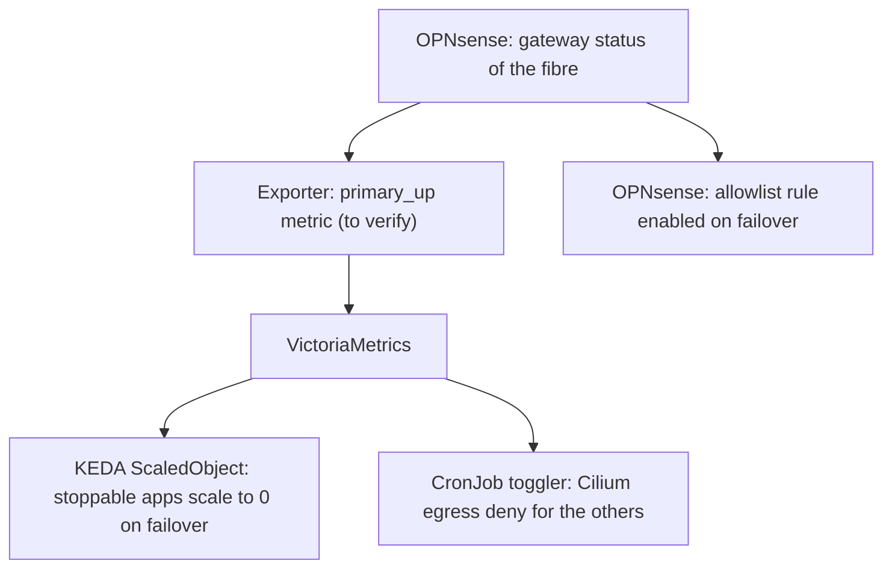

# Network: 4G backup

Plan to add a 4G (LTE) failover to the fibre connection with a Teltonika device, and to decide what the cluster does while it runs on it. Architecture: [README.md](README.md), tunnel: [milkywan.md](milkywan.md). The checkboxes track the work. Items marked **to verify** were not checked against the hardware, the shop or the operator terms.

## Decisions

- **LTE only.** 5G is useless for a backup, Cat 4 is enough. The throughput is limited by the signal, not by the category ([LTE category](#lte-category)).
- **The modem is only a modem** (Teltonika or MikroTik): bridge / IP passthrough mode, OPNsense does the routing, the NAT and the failover. The device does not route, so it does not decrement the TTL and does not NAT.
- **The tunnel rides on the 4G during a failover** ([milkywan.md](milkywan.md#decisions)): the nodes subnet keeps its stable public IPv4 and its /48, whatever the carrier does (CGNAT included). The **other subnets** (not in the tunnel) go out through the 4G with the carrier address, behind CGNAT, with no inbound connectivity and no stable address.
- **The cluster does not keep running as usual on the 4G.** The stateful applications that must not be reachable during a failover (Plex, ...) are stopped or cut, and the bulk traffic is limited ([workloads](#workloads-during-a-failover)). Mechanism: **KEDA (scale to 0) plus Cilium (`egressDeny`)**; the per-service list is decided during the [migration](../roadmap.md#migration).
- **Operator diversity.** The 4G should be on a different network than the fibre ISP, see [operators](#operators).

## Hardware

Teltonika supports a product 5 years after the end of production: 24 months of full security and bug fixes, then 36 months of critical security fixes and best-effort support ([EOL policy](https://teltonika-networks.com/support/eol-products)). Neither the RUT241 nor the TRB140 is on the EOL list and both are still sold. RutOS 7.24.7 (2026-10-27) covers them both. The device is only a modem in bridge mode, so an EOL announcement would not be urgent.

| Model | LTE | Ethernet | Notes |
| --- | --- | --- | --- |
| RUT241 | Cat 4 | 2 × 10/100 | Wi-Fi, newer platform than the TRB140 (first firmware 2022-02, kernel 5.15). Cheapest. **To verify**: price, variant (eSIM or not). |
| TRB140 | Cat 4 | 1 × Gigabit | No Wi-Fi, DIN rail, old platform (first firmware 2018-12, kernel 5.4). Ships with a magnetic antenna with a cable. **To verify**: price. |
| TRB160 | Cat 6 | 1 × Gigabit, USB Type-C | No Wi-Fi, 2 SMA connectors, 2 detachable magnetic antennas included. Newer than the TRB140 (firmware `TRB16_R`, listed since mid-2024, eSIM support, kernel 5.4.302 patched with RutOS 7.24.7 of 2026-10-27). **To verify**: price. |
| MikroTik KNOT Embedded LTE4 | Cat 4 (Quectel EC25-EU, 150/50 Mbit/s, 2x2 MIMO downlink, 1x1 uplink) | 1 × Gigabit with PoE-in (802.3af/at, 12-57 V) | RouterOS v7 (7.25.1 stable on 2026-11), license level 3, ARM Cortex-A7 800 MHz, 256 MB RAM. Nano SIM + eSIM (MikroTik Connectivity). LTE bands 1, 3, 7, 8, 20, 28A, 38, 40, 41 (covers B20 and B3). DIN rail, USB-C 5 V adapter included. **No antennas included** ([antennas](#antennas)). Suggested price $79, about 80 € found, about 95 € with two antennas. **Ordered** (2026-11). Updates for the life of the product or at least 5 years from the purchase. **Known issue: LTE passthrough** (see [below](#if-mikrotik-knot-embedded-lte4)). |
| RUT361 | Cat 6 | **To verify** | Replaces the RUT360 (EOL since 2025-03), first firmware 2024-02. **To verify**: ports, price. |

Cat 6 over 10/100 ports is limited to 100 Mbit/s, which is enough for a backup.

- [x] **Choose the model** (target: 200 € or less, TTC). KNOT Embedded LTE4 ordered (2026-11) with 2 × Teltonika PR1US440 antennas ([antennas](#antennas)).
- [x] **Check in the datasheet** the antenna connectors and the passthrough mode. Three SMA connectors (`MAIN`, `DIV`, `GNSS`, the GNSS one is SMA female per the [manual](https://help.mikrotik.com/docs/spaces/UM/pages/366477381/KNOT+Embedded+LTE4+EC25-EU+KNe)), MikroTik sells SMA male antennas for it. Passthrough is supported but has a [known issue](#if-mikrotik-knot-embedded-lte4). IPv6 passthrough is not needed: the failover is IPv4 only ([IPv4 only](#ipv4-only-failover)).

## IPv4-only failover

The mobile operator delegates a single /64, which cannot be split across several subnets. The 4G interface is therefore **IPv4 only** (CGNAT address in passthrough mode):

- **Nodes subnet**: nothing is lost. The WireGuard endpoint has an `A` record, so the tunnel comes up over IPv4 through the 4G, and the IPv6 /48 and the public IPv4 travel inside it.
- **Other subnets**: no IPv6 during a failover (the ISP prefix is gone). Clients that still hold the ISP prefix will try IPv6 first and time out before falling back to IPv4. **To test**: whether the IPv6 rules of these subnets should reject quickly (instead of dropping) when the fibre is down.
- The WireGuard handshake leaves with the IPv4 address of the 4G interface, so the source address problem of the IPv6 handshake ([milkywan.md](milkywan.md#1-wireguard-tunnel)) does not apply to it.
- [ ] **Endpoint family.** The endpoint hostname has an `A` and an `AAAA` record, and WireGuard resolves it when the peer is configured: if it picked the `AAAA`, the handshake would keep targeting an IPv6 address that the 4G cannot reach. **To verify** what the peer does during a failover test. If it stays on IPv6, put the IPv4 address of the endpoint (checked with Milkywan that it is stable) in the peer instead of the hostname: the handshake is then IPv4 on both paths, and the IPv6 source address workaround of the WAN ([milkywan.md](milkywan.md#1-wireguard-tunnel)) is no longer needed.

## SIM and operator

- A second SIM of the existing mobile plan (Sosh *Multi-SIM Internet +1Go*): its terms say the SIM is usable "in a compatible device such as a smartphone, tablet or modem", with the data of the main plan plus 1 GB, "in the same conditions as the main plan". The general terms of the subscription do not mention box or router use.
- The user plans to move to B&You (Bouygues). Its general terms seem to allow the use (**not read in full**).
- [ ] **Read the terms of the B&You multi-SIM / extra SIM** for modem or router use and tethering limits.
- [ ] **Check the fair-use limit** of the plan and set a data limit in the Teltonika device **well above it**: a hard cut would also kill the tunnel.

### Operators

The fibre ISP (Red by SFR, being split up) and the mobile operator (Sosh, Orange network) are different today. A bundle with the same operator (B&You mobile + Bouygues fibre) would be cheaper, but the 4G would then share more with the fibre:

- **Rarely correlated**: the usual fibre outages are local (cut cable, a problem in the street cabinet or at the NRO) and do not affect the mobile network. They are the main reason to have a backup.
- **Correlated with the same operator**: a national incident of the operator (core, authentication, DNS, IT), a regional outage, or a power cut (the fibre and the nearby antennas are both affected, the antennas have batteries for a limited time).
- **Network and signal**: the NetMonster measures above are on Orange. A different mobile operator means **another measurement at the rack** before the purchase (a SIM or the phone of someone on that network).
- The fibre infrastructure is shared between ISPs in France (street cabinets, NRO), so changing the fibre ISP does not change the physical path anyway.

The diversity is a plus, not a requirement: choose the bundle if the saving is significant **and** the signal of that operator is at least as good at the rack.

### Tethering detection

Carriers detect connection sharing in several ways. TTL / hop limit is only the most common:

- the TTL (IPv4) and hop limit (IPv6) of the packets, decremented once more when a router sits behind the phone;
- the device fingerprint: the IMEI and its TAC (the type of device), a SIM used in a router when it is sold for a phone;
- deep inspection of the traffic: user agents, operating system specific services (Windows or Linux updates, telemetry), several clients behind the same address;
- DNS and NTP behaviour of the devices behind the NAT;
- volume and pattern: a sustained heavy bandwidth use, constant 24/7 traffic;
- the IPv6 prefix delegation (a /64 handed out to a downstream router).

Only the WireGuard UDP of OPNsense crosses the 4G when the device is in bridge mode: the payload is opaque, the TTL is the one of OPNsense (set `net.inet.ip.ttl=65` if it is wanted to look like a hop away), and the visible signals are the volume and the pattern. The LAN traffic through the 4G failover is NAT'd by OPNsense, so it is also one host from the carrier's point of view. Keep the failover traffic small ([workloads](#workloads-during-a-failover)).

## Signal and antenna

The rack is a small 4U 19" rack on the sideboard of the living room, a few metres from the windows. The KNOT sits on a shelf in the top U. All the windows face the same side of the building.

Measures with a Pixel 8 Pro (NetMonster, then a second app), Orange, serving cell eNB 39352 CID 7 (PCI 215, B3, EARFCN 1300), TA 17 (about 1.3 km; the second app shows 2.4 km with another conversion). The Pixel has a Samsung Exynos modem: NetMonster warns that the values may be inaccurate, read them as trends. The KNOT will give its own values.

| Spot | Time | B3 RSRP | B3 RSRQ | B3 SINR | B20 RSRP / RSRQ |
| --- | --- | --- | --- | --- | --- |
| Rack | 22:11 | -108 dBm | -18 dB | -6 dB (CQI 4) | -97 dBm / -17 dB |
| Window 1 | 01:46 | -102 dBm | -15 dB | 4 dB (CQI 7) | -93 dBm / -17 dB |
| Window 2 | 01:47 | -101 dBm | -12 dB | 7 dB (CQI 8) | -93 dBm / -16 dB |
| Side of the rack | 02:05 | -110 dBm | -11 dB | 8 dB | - |
| KNOT spot (top shelf) | 02:05 | -109 dBm | -12 dB | 7 dB | - |

B1 (2100) and B7 (2600): -116 dBm at the rack (22:11).

- **Limited by interference, not by power.** Other cells on the same frequency arrive at about the level of the serving cell: B3 PCI 60 and 109 at -110 dBm (22:11), B20 PCI 397, 62 and 468 at -94/-96 dBm with RSRQ -19 dB. An omni antenna with more gain raises the signal and the interference alike.
- **The window gains about 8 dB of RSRP on B3 (4 dB on B20), but no SINR** at the same time of night. Minus the loss of a 3 m RG174 cable (2-3 dB around 1800-2600 MHz), about 5 dB net: not worth a cable across the ceiling or around the room.
- **The time of day matters more than the spot.** At the rack, the SINR goes from -6 dB at 22:11 to +7/8 dB at 02:05 (load of the neighbour cells). Expect much less in the evening.
- **The side of the rack and the KNOT spot are the same**: antennas with a cable next to the rack bring nothing over antennas screwed on the KNOT.
- cartoradio shows closer Orange sites in the direction of the windows, but the phone camps on this one (sector orientation or obstacles, nothing to do about it).

Expected throughput of the KNOT (Cat 4, one carrier, an estimate from these values, **to verify** with the device):

| | Night (SINR ~7 dB) | Evening (SINR ~-6 dB) |
| --- | --- | --- |
| Download | ~15-30 Mbit/s | ~2-5 Mbit/s |
| Upload | a few Mbit/s | ~1-3 Mbit/s |

Needs during a failover: Nextcloud and Immich through the tunnel, where the upload of the home is the limit (2-5 Mbit/s is enough to browse and open files, a large photo sync will be slow), and now and then the PC with YouTube (about 2.5 Mbit/s for 720p, 5 Mbit/s for 1080p), not at the same time. The bulk services are cut ([workloads](#workloads-during-a-failover)). It should fit most of the time, with YouTube in 720p or 480p at peak hours.

- [ ] **Antennas.** 2 × PR1US440 screwed on `MAIN` and `DIV`, in a V shape (different orientations, as the manual recommends), above the metal of the rack if the shelf allows it. No window or cable run is wanted. Fallback if the evening throughput is not enough: a Teltonika PR1KCL25 on window 2 (about 5 dB net, see above). Beyond that, only an outdoor antenna would help, which is not possible here.
- [ ] **Placement.** Measure with `/interface/lte/monitor` at the final spot, in the evening (20:00-22:00) and at night, with a speed test each time.
- [ ] **Band lock.** Compare B3 and B20 on the device. B20 has the strongest RSRP but only 10 MHz and many co-channel neighbours (RSRQ -16 to -19 dB); B3 has 20 MHz and a better RSRQ at night. Probably B3, the test decides. Locking avoids hopping to the weaker band.

### LTE category

A higher category would not help much here:

- **Cat 6** adds 2-carrier aggregation on the downlink, probably B3 (20 MHz) + B20 (10 MHz) here: at best +30-50 % download. No gain on the SINR of each carrier, **no gain on the upload** (one uplink carrier), and the same RouterOS passthrough bug on a MikroTik (reported on an R11e-LTE6).
- **Cat 12 and above** add 3-5 carriers (B1 and B7 are too weak indoors, -116 dBm), 256QAM (needs a SINR of about 20 dB or more), 4x4 MIMO (4 antennas and a good SINR) and uplink aggregation: none of it would be used with this signal.

### Antennas

Chosen: **2 × Teltonika PR1US440** (about 3-5 € each): 698-960 and 1710-2690 MHz (all the bands of the EC25-EU and of the EG25-G), 4.0 dBi (3 dBi at some resellers), VSWR 3.0, SMA male, screwed directly on the KNOT (no cable loss).

Rejected:

| Antenna | Why |
| --- | --- |
| Teltonika PR1KS210 (mobile magnetic) | 699-868 and 1850-2690 MHz: misses **B3** (1710-1880) and B8 (880-960). 1 dBi, eaten by its 3 m RG174 cable. One antenna, 2 needed for the MIMO. |
| Teltonika PR1US540 | Fits (617-960, 1410-1610, 1710-2690, 3300-7125 MHz, 4.5 dBi, SMA male), but a 5G wideband design: the bands above 2690 MHz are useless for the KNOT and the gain figure is a peak over all the bands. |
| Teltonika PR1KS536 (5G magnetic) | Fits (617-960, 1400-2690, 3300-5900 MHz, 3.6 dBi), but 18 cm high, 2 needed, and a 1.5 m RG-58 cable (most resellers) that brings nothing at the rack. |
| Teltonika PR1KCL25 (combo MIMO roof) | Fits (698-960, 1710-2690 MHz, 2.5 / 2.0 dBi, 2 × 3 m RG174, SMA male, about 80 × 15 mm). Only useful at a window: kept as the fallback. |
| MikroTik mANT LTE 5o | 699-2690 MHz, 5 dBi, 2x2 cross-polarised, used on a KNOT by a [forum user](https://forum.mikrotik.com/t/knot-embedded-lte4-antenna-ports/268480) (95/28 Mbit/s indoors). Too big (129 × 129 × 34 mm), SMA female, needs 2 × SMASMA cables. |
| MikroTik HGO-LTE-W | Fits (699-3800 MHz, 1.5-4 dBi, SMA male per MikroTik, some resellers say RP-SMA), listed in the KNOT manual. White and bulky. |
| MikroTik LGO-LTE-W | Recommended by MikroTik for the KNOT (617-5925 MHz, 3 dBi, SMA male), not found in France. |

## 1. Teltonika

- [ ] **Firmware.** Update RutOS, disable the cloud features that are not used (RMS optional).
- [ ] **SIM and APN.** PIN, APN of the operator, *Mobile data limit* above the fair-use limit.
- [ ] **Passthrough mode.** *Network → Mobile → General → Mode*: *Passthrough* (bridge), with the MAC address of the OPNsense interface. DHCP lease: short, so a new IP is picked up quickly.
- [ ] **Reboot on failure.** *Ping Reboot* or the connection watchdog of the device, towards a public IP.
- [ ] **SNMP or Modbus.** Optional, only if the signal (RSRP) must be monitored: **to verify**.
- [ ] **Power.** On the UPS (Eaton Ellipse Pro 1600) through a PoE injector or a 9-30 V adapter, according to the model.

### If MikroTik (KNOT Embedded LTE4)

**Known issue with LTE passthrough** ([forum thread](https://forum.mikrotik.com/t/knot-embedded-lte4-lte-passthrough-dhcp-stops-working/268546), Feb-Oct 2026):

- passthrough works after a boot, but when the LTE link goes down and up again (an interface toggle, or a network-side PDN deactivation), the host no longer gets the new IP and the connectivity is lost;
- RouterOS 7.22.1 stopped the DHCP server from disappearing, but the lease still kept the old IP; a user went back to the long-term channel;
- another user reports the same on an R11e-LTE6 with RouterOS 7.23.7 (2026-10-01): only a reboot (ping watchdog) or toggling the passthrough interface recovers;
- workarounds seen: a scheduled script that toggles the passthrough interface, a reboot watchdog. **The RouterOS changelogs from 7.22 to 7.25.1 (2026-11-02) contain no entry that fixes it** (7.22 *do not flap LTE passthrough assigned interface on modem link state change* is the change that exposed it; 7.23 only touches passthrough for IPv6-only setups and VLANs on Chateau 5G). Not tested on a device. Other points of the same changelogs for the EC25-EU&KNe modem: 7.23.2 *EC25-EU and EG25-G boards would receive packets with missing last 4 bytes*, 7.23.6 and 7.24.3 deleted the modem firmware (fixed in 7.23.7 and 7.24.4, needs a modem firmware update). Update with care, read the changelog first.
- **Fixes in the development channel only** (not in 7.25.1 stable/testing, nor in long-term 7.23.8 and 7.24.6): 7.26beta1 *lte - fix passthrough cleanup when the lte link goes down for QMI modems*, and 7.26beta3 *fix QMI modems waiting out the full link-recovery-timer after re-attaching* (120 s by default). The KNOT modem is driven over QMI (log `lte1 qmi: qmux0` of a KNOT EC25-EU in [this thread](https://forum.mikrotik.com/t/lte-link-flaps/271622), which also shows the 120 s gap), so both fixes apply to it. No user has confirmed them yet. The same thread reports LTE flaps about every 2 hours on a KNOT.

For a backup that sits idle and must come back by itself after any link drop, this is the main risk of the KNOT. Two options:

1. **Routed mode (NAT on the KNOT) instead of passthrough.** The KNOT gets its IP from the LTE (default route on `lte1`, masquerade), OPNsense uses a gateway on the KNOT LAN address, and the KNOT reconnects on its own. It adds a NAT layer for what crosses the 4G (OPNsense NAT, then the KNOT, then the carrier CGNAT): harmless for the WireGuard UDP, but **visible for the LAN clients** if they go out through the 4G directly (UPnP, peer-to-peer, gaming, WebRTC, VoIP; most of it is already broken by the CGNAT). That impact disappears if the LAN goes through the tunnel during a failover ([LAN rules](#2-opnsense)). Add a mangle rule that raises the TTL of the forwarded packets ([tethering detection](#tethering-detection)). **To verify** on the device.
2. **Passthrough**, only if a link-flap test passes ([tests](#tests)): on the current stable, or on 7.26 (beta, then stable) for the QMI fixes above.

The same steps in RouterOS (`/interface/lte`), **to verify on the device**:

- [ ] `/interface/lte/show-capabilities [find]`: `passthrough: yes`, otherwise the model does not fit the plan.
- [ ] **APN with passthrough:** `/interface/lte/apn/add apn=<apn> passthrough-interface=ether1 passthrough-mac=<MAC of the OPNsense port> ip-type=ipv4` (the manual: the modem firmware hands the IP configuration to the host, the router only configures the modem). Without `passthrough-mac`, the MAC of the first packet is learned. The default DHCP lease is 1 minute, it can be changed with a DHCP server on the same interface.
- [ ] **Band lock:** the `band` property of the LTE interface (`3` or `20`, compare both, see [signal](#signal-and-antenna)), check the result with `/interface/lte/monitor` (primary band, RSRP, RSRQ, SINR).
- [ ] **Management address** on `ether1` to reach the device in passthrough mode (an address on a small dedicated subnet, with an alias on the OPNsense side): **to verify**.
- [ ] **Antennas:** the device ships without any. Its three SMA connectors are `MAIN`, `DIV` and `GNSS`: the two PR1US440 (2x2 MIMO) go on `MAIN` and `DIV`, in a V shape, the GNSS one stays unused ([antennas](#antennas)). Keep them above the metal of the rack and away from the UPS. Lock the band ([above](#signal-and-antenna)) and measure the real throughput with the device.
- [ ] **Power:** the included 5 V USB-C adapter, on the UPS. PoE-in is not needed.

## 2. OPNsense

- [ ] **Interface `WAN_4G`.** Assign the port connected to the device, IPv4 DHCP only, IPv6 **None** ([IPv4 only](#ipv4-only-failover)). The handshake must leave over IPv4 ([endpoint family](#ipv4-only-failover)). On the modem, passthrough has a short DHCP lease by default (1 minute on RouterOS).
- [ ] **Gateway `WAN_4G_DHCP`.** Its own monitor IP (not the same as the other gateways), higher *Priority* (weight) than the fibre so that it is not used by default. Never set it as the default gateway by hand.
- [ ] **Gateway group.** `WAN_FAILOVER`: fibre in *Tier 1*, 4G in *Tier 2*, trigger *Member down* (or packet loss and latency).
- [ ] **Allow default gateway switching** (*System → Settings → General*), so that the locally generated traffic (the WireGuard handshake, DNS of Unbound) follows the 4G default route: a gateway group does not change the routing of the traffic originated by the firewall.
- [ ] **WireGuard endpoint.** The traffic to the Milkywan endpoint must be able to leave through both gateways.
- [ ] **LAN rules.** The rules of the subnets that are not in the tunnel use the `WAN_FAILOVER` group (one rule per family). Two ways to handle the fibre-down state, **to decide**:
  - **A. Direct through the 4G:** the group is fibre (Tier 1) and `WAN_4G` (Tier 2), with *NAT* to the address of the 4G interface (Outbound NAT in *Hybrid* mode). The clients are behind the carrier CGNAT (and the NAT of the modem in routed mode): no inbound, no stable address, and their traffic looks like tethering to the carrier.
  - **B. Through the Milkywan tunnel:** the group is fibre (Tier 1) and the `WG_MilkyWan` gateway (Tier 2), which itself rides on the 4G. The clients are NAT'd by OPNsense to `45.13.104.160` (extend the *Outbound NAT* rule of the tunnel to these subnets): a stable public IPv4, port forwardings keep working, the CGNAT and the modem NAT are invisible, and the carrier only sees one opaque UDP flow (nothing to detect). Costs: IPv4 only, the tunnel overhead (MSS), the throughput and the policy of the Milkywan service (**to check**), and all the LAN traffic still uses the 4G data.
- [ ] **Nodes subnet.** The rules that use the tunnel gateway are unchanged: the tunnel is the same, only its path changes.
- [ ] **Default routes.** After a failover: a single line each in `netstat -rn | grep default` and `netstat -rn -f inet6 | grep default` ([multi-WAN](evaluations.md#open-points)).
- [ ] **MTU.** The path MTU through the 4G ([milkywan.md](milkywan.md#6-tests)): ping with DF through the 4G with the fibre unplugged, lower the MTU of `wg2` and the MSS if 1420 does not fit.

## Workloads during a failover

Goal: when the fibre is down, the applications that must not stay reachable are stopped, and the bulk traffic (backups, image pulls) does not exhaust the data.



### Signal

The failover state must be a metric in VictoriaMetrics (`primary_up`, 1 when the fibre gateway is up, 0 otherwise).

- [ ] **Choose the source.** An exporter of the OPNsense gateway status (the community `opnsense-exporter`, deployed at [observability stage 5e](../observability/bootstrap.md#5-external-devices), exposes it: `opnsense_gateways_status`, per gateway `name`, 0 offline and 1 online), or the Teltonika SNMP.
- [ ] **Alert** on `primary_up == 0` for a few minutes ([observability](../observability/README.md)).

### Stop the applications: KEDA (**prerequisite: KEDA is not deployed**)

Scale to 0 is the simplest way to make Plex and the other stateful applications unreachable: nothing listens and nothing sends. Remove `replicas` from the Flux / Helm values of the application to avoid a fight with KEDA.

Example (not applied, the metric and the address are to adapt):

```yaml
apiVersion: keda.sh/v1alpha1
kind: ScaledObject
metadata:
  name: plex
  namespace: media
spec:
  scaleTargetRef:
    name: plex
  minReplicaCount: 0
  maxReplicaCount: 1
  fallback:
    failureThreshold: 3
    replicas: 1
  triggers:
    - type: prometheus
      metadata:
        serverAddress: http://vmselect.observability.svc:8481/select/0/prometheus
        query: max(primary_up)
        threshold: "1"
        activationThreshold: "0.5"
```

Check which `fallback.replicas` is wanted when the metric is unavailable: here the application keeps running, because a broken exporter must not stop everything.

- [ ] **Deploy KEDA** (new app under `kubernetes/apps/`, see [conventions](../conventions.md)).
- [ ] **List the applications to stop** (Plex confirmed) and the ones that stay.
- [ ] **StatefulSets and volumes.** Check that scale to 0 is harmless for each (RWO volumes, VolSync, CNPG: do **not** scale a CNPG cluster to 0 with KEDA).

### Cut the egress: Cilium (for what stays running)

Cilium policies are not dynamic. A `CiliumClusterwideNetworkPolicy` with an `egressDeny` to `world` for a label is **created and deleted by a small toggler** (a CronJob that queries VictoriaMetrics and runs `kubectl`, with a minimal RBAC). Cilium is stateful: the replies to the connections already established from outside keep working.

Skeleton of the policy (not applied):

```yaml
apiVersion: cilium.io/v2
kind: CiliumClusterwideNetworkPolicy
metadata:
  name: failover-deny-world
spec:
  endpointSelector:
    matchLabels:
      failover.shelltopia.net/deny-egress: "true"
  egressDeny:
    - toEntities:
        - world
```

- [ ] **Decide** whether this layer is needed, or if KEDA is enough.
- [ ] **Toggler.** CronJob (every minute) + ServiceAccount, Role to create and delete the policy only. Deleted when `primary_up` is 1.

### OPNsense safety net

OPNsense only sees the IPs of the nodes (masquerade), so its filtering is coarse. Options (**to verify** on the version in use):

- an **allowlist** egress rule of the nodes subnet, enabled only on failover, by a script triggered by the gateway alarm (a *syshook* in `monitor`) or by the API;
- or, without a script: the bulk traffic rules pinned to the fibre gateway with *Skip rules when gateway is down* (this changes the design: IPv4 NAT only, no stable address for these flows).

### Other effects

- **Spegel**: the images are already on the nodes, a new image will be pulled through the 4G.
- **CNPG WAL**: the archiving to B2 is delayed, watch the disk of the nodes.
- **VolSync / restic**: the backups fail or are slow, they retry. Schedule or suspend them during a failover if the data is a concern.
- **Data limit** of the Teltonika: see [SIM](#sim-and-operator).

## Tests

- [ ] **Failover.** Unplug the fibre: the gateway goes down, the WireGuard handshake is renewed through the 4G, the ingress of the `external` Gateway works over IPv4 and IPv6.
- [ ] **Egress.** From a pod: `curl -4 https://ifconfig.co` shows `45.13.104.160`. From a LAN host (not in the tunnel): the carrier address.
- [ ] **Routes.** `netstat -rn | grep default` and the IPv6 one: a single line each, during the failover and after the fibre comes back.
- [ ] **Failback.** The fibre comes back, the traffic returns to it (the tunnel keeps its state), the stopped applications start again.
- [ ] **Workloads.** Plex and the others are stopped within the expected delay, and not reachable from outside.
- [ ] **UPS.** The modem keeps running on battery.
- [ ] **Throughput and latency** on the 4G at the final antenna position, in the evening and at night ([expected values](#signal-and-antenna)), MTU ([OPNsense](#2-opnsense)).
- [ ] **Link flap** (modem): disable and enable the LTE interface, then pull and reinsert the SIM; the OPNsense gateway must come back **without** any manual action, within a few minutes. Repeat after a long idle period (a day) and check the log for network-side deactivations (`PDN DEACT`). On the KNOT: run it on the current stable and on 7.26 ([known issue](#if-mikrotik-knot-embedded-lte4)).
