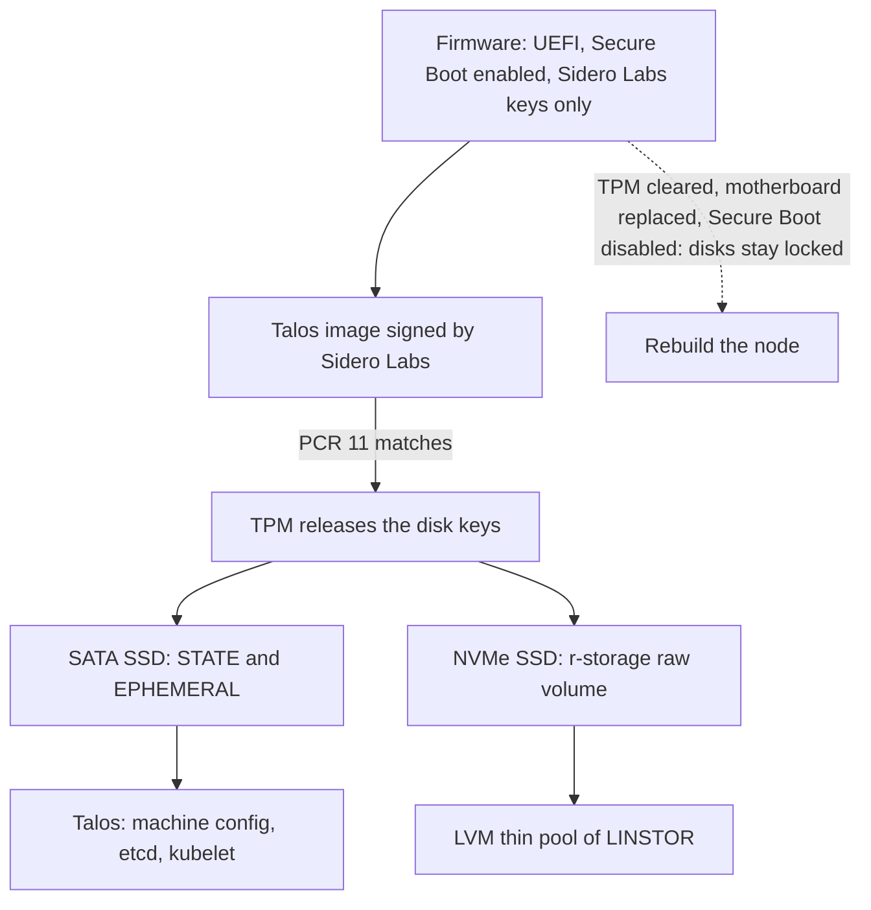

# Nodes: Talos

The machines of the cluster: hardware, BIOS, Secure Boot, disk encryption and the Talos image. The machine configuration is in `talos/` (`vars.yaml`, `nodes/`, `patches/`, `schematic.yaml`), driven by the `just talos` recipes. The decisions are [below](#decisions).

| Document | Content |
| --- | --- |
| [bootstrap.md](bootstrap.md) | First installation: BIOS, ISO, first boot in maintenance mode, checks of the nodes after the cluster bootstrap. |
| [runbook.md](runbook.md) | Day-to-day: adding kube-02, rebuilding a node, power outage and shutdown, starting over. |
| [evaluations.md](evaluations.md) | The disk selectors, the tooling that was set aside, the remote management study, and the points to watch. |

## Status

| Part | Status |
| --- | --- |
| Talos machine configs | Done: Secure Boot, TPM disk encryption, disks and NIC selectors, dynamic network, NTP, NUT, watchdog, i915, DRBD, image verification |
| kube-01, kube-03 | Installed, first bootstrap in progress with these two nodes only ([test phase](#test-phase-2-nodes)) |
| kube-02 | Still the `home` host managed by Ansible, [to add](runbook.md#adding-kube-02) once it is migrated |
| Secure Boot, watchdog | [To check](bootstrap.md#1-hardware-and-bios) on each node |
| Remote power cycle and console | [To study](evaluations.md#remote-node-management) |

## Test phase: 2 nodes

kube-02 is still the `home` host managed by Ansible. The cluster is first built and tested with **kube-01 and kube-03 only**: kube-02 is commented out in `talos/vars.yaml`, so the bootstrap recipes ignore it.

Be aware that an etcd cluster with 2 members has **no fault tolerance**: the quorum is 2, so as soon as one node is down (reboot, upgrade, failure), etcd and the Kubernetes API are unavailable until it comes back. Each Talos upgrade made by tuppr makes the API unavailable during the reboot of the node. This is fine for testing, not for production: the third node restores the tolerance to one failure ([adding kube-02](runbook.md#adding-kube-02)).

## Hardware

| Node | Machine | System disk (SATA, WWID) | Storage disk (NVMe, serial) | NIC | MAC address |
| --- | --- | --- | --- | --- | --- |
| `kube-01` | OptiPlex 3000 Micro | `naa.500a0751e88e1e24` | `2535527309AF` | RTL8111 (`r8169`) | `00:be:43:ef:c8:c9` |
| `kube-02` | OptiPlex 3000 Micro | TODO | TODO | RTL8111 (`r8169`) | `6c:3c:8c:18:d9:1b` |
| `kube-03` | OptiPlex 3060 Micro | `naa.500a07510df503c3` | `24444BCBA81D` | I219-LM (`e1000e`) | `00:4e:01:98:9b:db` |

Talos is installed on the SATA SSD, selected by WWID, and the `lan0` link is the onboard NIC, selected by its permanent MAC address. Both are set in `talos/nodes/kube-0X.yaml`. The NVMe SSD, selected by serial number, holds a single raw volume (`r-storage` partition spanning the whole disk, encrypted by the TPM, not formatted) for the storage solution (Piraeus/LINSTOR, LVM thin pool), see `talos/patches/storage.yaml` and [storage](../storage/README.md). Why WWID and not serial: [evaluations](evaluations.md#disk-selectors).

The addresses of the nodes are in [network](../network/README.md#nodes-subnet).

## Secure Boot and encryption

The Talos ISO enrolls the Sidero Labs keys automatically (`secureboot.enrollKeys: force` in `talos/schematic.yaml`) **without the Microsoft certificates**: once enrolled, the machine only boots images signed by Sidero Labs. Option ROMs signed by Microsoft (discrete GPU, add-on NIC) would no longer load. The onboard devices of these machines are part of the firmware, they are not affected. To boot anything else again (e.g. a Fedora live USB), restore the factory keys in the BIOS.

STATE, EPHEMERAL and the NVMe raw volume (`r-storage`) are encrypted by the TPM, bound to PCR 11 only (`pcrs: []`): firmware and dbx updates do not lock the disks. The disks are unlocked as long as the machine boots a Talos image signed by Sidero Labs with Secure Boot enabled. A node whose TPM can no longer unlock its disks is [rebuilt](runbook.md#rebuilding-a-node): the data is replicated elsewhere.

## Decisions

- Talos configs: plain machine config documents templated with minijinja, secrets resolved by `op inject` ([secrets](../secrets/README.md)). No talhelper (unmaintained), no Omni, no Cluster API, no Terraform provider for Talos.
- Secure Boot with the Sidero Labs keys, enrolled automatically by the ISO, **without** the Microsoft certificates.
- Disks selected by unique hardware identifier: WWID for the SATA SSDs (Talos leaves their serial empty), serial number for the NVMe SSDs. NIC selected by permanent MAC address (`lan0` alias).
- SATA SSD: Talos only (default layout). NVMe SSD: one unformatted encrypted partition, used whole as the LVM thin pool of LINSTOR (replicated and local volumes share it, no fixed split).
- No swap, no zswap. Weekly fstrim with `allowDiscards`, weekly XFS scrub.
- `watchdog0` (iTCO) armed, NUT client shutting down 90 s after the UPS goes on battery.
- No Talos ingress firewall: OPNsense filters everything entering the nodes subnet. Pod ↔ node isolation comes from the Cilium host firewall ([cluster](../cluster/README.md#network-policies)).
- iGPU used on kube-01 and kube-02 only (`shelltopia.net/intel-gpu` label). The UHD 630 of kube-03 is not exposed.
