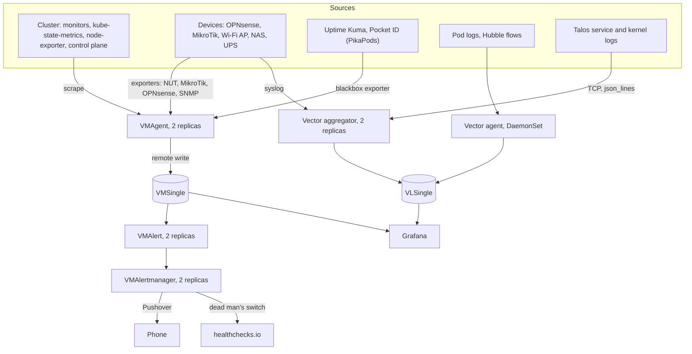

# Observability

What watches the cluster and the devices around it: metrics, logs, dashboards and alerts. Deployed in stages ([bootstrap.md](bootstrap.md)), tracked in the [status](#status) below.

| Document | Content |
| --- | --- |
| [bootstrap.md](bootstrap.md) | First deployment: prerequisites, then the steps in order (stages 1 to 4 run, the noise pass of stage 4 two weeks later, stage 5 written, to do). |
| [evaluations.md](evaluations.md) | What was considered or rejected, what is still to verify, and the open points. |

The manifests are in `kubernetes/apps/observability` and `kubernetes/apps/observability-agents` ([Pod Security](#network-and-pod-security)):

| Folder | Content |
| --- | --- |
| `observability/victoria-metrics-k8s-stack` | `app/`: the release of the [stack](#the-release-of-the-stack) (the VictoriaMetrics operator and its CRDs, `VMSingle`, `VLSingle`, `VMAgent`, `VMAlert` and its internal `VMAuth`, `VMAlertmanager`, kube-state-metrics, node-exporter deployed in `observability-agents`, the data sources of Grafana, the default rules and dashboards, the mixins of the [alerting](#alerting)) and the ExternalSecret of the Alertmanager. `config/`: the second Flux Kustomization (`victoria-metrics-k8s-stack-config`), the etcd scrape and the LogsQL rules (`VMRule`). |
| `observability/grafana` | Grafana, its own release ([Grafana](#grafana)): the OIDC login, its ExternalSecret, its route, the `volsync` component for its volume, the community dashboards and the dashboards of this repository (`app/dashboards/`). |
| `observability/prometheus-operator-crds` | The CRDs of the Prometheus operator (`ServiceMonitor`, `PodMonitor`, `PrometheusRule`), for the monitors that the other charts create. |
| `observability/vector-aggregator` | The Vector aggregator: the syslog of the devices (stage 3), their `host` normalized, the firewall logs parsed and the per-host counter (stage 5). |
| `observability/nut-exporter`, `observability/mktxp`, `observability/opnsense-exporter`, `observability/snmp-exporter`, `observability/blackbox-exporter` | The exporters of the [external devices](#external-devices) (stage 5): the UPS, the MikroTik devices, the OPNsense API, the access point, the HTTP checks. |
| `observability-agents` | The namespace of the agents reading the nodes (`privileged`). node-exporter is deployed there by the release of the stack. |
| `observability-agents/vector-agent` | The Vector agent, on every node: the pod logs, the Hubble flows and the Talos logs of its node (stage 3). |

`prometheus-operator-crds` is also listed in `bootstrap/helmfile/crds.yaml.gotmpl`, so that the other applications can enable their monitors without `dependsOn` ([cluster](../cluster/README.md#overview)). Its CRDs are in the `templates/` of the chart: the helm-controller takes over those applied by `just bootstrap crds` (Flux leaves `install.disableTakeOwnership` to false), and `helm.sh/resource-policy: keep` keeps them if the release is ever uninstalled. The VictoriaMetrics CRDs come with the stack: the manifests of the repository that use them (etcd scrape, `VMRule`s) are in the second Kustomization, which depends on the release ([conventions](../conventions.md#flux-kustomizations)). The monitors of the other applications go next to them (the Flux controllers next to `flux-instance`, LINSTOR next to the `LinstorCluster`, Envoy Gateway next to its release), and so do their alert rules (`prometheusrule.yaml`, [alerting](#alerting)).

## Status

| Part | Tool | Status |
| --- | --- | --- |
| Metrics | `victoria-metrics-k8s-stack`: operator, `VMSingle`, `VMAgent`, kube-state-metrics, node-exporter | Deployed (stage 2) |
| Logs | `VLSingle` (from the stack), Vector agent and aggregator | Deployed (stage 3) |
| Dashboards | Grafana (its own release): the default dashboards of the stack, community dashboards pinned by revision, the dashboards of the repository | Deployed (stage 2) |
| Alerting | `VMAlert` and `VMAlertmanager` (from the stack), Pushover, dead man's switch to healthchecks.io | `VMAlertmanager` and Pushover deployed (stage 1). `VMAlert`, the default rules and the dead man's switch deployed (stage 4a). The rules of the repository, the mixins and the Piraeus rules deployed (stage 4b). The noise pass two weeks later |
| Flux alerts | Rules of `vmalert` on the metrics of the flux-operator (`flux_resource_info`) | Rules deployed with stage 4a. The events of the notification-controller (stage 1) removed |
| Cluster scrape targets | From the stack: kubelet, cAdvisor, API server, scheduler, controller-manager, kube-state-metrics, node-exporter. By hand: etcd (`VMNodeScrape`). Monitors of the charts: Cilium agent, Cilium operator and Hubble, CoreDNS, cert-manager, External Secrets, flux-operator, Spegel, Reloader, external-dns, k8s-gateway, VolSync. Next to the applications: the Flux controllers (`PodMonitor`), Piraeus (LINSTOR controller, satellites and drbd-reactor, affinity controller), Envoy Gateway (controller and proxies). The Vector agent and aggregator (`podMonitor` of their chart) | Deployed (stage 2). Vector deployed (stage 3) |
| Talos logs, Hubble flows | Vector, `machine.logging`, `KmsgLogConfig`, `hubble.export` | Hubble export in place. Talos destinations applied on both nodes, to the agent of the node (stage 3) |
| External devices | `nut_exporter`, MKTXP, `os-node_exporter` and `opnsense-exporter`, `snmp_exporter`, `blackbox_exporter`, syslog to the aggregator | The NAS syslog, the UPS, the MikroTik switch and OPNsense deployed (stages 5b to 5e). The access point and the HTTP checks written (stages 5f and 5g). The others decided, steps written ([stage 5](bootstrap.md#5-external-devices)), [to verify](evaluations.md#to-verify) per device. The NAS metrics deferred |

## Overview

## Objectives

- Metrics and logs of the cluster (Kubernetes, Cilium, Flux, LINSTOR and DRBD, certificates, VolSync), of the Talos nodes, and of the devices: OPNsense, the MikroTik switch, the Grandstream access point, the NAS, the UPS.
- HTTP checks of Uptime Kuma and Pocket ID, which stay hosted at PikaPods. Uptime Kuma is already an independent observer from the outside: it stays that, the cluster does not replace it.
- The logs needed to enforce the network policies: the audited and denied flows searchable by namespace ([cluster](../cluster/README.md#network-policies)).
- Dashboards in Git, a single notification channel: everything goes through Alertmanager to Pushover.
- Resilience to the loss of one of the three nodes, for the monitoring as well: [level 1](#high-availability) below. Without kube-02 it cannot be tested ([nodes](../nodes/README.md#test-phase-2-nodes)).

Resources are not a constraint: the current hosts use a fraction of their RAM, and the heavy workloads (Plex transcoding, Immich) run on the GPU. Each node has 16 GiB and a 1 TB NVMe shared elastically by Piraeus between `local` and `replicated`. The sizes are in [storage and retention](#storage-and-retention).

## Decisions

### Stack

| Need | Tool | Why |
| --- | --- | --- |
| Metrics storage and scraping | `VMSingle` and `VMAgent` of the VictoriaMetrics operator | Frugal, single binary, reads the `ServiceMonitor`, `PodMonitor` and `PrometheusRule` objects (the operator converts them) |
| Logs storage | `VLSingle` (VictoriaLogs, single node) | Same family, frugal, queried from Grafana |
| Logs collection and reception | Vector, for everything | One tool and one configuration language for pod logs, Hubble files, Talos and device syslog ([why not vlagent](evaluations.md#vector-or-vlagent)) |
| Dashboards | Grafana, provisioned from Git | No `vmui`: Grafana is the only UI |
| Alerts | `VMAlert` and `VMAlertmanager` | The only notification path, Pushover as the only channel |
| Packaging | `victoria-metrics-k8s-stack`, one release, the components not needed disabled, Grafana apart | Fewer charts to follow: the operator, its resources, the scrapes of the control plane, the rules and the dashboards stay consistent with each other (the `job` labels the rules expect). [Why not separate releases](evaluations.md#victoria-metrics-k8s-stack-or-separate-releases) |

Outside the stack: Grafana (its own release, [why](evaluations.md#grafana-apart-from-the-stack)) and Vector (two releases, agent and aggregator).

### The release of the stack

- **Enabled:** the operator, `vmsingle`, `vlsingle`, `vmagent`, `vmalert` (and the internal `vmauth` the chart creates for it), `alertmanager`, `kube-state-metrics`, `prometheus-node-exporter` (`namespaceOverride: observability-agents`), the scrapes of the kubelet (and cAdvisor), the API server, the scheduler and the controller-manager, the default rules and dashboards.
- **Disabled:** `grafana` (its own release), the cluster modes and the traces (`vmcluster`, `vlcluster`, `vtsingle`...), `vlagent`, the public `vmauth`, every ingress, `kubeProxy` (Cilium replaces kube-proxy), `kubeDns` and `coreDns` (the CoreDNS chart has its own monitor), `kubeEtcd` (see below).
- **`vmalert`:** two replicas spread over the nodes, evaluating every 30 s (the scrape interval) every `VMRule` of the cluster, the `PrometheusRule`s converted by the operator included (`selectAllByDefault`). The chart wires the rest: `remoteWrite` to `VMSingle` (the `ALERTS` series and the state of the `for`), `remoteRead` from it (that state restored at a restart, so a restart neither resolves nor delays an alert), a notifier per Alertmanager replica. Its datasource is the internal `VMAuth` of the chart (two replicas): `/select/logsql/` to `VLSingle` for the LogsQL rules, the rest to `VMSingle`; if it is down, `Watchdog` stops too and the dead man's switch notices. The links of the alerts (`generatorURL`) open an *Explore* of their expression in Grafana (`external.grafana.host`). `VMSingle` and `VLSingle` proxy the rules API of `vmalert` (`vmalert.proxyURL`, set by the chart): its rules show in *Alerting → Alert rules* of Grafana, under each data source.
- **For Grafana:** with its subchart disabled, the stack still creates the ConfigMap of the data sources (`grafana.forceDeployDatasource: true`, `victoria-metrics-k8s-stack-grafana-ds`) and the Job creates those of the default dashboards, with the labels that the sidecars of the Grafana release read (`grafana_datasource: "1"`, `grafana_dashboard: "1"`). Checked on the render: `VMSingle` (type `prometheus`, uid `VictoriaMetrics`, the default) and the Alertmanager. A data source of a plugin type (VictoriaLogs) is only rendered when `grafana.plugins` of the values of the stack lists it: set at stage 3, checked on the render (uid `VictoriaLogs`).
- **etcd:** Talos runs it outside any pod, and the chart only finds it through a Service selector or a list of IPs. A `VMNodeScrape` on the control plane nodes instead (`node-role.kubernetes.io/control-plane`, port 2381, no address in Git), with the label `job="kube-etcd"` (the rules and the dashboard select `job=~".*etcd.*"`). The etcd rules and dashboard follow `kubeEtcd.enabled` in the chart: their sources are enabled explicitly.
- **Scheduler and controller-manager:** the chart scrapes them through headless Services in `kube-system` that select the Talos static pods by `component: kube-scheduler` and `component: kube-controller-manager` (the default selectors of the chart, labels checked on the cluster), not a list of IPs (ports 10259 and 10257, already bound to `0.0.0.0`). Their certificates are self-signed (Talos sets no `--tls-cert-file`): `insecureSkipVerify`.
- **node-exporter** in `observability-agents` (`namespaceOverride`); its `VMServiceScrape` stays in `observability` with a `namespaceSelector` on `observability-agents`.
- **The `cluster` label:** `VMAgent` adds `cluster: kubecluster-01` to every series (`externalLabels`), for the `cluster` variables of the community dashboards and the `clusterLabel` of the rules.
- **CRDs:** shipped in the chart (`crds/`), so the HelmRelease sets `upgrade.crds: CreateReplace` for them to follow the chart. `crds.cleanup.enabled: false`: its hook would delete the CRDs, and every VictoriaMetrics resource with them, when the release is uninstalled.
- **Images:** no tag in the values, the versions follow the chart (`global.versions`).
- **Rules and dashboards:** the chart downloads them with a Job (Helm hook `post-install,post-upgrade`, `restricted` security context and an `emptyDir` on `/tmp` set in the values) and creates the `VMRule`s and the dashboard ConfigMaps itself, outside Helm and Flux (owner references, pruned when they leave the configuration). Its sources are the `main` or `master` branches upstream, not pinned: the content only changes with an upgrade of the chart ([why](evaluations.md#sources-of-the-rules-and-dashboards)). The default rules are enabled with `vmalert` (stage 4a): before, the dashboards of kube-prometheus that read their recording rules stayed empty.
- **Default rules disabled:** `KubeCPUOvercommit` and `KubeMemoryOvercommit` until kube-02 joins: with two nodes, losing one never leaves room for the requests.
- **Mixins:** the sync-job also fetches the alert rules of cert-manager, CoreDNS and Cilium (`defaultRules.sources`, [alerting](#alerting)), with the same overrides as the default rules (`defaultRules.rules`, `defaultRules.groups`).
- **kube-state-metrics** also exports the `ReplicationSource`s of VolSync (`customResourceState`, with `rbac.extraRules` to list them): `kube_volsync_replicationsource_created`, `_status_last_sync_time` (0 before the first sync) and `_spec_paused`, the dates as Unix timestamps, labelled with the `namespace` and `name` of the object. The rules that read them stay next to VolSync. And the message of the `Ready` condition of the Flux objects, which `flux_resource_info` does not carry: `kube_flux_resource_ready_message` (`namespace`, `name`, `customresource_kind`, `message`), every kind of the groups `kustomize.toolkit.fluxcd.io/v1`, `helm.toolkit.fluxcd.io/v2` and `source.toolkit.fluxcd.io/v1` (`kind: "*"`), and the `FluxInstance` (`fluxcd.controlplane.io/v1`), with read-only RBAC on them. Not the `FluxReport`: its message changes at each report (`Reporting finished in 123ms`, every 30 s), a new series each time; nor the `ResourceSet`s, which `FluxResourceNotReady` does not read (to add to both if they are adopted). The message changes with each revision (`Applied revision: …`): about 70 new series per commit (the Kustomizations and their `GitRepository`), the old ones stale at once, plus the upgrades, the new chart versions, the indexes of the `HelmRepository`s and the reconciliations of the `FluxInstance` (about a hundred a day). Negligible next to the active series; dropping the message of the `Ready` objects (relabeling on the scrape of kube-state-metrics) would mean redefining the endpoints of its `VMServiceScrape`.
- **Rules of the repository:** next to each application, see the [alerting](#alerting). The VictoriaMetrics, VictoriaLogs, operator and Alertmanager rules come with the stack.
- **Dashboards:**
  - The default ones of the stack: Kubernetes views, node-exporter, VictoriaMetrics, VictoriaLogs, operator, etcd, control plane.
  - Those of the Cilium chart, which follow its version: agent, operator, and Hubble (metrics, network overview, DNS and L7 HTTP). The Hubble ones mostly read flow metrics that are not enabled, only their `drop` panels can show data: to decide ([open points](evaluations.md#open-points)). The chart creates them in `observability` (`dashboards.namespace` in the values of Cilium), so the bootstrap creates that namespace before installing Cilium ([cluster](../cluster/README.md#overview)). Their `DS_PROMETHEUS` variable picks the default Prometheus data source, `VMSingle`. The ones on grafana.com (16611, 16612, 16613) date from Cilium 1.12.
  - Community dashboards by `gnetId` and `revision` in the values of the Grafana release, pinned, in the *Community* folder: cert-manager (20842), External Secrets (21640), external-dns (15038), LINSTOR and DRBD (15917), Envoy Gateway (24460) and the Envoy proxies (24459). Flux has none up to date on grafana.com: the *Flux Control Plane* dashboard of `fluxcd/flux2-monitoring-example`, by a URL pinned to a commit. Their inputs (`DS_METRICS`...) are replaced by the data source of the stack.
    - The dashboards of the [external devices](#external-devices) (stage 5), the same way: UPS (19308), MikroTik (13679), OPNsense (19366 for the host, 21113 for the API). A revision whose data source is hard-coded (no `DS_` input) cannot be fixed by the chart: the previous one is kept, as for the UPS (revision 3; the 4 hard-codes the uid `prometheus`, and only adds the power panels).
  - **Vendored community dashboards** (decided 2026-11-13): the dashboards of the projects themselves follow upstream (the stack, the Cilium chart, the Flux example). Those published by individuals on grafana.com are seldom updated and written for another setup (labels, data source): they are vendored in `app/dashboards/` to adapt them. The `DS_` input becomes a `datasource` variable, the `uid` and `gnetId` are kept, and the `description` names the revision and the changes. The same `uid`: the *Community* provider has `disableDeletion`, so a dashboard gone from it stays in the database, unprovisioned, and the vendored copy takes it over. Two for now: *SNMP device* (20347 revision 2, `snmp-device.json`) and *Prometheus Blackbox Exporter* (14928 revision 6, `blackbox.json`). Both had a table that hides the labels by a fixed list, which misses the labels of the scrape and the external labels of `VMAgent` (`cluster`, and `prometheus`, added by the operator): the interface table of 20347 drops them by a filter, the TLS version table of 14928 keeps the `target` and `version` fields only. The others stay by `gnetId` until vendored ([open points](evaluations.md#open-points)).
  - The dashboards of the repository (the denied flows, `app/dashboards/denied-flows.json`; the Wi-Fi of the access point, `wifi.json`; the vendored ones) as JSON in Git, next to the Grafana release, a ConfigMap generated by kustomize and read by its sidecar, with `kustomize.toolkit.fluxcd.io/substitute: disabled`: the Kustomization of Grafana substitutes the variables of the `volsync` component, and Grafana uses `${...}` variables too.
- **Upgrades:** the chart is in 0.x, its minors may break: read its changelog before each upgrade, no automerge by Renovate ([roadmap](../roadmap.md#upgrades)).

### High availability

Level 1: the loss of a node costs a few minutes of access, never data.

- `VMSingle` and `VLSingle` run as one pod each, on `replicated` volumes: the Piraeus failover reschedules them on another node ([storage](../storage/README.md#decisions)). While they are down, the collectors buffer.
- No gap in metrics and logs: `VMAgent` runs two replicas that both scrape every target, `VMSingle` deduplicates (`-dedup.minScrapeInterval=30s`, the scrape interval). Vector buffers on disk towards VictoriaLogs.
- The alert path is redundant by design, since a dead monitoring must still ring: `VMAlert` with two replicas, `VMAlertmanager` with two replicas (gossip between them), and a dead man's switch.
- A replaced `VMAlertmanager` replica is forgotten after a minute (`cluster.reconnect-timeout: 1m`, 6 hours by default): until then, the gossip retries its old address every 10 s, flows to a deleted pod that the network policies drop ([open points](evaluations.md#open-points)). The peers are the DNS names of the pods, resolved again every 15 s: the new replica joins back on its new address.
- Grafana: one replica with the same failover. Its configuration is in Git, its small state (SQLite) goes through the `volsync` component. Two replicas would need session affinity because of the local SQLite.
- No S3 storage for this: B2 covers `vmbackup` if the metrics are ever backed up ([backups](../backups/README.md#what-is-backed-up)). If an S3 service is ever needed, [Garage](evaluations.md#s3-storage) is the candidate.
- UDP syslog is lost while the receiver is down: TCP wherever the device supports it with a framing (not RouterOS, [MikroTik](#external-devices)), and always for Talos.

### Storage and retention

| Data | Volume | Retention |
| --- | --- | --- |
| `VMSingle` | 50 Gi, `replicated` | 90 days (`retentionPeriod: 90d`), scrape interval 30 s |
| `VLSingle` | 30 Gi, `replicated` | 30 days, and `-retention.maxDiskSpaceUsageBytes` at about 25 Gi as a safety net |
| `VMAlertmanager` | A small `local` volume per replica | The silences, copied between the replicas by the gossip |
| Vector aggregator | A `local` volume per replica (StatefulSet) | Disk buffer |
| Vector agent | `hostPath` `/var/lib/vector` | Disk buffer, `max_size` about 1.25 Gi per node |
| Grafana | The `volsync` component, `replicated` | Backed up to B2 |

Sizes estimated, to check in the dashboards of VictoriaMetrics and VictoriaLogs after two weeks. The volumes can be expanded later, the retentions changed at any time. The firewall logs of OPNsense (stage 5) are the largest unknown: their daily volume is measured over a week, then `VLSingle` resized.

Every component has modest requests and a memory limit from the start, with a comment saying they are to resize from the metrics ([roadmap](../roadmap.md#cluster-tools)). Exception: the memory limits of Vector (1 Gi for the agent, 512 Mi for the aggregator) are sized for the catch-up, not for the idle use ([memory of Vector](evaluations.md#memory-of-vector)).

### Alerting

- **Severities:** `critical` to Pushover with priority 1, `warning` with priority 0, `info` to a null receiver (visible in Grafana only). A noise-tuning pass after two weeks of alerts.
- **Grouping:** `group_by: [alertname, namespace]`, `repeat_interval: 12h`. No quiet hours: the do-not-disturb mode of the phone covers the nights.
- **Alerts to every replica:** the Alertmanager replicas share the silences and the notifications already sent (gossip), not the alerts. `vmalert` sends each alert to both (a notifier per replica), and each `vmalert` replica sends its own: one notification in the end. An alert posted by hand goes to both pods too ([bootstrap](bootstrap.md#4-alert-rules-and-the-dead-mans-switch)); through the Service, it reaches one replica, and Grafana, which reads the other one, may not show it.
- **Template:** one for both Pushover receivers. The title: the status, the number of firing alerts, the name and the namespace (`[FIRING:1] Test (debug)`). The body: one line per alert, its `summary`, else its `description`, else `(no details)`, prefixed `[resolved]` once resolved. The link (*Grafana*): *Alerting → Active notifications* on the `Alertmanager` data source, filtered on the name and namespace of the group, from where *See source* opens the `generatorURL` (an *Explore* of the expression) and *Silence* silences it. Not the `generatorURL` itself: often over the 512 characters of a Pushover URL.
- **Configuration in Git, secrets as files:** the routes and receivers are in the values of the stack. The Pushover user key and token, and the ping URL of healthchecks.io, come from ExternalSecrets mounted in the pods (`spec.secrets` of the `VMAlertmanager`) and read through `user_key_file`, `token_file` and `url_file`.
- **Pushover:** an application token from the `pushover-alertmanager` item (`username`: the user key, `credential`: the token; one token per tool, [conventions](../conventions.md#secrets)).
- **Flux alerts from the metrics of the flux-operator**, not from the events of the notification-controller ([why](evaluations.md#rejected-and-alternative-options)). The operator exports `flux_resource_info` (every Flux object of the cluster: `kind`, `name`, the namespace of the object in `exported_namespace`, `ready`, `reason`, `suspended`) and `flux_instance_info`, rebuilt at each of its reports (`reporting.interval: 30s`, 5 minutes by default). The rules, `kubernetes/apps/flux-system/flux-operator/app/prometheusrule.yaml`: `FluxResourceNotReady` (`warning`, 10 minutes: `Ready` False, not suspended, not `DependencyNotReady`, the definition of "failing" of the operator itself; the reason and the message of the `Ready` condition (from kube-state-metrics, [above](#the-release-of-the-stack)) read back in the summary by queries, out of the labels so that a change does not restart the `for`), `FluxResourceSuspended` (`info`, a day) and `FluxMetricsAbsent` (`warning`, 15 minutes: without the metric, the first rule is blind). The full error otherwise: `flux get` or the web UI of the flux-operator. A long message (the health checks of a Kustomization) can fill the 1024 characters of a Pushover message, which the Alertmanager truncates.
- **Inhibition:** a `critical` alert silences the `warning` of the same `alertname` (the two thresholds of a rule, as in kube-prometheus), when the labels of the `equal` list match: `namespace`, and the labels that tell apart the instances of an alert whose namespace is the one of its exporter, `instance`, `mountpoint`, `persistentvolumeclaim`, `exported_namespace`, `name`, `node`, `storage_pool`. Without them, a `critical` on one disk or certificate would hide the `warning`s of all the others. A label missing on both sides counts as equal, so each one added can only narrow the inhibition. To recheck at each new source of rules: the pairs of severities and their labels ([bootstrap](bootstrap.md#4-alert-rules-and-the-dead-mans-switch)).
- **`InfoInhibitor`** (`severity: none`, default rules): fires as long as an `info` alert fires in a namespace, to inhibit them in a setup that notifies them. Ours never does: its own route to `"null"`, without which the default receiver would notify it.
- **Dead man's switch:** the `Watchdog` alert of the default rules (always firing) has its own route (`group_interval: 30s`, `repeat_interval: 1m`) to a webhook receiver, the ping URL of a healthchecks.io check (field `kubecluster-01-alertmanager` of the `healthchecks` item). The check expects a ping every minute, with a grace of 3 minutes, and notifies through healthchecks.io itself. The healthchecks checks of the backups may then be dropped ([backups](../backups/README.md#monitoring)).
- **Rules of the repository**, next to each application: a `prometheusrule.yaml` (converted to a `VMRule` by the operator), in the `kustomization.yaml` of its folder. Each rule has a `summary` (the line of the notification) and a `description`. A rule whose series carry no namespace of their own gets one by `label_replace`, for the grouping and the inhibition.

  | Folder | Alerts |
  | --- | --- |
  | `cert-manager/cert-manager/app` | `CertManagerCertExpirySoon` `critical`, under 7 days (1 hour) |
  | `backups/volsync/app` | `VolSyncVolumeOutOfSync` (1 hour), `VolSyncMissedIntervals` (over a day), `VolSyncBackupLate` (no sync for 26 hours, from kube-state-metrics), `VolSyncBackupPaused` (`info`, 1 hour); `namespace` from `obj_namespace` ([backups](../backups/README.md#monitoring)) |
  | `flux-system/flux-operator/app` | The Flux alerts (above) |
  | `kube-system/cilium/app` | `NetworkPolicyAuditedFlows` (`info`, any audited flow over the last hour, without `for`: the rare ones too), `NetworkPolicyDroppedFlows` (`warning`, dropped for 10 minutes: `for: 20m` on a 10-minute `rate`, so that the few flows to a deleted pod do not notify); `namespace` from the side whose policy decides; in the summary, `(a pod without workload)` for a pod without workload nor app label (a `kubectl run` pod: the metrics have no pod name, `hubble observe --namespace` finds it) |
  | `observability-agents/vector-agent/app`, `observability/vector-aggregator/app` | The same rules on the `job` of each: `VectorComponentErrors` and `VectorDiscardedEvents` (over 15 minutes, `increase_pure`: Vector creates the counters at the first event), `VectorSinkStalled` (a sink receiving events and sending none for 15 minutes: an unreachable destination, which Vector retries without limit and without a component error), `VectorBufferFillingUp` (a disk buffer over 80 % for 10 minutes). On the aggregator, `VectorComponentErrors` leaves out the frames its syslog sources fail to parse (`error_type="parser_failed"`): `SyslogParseErrors` fires on them above 10 over 15 minutes, a device sending in a wrong format, not a stray frame ([open points](evaluations.md#open-points)) |
  | `observability/nut-exporter/app` | The UPS alerts of the [external devices](#external-devices): `UPSExporterDown`, `UPSOnBattery`, `UPSLowBattery`, `UPSReplaceBattery` |
  | `observability/mktxp/app` | `MikrotikDown`, one per MikroTik device of the [external devices](#external-devices) |
  | `piraeus-datastore/piraeus-operator/cluster` | `linstorStoragePoolAtCapacity` `critical`, under 10 % free |
  | `observability/victoria-metrics-k8s-stack/app` | The checks of the [resources](../cluster/README.md#resources-and-priorities), from kube-state-metrics, without `for`: `ContainerWithoutMemoryLimit` (`info` until the [sizing](../cluster-tools.md#3-sizing), then `warning`; a container or an init container, out of `debug`, the static pods and the finished pods), `ContainerOOMKilled` (`warning`: restarted in the last 15 minutes after an OOM kill, or terminated by one) |
  | `observability/victoria-metrics-k8s-stack/config` | `SELinuxUnlabeledDenials` (LogsQL, below) |

  The rules of the external devices come with stage 5 ([below](#external-devices)).

- **Upstream rules, followed rather than written** where the project publishes them:
  - **Mixins**, fetched by the sync-job of the stack (`defaultRules.sources`, from `monitoring-mixins/website`, `master`, unpinned like the default rules): cert-manager (`CertManagerAbsent`, `CertManagerCertExpirySoon` `warning`, `CertManagerCertNotReady` `critical`, `CertManagerHittingRateLimits`), CoreDNS (its `job="kube-dns"` rewritten to the regexp `coredns-metrics|k8s-gateway-metrics`, the cluster DNS and k8s-gateway; `CoreDNSDown` then only fires when both are absent) and Cilium (the mixin of Isovalent, on the metrics of the open-source agent and operator). Disabled in the values: the Cilium groups not used here (`IPAM`, `Clustermesh`, `Kvstoremesh`), `Cilium Drops` (its only rule duplicates `NetworkPolicyDroppedFlows`, without namespaces), and `RunningOutOfCiliumClusterIdentities` (its template fails when the alert is rendered).
  - **Piraeus:** `config/extras/monitoring/alerts.yaml` of the operator repository (`linstor.rules`, `drbd.rules`), applied unmodified as the `PrometheusRule` `piraeus-datastore`. The `GitRepository` `piraeus-operator` (next to the release, at the tag of the chart, `ignore` keeping that file only) and the Flux Kustomization `piraeus-alerts` (depends on `piraeus-operator`, which creates the source). Renovate updates the chart and the tag in one PR (package rule `Piraeus`); the patches of Piraeus are automerged, the rules follow without review. A noisy rule of that file is silenced by an Alertmanager route to `"null"` on its name, the file staying unmodified.
  - **A `critical` on top of an upstream `warning`** (`CertManagerCertExpirySoon`, `linstorStoragePoolAtCapacity`): the same name and the same labels, so that the inhibition silences the `warning` while the `critical` fires.
  - **Checked before a change:** the render of the sync-job and `vmalert -dryRun`. `-dryRun` parses the templates but does not execute them: a template that fails at rendering only shows when the alert fires ([evaluations](evaluations.md#open-points)).
- **LogsQL rules:** `VMRule`s (a `PrometheusRule` has no group `type`) in `config/` of the stack, groups `type: vlogs`, evaluated through the internal `VMAuth`; `vmalert` limits each query to the interval of its group. `SELinuxUnlabeledDenials` (`warning`, every 5 minutes): the SELinux denials on `unlabeled_t` files per node, a volume mounted without its context ([storage](../storage/README.md#decisions)); without `nfsrahead`, an extension shipped unlabeled ([nodes](../nodes/evaluations.md#open-points)). Their link is an *Explore* on the default data source, not VictoriaLogs ([open points](evaluations.md#open-points)).
- **Tests of a rule:** its syntax (`vmalert -dryRun`, on the rules of the repository and on the `VMRule`s the sync-job renders locally), then its expression run against `VMSingle` or VictoriaLogs before the commit (a rule on a series that does not exist never fires: names and labels from the cluster), then the failure provoked by hand when cheap, each test written in [bootstrap.md](bootstrap.md#4-alert-rules-and-the-dead-mans-switch). The test resources are applied by hand, never in Git. No unit tests (`vmalert-tool`) unless an expression becomes non-trivial.
- **The denied flows:** the policy verdicts of Hubble (`hubble_policy_verdicts_total`), `action="audit"` while the policies are in audit mode, `action="dropped"` once enforced, both namespaces in the labels. `hubble_drop_total` is not alerted: it has no namespace, and its policy drops are already in the verdicts; its other drops are watched apart ([roadmap](../roadmap.md#to-check-or-watch)), except the ICMPv6 Router Solicitations (`INVALID_SOURCE_IP`), harmless ([cluster](../cluster/README.md#network-policies)).
- **Not alerted:** the metadata of the LINSTOR thin pool, not exported ([open points](evaluations.md#open-points)).

### Logs

- **Vector agent** (DaemonSet, `observability-agents`): the pod logs (`/var/log/pods`, `kubernetes_logs` source), the Hubble export (`/var/run/cilium/hubble/events*.log`, JSON lines on each node, in tmpfs) and the Talos logs of its node (hostPorts 6050 and 6051 on `127.0.0.1`, below). Root without any capability (the files belong to root), read-only root filesystem and node paths. The checkpoints and the disk buffers (512 MiB for the pods and for Hubble, 256 MiB for Talos) in `hostPath` `/var/lib/vector`. The pod labels are kept, not the pod annotations nor the labels of the namespace and the node (too heavy on every line).
- **Vector aggregator** (StatefulSet, two replicas, `observability`): the syslog of the devices. A LoadBalancer Service on the [pinned addresses](../reference.md#pinned-loadbalancer-addresses) `192.168.19.2` and `fd38:4c4d:8f66:13::2`, named `syslog.kubecluster-01.shelltopia.net`, port 514 (TCP and UDP, RFC 5424 and RFC 3164) to the pod port 5514. Disk buffer (1 GiB) on a `local` volume of 2 Gi per replica. `restricted`, UID 65534: the pods only listen above 1024.

- **Syslog on 514 only.** Syslog over TCP (RFC 6587) has no port of its own: 514 is the usage. 601 is the port of RFC 3195 (BEEP), which syslog-ng reuses for its `syslog()` driver: no device here needs it. No TLS (6514) for now ([open points](evaluations.md#open-points)).
- **`externalTrafficPolicy: Local`** keeps the source address of the devices (`source_ip`): only the nodes running a replica announce the addresses over BGP.
- **Talos** sends its logs over raw TCP in `json_lines` (`talos/patches/logging.yaml.j2`; Talos v1.14.4, same behaviour as in the v1.12 documentation) to the Vector agent of its node: the service logs (`machine.logging.destinations`) to `127.0.0.1:6051`, the kernel logs (`KmsgLogConfig`) to `127.0.0.1:6050`, hostPorts of the agent that Cilium connects from the host to the pod. IPv4 only, the exception to dual stack: Cilium maps a loopback hostPort to one family, and Helm cannot keep two `hostIP`s on one container port ([evaluations](evaluations.md#to-verify)). Kernel logs only need `KmsgLogConfig` on a running node, the kernel argument is for the early boot. Nothing is sent before the agent runs (cluster bootstrap): `talosctl logs` and `talosctl dmesg` stay the reference then.
- **The node of the Talos logs** is the node of the agent (`VECTOR_SELF_NODE_NAME`). Sending them to the aggregator did not name the node of the kernel logs: `KmsgLogConfig` takes no tag, and for the node running the replica the peer address was its `cilium_host` address, without PTR ([evaluations](evaluations.md#to-verify)).
- **Fields** common to every source:
  - `log_source`: `pods`, `hubble`, `talos-service`, `talos-kernel` or `syslog`, the first stream field everywhere (`log_source:hubble` in a query);
  - `node`: the Kubernetes name of the node, every source except syslog (the device sets `host`, the aggregator adds `source_ip`: it listens on `[::]`, so IPv4 peers show up as `::ffff:a.b.c.d`, a prefix it strips; it removes `hostname`, the raw copy of `host` made by the syslog source).
- **Stream fields:** the pods by namespace, pod and container; Hubble by node; Talos by node and `talos-service`; the syslog by `host`.
- **Hubble flows:** the JSON of the flow is merged at the root (`flow.verdict`, `flow.source.namespace`, `flow.drop_reason_desc`...), with a short message: `VERDICT DIRECTION namespace/pod -> namespace/pod DROP_REASON Summary` (the IP when there is no pod).
- **Sinks:** the Elasticsearch API of VictoriaLogs (`/insert/elasticsearch/`, `_msg_field`, `_time_field` and `_stream_fields` as parameters), disk buffers that block the sources when full. No `dependsOn` on VictoriaLogs: the buffers cover its absence. Batches of 1 MiB (`batch.max_bytes`) instead of 10 MiB by default: during a catch-up (a backlog of pod logs, the disk buffers after an outage), the batches fill at once and the default ones led the agent to an OOM kill at 256 Mi ([memory of Vector](evaluations.md#memory-of-vector)).
- **Devices** (stage 5, [external devices](#external-devices)): the aggregator normalizes `host` (lower case, the domain removed), parses the firewall logs of OPNsense into `filterlog.*` fields, and counts the events per `host` (`syslog_events_total`, for the silent hosts).

### Metrics

- `VMAgent` scrapes every 30 s the monitors of the charts ([status](#status)), kube-state-metrics, node-exporter, the kubelet and cAdvisor, the API server and the control plane (etcd `:2381`, scheduler, controller-manager, already exposed by Talos). It selects the monitors of every namespace (`selectAllByDefault`), the `ServiceMonitor` and `PodMonitor` objects converted by the operator.
- **The operator only looks for the Prometheus CRDs at its start:** when the `monitoring.coreos.com` API is missing then, it disables the conversion of the `ServiceMonitor`, `PodMonitor`, `PrometheusRule` and `Probe` objects until its next restart (its log says `controller disabled either by provided flag or respective CRD is not found`). The CRDs are applied by `just bootstrap crds` before the applications, and the Kustomization of the stack depends on `prometheus-operator-crds`. If the CRDs ever arrive after the operator (no converted `VMServiceScrape` outside of the stack, only its own targets): `kubectl -n observability rollout restart deploy victoria-metrics-k8s-stack-victoria-metrics-operator`.
- The Hubble metrics (`drop`, `policy`) are enabled with the workload contexts, for the dashboard and the alert of the denied flows. At each end: the namespace (`source_namespace`, `destination_namespace`, from `labelsContext`), and in `source` or `destination` the workload, else the `app` label (Hubble only knows the workload of the pods of its own node), else the reserved identity (`reserved:world`, `reserved:host`...): `sourceContext` and `destinationContext` set to `workload-name|app|reserved-identity`. `hubble_drop_total` adds `reason` and `protocol`, `hubble_policy_verdicts_total` adds `direction`, `match` and `action` (`forwarded`, `dropped`, `audit`, `redirected`).
- VolSync checks the caller of its metrics endpoint (HTTPS, a TokenReview): a post-renderer of its release adds the ServiceAccount token of `VMAgent` to its ServiceMonitor.
- **Devices:** scraped through their exporters ([external devices](#external-devices)), `os-node_exporter` of OPNsense directly by `VMAgent`. Nothing is pushed: no Graphite listener ([why](evaluations.md#rejected-and-alternative-options)).
- The data sources of Grafana are generated by the stack (ConfigMaps read by the sidecar of Grafana): `VMSingle` (Prometheus type), VictoriaLogs (plugin `victoriametrics-logs-datasource`), the Alertmanager.

### Grafana

- **Its own release** (`grafana` chart of `grafana-community/helm-charts`), in `observability`, apart from the stack ([why](evaluations.md#grafana-apart-from-the-stack)). Its sidecars read the data sources and dashboards that the stack generates in the namespace, through a Role of the repository limited to the ConfigMaps (the Role of the chart also reads the Secrets). Its volume is the PVC of the `volsync` component (`APP: grafana`, owned by its UID 472), mounted as `existingClaim`, hence the `Recreate` strategy. The `initChownData` container is disabled (it runs as root, which `restricted` refuses).
- **No admin API, so no reload by the sidecars:** without a local account, the sidecars cannot call the reload API of Grafana. The dashboards are files that Grafana rescans by itself. The data sources are written by an init container at startup (in `LIST` mode: the chart passes `sidecar.datasources.watchMethod` to it as is, and the default `WATCH` never exits, leaving the pod stuck in `Init`): Reloader restarts Grafana when their ConfigMap changes (an upgrade of the stack, VictoriaLogs at stage 3), through `configmap.reloader.stakater.com/reload: victoria-metrics-k8s-stack-grafana-ds` next to `reloader.stakater.com/auto` (no pod references that ConfigMap, the sidecars read it through the API). Reloader checks the named list before `auto`, the two combine. Creating an admin account only for this reload was rejected ([evaluations](evaluations.md#rejected-and-alternative-options)).
- **The community dashboards are downloaded at each start** (an init container, from grafana.com and GitHub): if grafana.com is down, Grafana does not start until it is back.
pocket-id-grafana- **Login by OIDC only, with the Pocket ID, from the first start**: no local account, no password. `disable_initial_admin_creation` (only effective on an empty database, hence from the first start; set as the `GF_SECURITY_DISABLE_INITIAL_ADMIN_CREATION` variable, so that the chart creates no admin Secret), `[auth] disable_login_form = true`, and the generic OAuth integration with PKCE and `auto_login`, scopes `openid profile email groups`. Endpoints: `https://id.shelltopia.org/authorize`, `/api/oidc/token`, `/api/oidc/userinfo`.
- **Roles from the groups** of the `groups` claim: `grafana_admins` is `GrafanaAdmin` (`allow_assign_grafana_admin`), `grafana_viewers` is `Viewer`. `allowed_groups` lists both and `role_attribute_strict = true` refuses a user with no valid role. `allow_sign_up` creates the user at the first login, the groups being the only gate.
- **The client**: a confidential OIDC client in the Pocket ID, callback `https://grafana.shelltopia.org/login/generic_oauth` (and `root_url` set accordingly), the id and the secret in the `pocket-id-grafana` item (`kubernetes` vault: `username` and `credential`, [naming](../secrets/README.md#naming-of-the-items)), injected by the ExternalSecret `grafana-oidc` as the `GF_AUTH_GENERIC_OAUTH_CLIENT_ID` and `_SECRET` variables (Reloader restarts Grafana when they change).
- **Pocket ID down** (it is hosted at PikaPods): no new login, nothing else. The alerts do not go through Grafana, the dashboards are in Git. `use_refresh_token` stays off, so that an outage does not end the open sessions.
- **No break-glass account, by design.** Grafana holds nothing that Git does not: the way back is a new empty database with `disable_initial_admin_creation = false` and the login form, both in Git. The metrics and logs stay reachable with `kubectl port-forward` on the APIs of `VMSingle` and VictoriaLogs. To verify at the first deployment.
- Only on the `internal` Gateway, as `grafana.shelltopia.org` ([conventions](../conventions.md#routes-and-names)). The other UIs of the cluster use the same Pocket ID ([roadmap](../roadmap.md#cluster-tools)).

### External devices

Stage 5 ([bootstrap](bootstrap.md#5-external-devices)). Each device is a metrics source, a log source (except the HTTP checks) and an alert when it stops answering:

| Device | Name | Metrics | Logs | Secret |
| --- | --- | --- | --- | --- |
| TrueNAS CE 25.10 | `nas-01.shelltopia.net` | Deferred (below) | Remote syslog, TCP | None |
| UPS (NUT server, today on the NAS) | `ups-01-dmz.shelltopia.net:3493`, UPS `eaton-ellipse` | `nut_exporter` | None | None |
| MikroTik CRS326, RouterOS 7 | `sw-01.shelltopia.net` | MKTXP, over `api-ssl` | Remote syslog, UDP, the topics in `appname` | `sw-01-mktxp` |
| OPNsense 26.7.8 | `fw-01.shelltopia.net` | `os-node_exporter` (the host) and `opnsense-exporter` (the API) | Remote syslog, TCP, RFC 5424, the firewall logs parsed | `fw-01-opnsense-exporter` |
| Grandstream GWN7664, standalone | `ap-01.shelltopia.net` | `snmp_exporter`, SNMPv3, the default modules and a Grandstream module | Syslog, TCP | `ap-01-snmp` |
| Uptime Kuma, Pocket ID (PikaPods) | `uptime.shelltopia.org`, `id.shelltopia.org` | `blackbox_exporter`, HTTP probes in IPv4 and IPv6 | None | None |

Each line has points to [verify](evaluations.md#to-verify) before it is relied on. Every device is in a separate VLAN, except that the NAS also has a leg in the nodes subnet (`nas-01-dmz.shelltopia.net`): its traffic to the cluster comes from its main interface ([network](../network/README.md#nas-no-asymmetric-path)).

Later, outside stage 5:

- **NAS metrics**, with the NAS platform work of the [Backups](../roadmap.md#backups) item (Backrest deployed with Doco-CD, FRR, Traefik, a DNS controller for Docker): `node_exporter` (ARC, filesystems, disks, network) and `smartctl_exporter`, scraped by `VMAgent`. Pool health and SMART already alert through the native TrueNAS alerts, routed to Pushover. Neither Graphite nor the API exporter of TrueNAS ([why](evaluations.md#rejected-and-alternative-options)).
- **`gw-01.shelltopia.net`** (MikroTik KNOT Embedded LTE4), with the [LTE backup](../network/lte-backup.md) project: the `sw-01` pattern repeated, MKTXP with `lte = True`, item `gw-01-mktxp`, syslog.

**Common to every device:**

- **Names:** `fw-01`, `sw-01`, `ap-01`, `nas-01` (later `gw-01`) in `shelltopia.net`, with `AAAA` records only: every flow from the cluster to them is IPv6 (the pods leave through an address of their node, ULA or GUA, to check at the first scrape). The receiver keeps its `A` and `AAAA`.
- **`host`:** each device is configured with its short name and sends it; the aggregator lowers it and keeps the first label, whatever the domain (a device sending its FQDN). An address is kept whole (`::ffff:` removed, as for `source_ip`): Vector puts the peer address in `host` when the line has no hostname (to confirm at stage 5b). It is the stream field of the syslog: a device is searched by `host:sw-01`. Two devices with the same short name in different domains share a `host`: the names of the devices are unique.
- **Exporters:** their own applications in `observability/`. `snmp-exporter` and `blackbox-exporter` from their charts, the targets in their values (`serviceMonitor.params` for snmp-exporter, one `ServiceMonitor` per device; `serviceMonitor.targets` for blackbox-exporter), converted by the operator. `nut-exporter`, `mktxp` and `opnsense-exporter` have no usable chart: `app-template` ([conventions](../conventions.md#charts)), each with its own `ServiceMonitor`. `os-node_exporter` has no exporter to deploy: a `VMStaticScrape` in `config/` of the stack.
- **Syslog:** TCP to `syslog.kubecluster-01.shelltopia.net:514` (UDP for the MikroTik devices, below), by name (every device takes one), level `info` and above. No TLS ([why](evaluations.md#open-points)).
- **Scrape interval:** 30 s, the deduplication interval of `VMSingle`, except the HTTP checks (1 minute).

| Path | Content |
| --- | --- |
| `observability/victoria-metrics-k8s-stack/app/ciliumnetworkpolicy.yaml` | `VMAgent`: egress to `fw-01.shelltopia.net` by FQDN |
| `observability/victoria-metrics-k8s-stack/config/` | The `VMStaticScrape` of `os-node_exporter`, its rule |
| `observability/nut-exporter/` | `app-template` release, egress by FQDN, `ServiceMonitor`, rules |
| `observability/mktxp/` | `app-template` release, `ExternalSecret` (`sw-01-mktxp`, the credentials file), the ConfigMap of `mktxp.conf` and `_mktxp.conf`, egress by FQDN, `ServiceMonitor`, rules |
| `observability/opnsense-exporter/` | `app-template` release (upstream only ships manifests in `deploy/k8s`), `ExternalSecret` (`fw-01-opnsense-exporter`), egress by FQDN, `ServiceMonitor`, rules |
| `observability/snmp-exporter/` | Release, `ExternalSecret` (`ap-01-snmp`), the `auths` file, `generator.yml` and the generated Grandstream module, egress by FQDN, targets, rules |
| `observability/blackbox-exporter/` | Release, the two modules, targets, rules |
| `observability/vector-aggregator/app/` | The normalization of `host`, the parsing of the firewall logs, the per-host counter, its rule |
| `observability/grafana/app/` | The community dashboards in the values, the Wi-Fi dashboard of the repository, the vendored *SNMP device* and *Prometheus Blackbox Exporter* |

**NAS.** Syslog with *Include Audit Logs* (the middleware calls, `sudo`), hostname `nas-01`. No SMB share, so no SMB auditing.

**UPS.** `nut_exporter` (DRuggeri) against the NUT server rather than an exporter on the NAS, so that the UPS can move to another host without touching the cluster side. Target `ups-01-dmz.shelltopia.net:3493`, the UPS in `params.ups` of the scrape, every variable exported. The scrape reads `/ups_metrics` (the UPS); `/metrics` is the exporter itself, for the probes, so that a NUT server down does not restart the pod. The exporter does not label the series with the UPS: the `ServiceMonitor` sets `ups` from the parameter (`__param_ups`), which the dashboard filters on. A NUT server unreachable or an unknown UPS fails the scrape (HTTP 500): `UPSExporterDown` covers both. No credentials: reading the variables of a UPS needs no login in NUT (`upsc` reads anonymously; the login serves `upsmon` and the instant commands), and `nut_exporter` only authenticates when given a username. The item `nas-01-nut-server` stays in the `infrastructure` vault, for `upsmon` on the nodes. The chart of DRuggeri is not used ([why](evaluations.md#rejected-and-alternative-options)).

**MikroTik.** MKTXP for the RouterOS devices, rather than `snmp_exporter` ([why](evaluations.md#rejected-and-alternative-options)):

- **On the device:** identity `sw-01`, a user `mktxp` in a group `policy=api,read`, its password in `sw-01-mktxp` (a *Login* item: `username`, `password`). `api` (8728) disabled, `api-ssl` (8729) kept. No `address=` on the user nor on `api-ssl`: `fw-01` already filters what reaches the switch. SNMP disabled and its user removed: an unused access is attack surface.
- **TLS:** `sw-01` has a Let's Encrypt certificate, issued by the ACME client of `fw-01` and pushed to `www-ssl` and `api-ssl` by its automations (an SFTP upload, then an SSH script). MKTXP checks it: `use_ssl`, `ssl_certificate_verify` and `ssl_check_hostname` on, the trust store of the image (`ssl_ca_file` empty), `hostname = sw-01.shelltopia.net`, `port = 8729`. No trailing dot in the name (unlike `nut_exporter`): it is also the server name of the TLS check, which fails with one in Python. The pod has `ndots: 1` instead, so the name is asked as is first, not after the search domains.
- **Configuration:** `mktxp.conf` (one section per device and `[default]`, `enabled = True` there: off when missing) and `_mktxp.conf` (the listen sockets `0.0.0.0:49090` and `[::]:49090`, one per family, [conventions](../conventions.md#listen-addresses); the timeouts) in a ConfigMap, versioned. The credentials stay out of it: the device section points to `credentials_file = /credentials/sw-01.yaml`, a Secret templated by the `ExternalSecret` from `sw-01-mktxp` (`username`, `password`), read once at startup: Reloader restarts the pod when it changes. MKTXP adds the keys missing from its files at startup and writes them back (read in its code, 2.1.0): an init container copies the ConfigMap into an `emptyDir`, and MKTXP runs with `--cfg-dir` on it.
- **Collectors:** the defaults, plus `switch_port`, `routerboard` and `certificate` (the certificate of `api-ssl`: a broken push from `fw-01` shows there); off: `wireless`, `capsman`, `dhcp`, `pool`, `public_ip`, `netwatch`, `kid_control_*`. To read again on the first run.
- **Exporter:** the speed test (`bandwidth`, to `8.8.8.8`) and `/probe` (`enable_probe`) off. MKTXP collects from the devices during each scrape: the probes of the pod are TCP, since every HTTP path is a collection. A device that fails (unreachable, login, TLS) is skipped and the scrape still answers 200, without its series: `MikrotikDown` is the absence of its identity, not `up`. After a failure it retries every 30 s at first, then up to every 5 minutes (`initial_delay_on_failure`, `max_delay_on_failure`, 2 and 15 s by default).
- **Syslog:** a `remote` action, `remote=syslog.kubecluster-01.shelltopia.net`, `remote-port=514`, `remote-protocol=udp`, `remote-log-format=syslog` (BSD), `add-topics-string=yes`, `syslog-time-format=iso8601`, `syslog-facility=daemon`; one rule per topic, `info`, `warning`, `error`, `critical` (the topics of one rule must all be on an entry).
  - UDP: over TCP, RouterOS only ends the CEF entries with a delimiter; the `syslog` ones follow each other in the stream, and Vector merges them until the connection closes ([why](evaluations.md#rejected-and-alternative-options)). The entries sent while the aggregator is unreachable are lost.
  - `add-topics-string`: the BSD format of RouterOS has no tag, so Vector takes the first word of the message as `appname` (`user`, a session id). With the topics in front of the message, `appname` holds them (`system,info,account`, `ssh,info`) and the message stays whole.

**OPNsense.** Both exporters: `os-node_exporter` for the host (the plugin, listening on `0.0.0.0:9100`, an OPNsense rule allows the nodes), `opnsense-exporter` for what the host view does not show (gateways, services, pf, WireGuard; also needed by the [LTE backup](../network/lte-backup.md) for the status of the gateways).

- **API user:** a user `opnsense-exporter` without login, an API key: the key in `username`, the secret in `credential` of `fw-01-opnsense-exporter`. The exporter reaches the web UI on `fw-01.shelltopia.net:8443`. Its certificate is public (Let's Encrypt): verified, no `--opnsense.insecure`. `--exporter.instance-label=fw-01`.
- **Collectors and privileges:** OPNsense has no read-only API: a privilege grants pages and API paths, the write endpoints of a module included (inferred from the ACL model, to confirm in the ACL files of 26.7). So only the collectors whose rights are acceptable are kept:

  | Privilege | Collector | Also allows (to confirm) |
  | --- | --- | --- |
  | System: Gateways | Gateways (status, loss, latency) | Editing the gateways |
  | Diagnostics: Firewall statistics, Lobby: Dashboard, System: Status | pf, pf states, mbuf, temperature | Little (dashboard widgets) |
  | Reporting: Traffic, Diagnostics: Netstat | Interfaces | Nothing |
  | Status: Services | Services up or down | Starting, stopping, restarting the services |
  | VPN: WireGuard | WireGuard (the only VPN) | Editing the tunnels |

  Disabled, with no privilege granted: Unbound (editing Unbound is a DNS hijack of the network), firmware (updating and rebooting the firewall), cron (creating jobs), ARP and the Kea leases (v4 and v6), CARP (not used), OpenVPN and IPsec (not used): `--exporter.disable-unbound`, `--exporter.disable-firmware`, `--exporter.disable-cron-table`, `--exporter.disable-arp-table`, `--exporter.disable-kea-dhcpv4`, `--exporter.disable-kea-dhcpv6`, `--exporter.disable-carp`, `--exporter.disable-openvpn`, `--exporter.disable-ipsec`. The key sits in a Secret of the cluster: a leak of `observability` still gives the write rights of the table on the firewall ([open points](evaluations.md#open-points)).
- **Host:** `os-node_exporter` scraped by `VMAgent` (`VMStaticScrape`, `fw-01.shelltopia.net.:9100`, `instance` set to `fw-01`). A static scrape has no `namespace` label: `OPNsenseNodeExporterDown` adds it (`label_replace`), for the grouping of the notifications.
- **Syslog:** TCP, RFC 5424, `info` and above, every application and facility. Hostname `fw-01`.
- **Firewall logs:** sent, parsed by the aggregator into `filterlog.*` fields (the CSV of filterlog: rule, interface, reason, action, direction, IP version, protocol, source, destination, ports), all kept. A transform `syslog_parsed` after the normalization, so that the counter does not depend on it. The field names are those of the parser of OPNsense (`read_log.py`); the order is the one filterlog prints (`print-tcp.c` in `opnsense/ports`): TCP has a `window` field that this parser misses. Only the blocking rules log for now. The daily volume of `fw-01` is measured over a week, then `VLSingle` resized if needed ([storage](#storage-and-retention)).

**Access point.** Standalone (configured on the device), device name `ap-01`, syslog over TCP.

- **SNMPv3:** `authPriv`, `SHA` and `AES` (AES-128), the strongest the GWN offers (`MD5` or `SHA`, `DES` or `AES128`). The protocols in `snmp-auths.yml` (one auth per device, `ap-01`), in Git; the credentials read from environment variables (`--config.expand-environment-variables`, filled by the `ExternalSecret` from `ap-01-snmp`: an *API* item, `username` and `credential`, the privacy password in `privacy_key`). Read once at startup: Reloader restarts the exporter, its annotation added by a post-renderer (the chart has no value for it).
- **Modules:** `system`, `if_mib`, the host modules `hrDevice` (the CPU per core) and `ucd_la_table` (the load), which the AP answers and the Grandstream MIB lacks, and `gwn_ap`. The `snmp.yml` of the image (the default modules), `snmp-gwn.yml` and `snmp-auths.yml` are three `--config.file`, merged by the exporter.
- **Target:** `ap-01.shelltopia.net.`, with a trailing dot: the chart has no `dnsConfig`, and the search domains of the pod would be refused by the DNS rule of its network policy. `instance` is set to `ap-01` (on `up` and on the series). The release has `nameOverride: snmp-exporter`: the label `app.kubernetes.io/name` and the names of the resources, `job="snmp-exporter"`. Two entries, so two `ServiceMonitor`, told apart by `target`: `ap-01` (the standard modules, 30 s) and `ap-01-wifi` (`gwn_ap`, 5 min, timeout 90 s).
- **The slow agent:** the agent of the AP computes every Grandstream value on its own, about 0.5 s per radio value (0.05 s for the WLAN and client tables), whatever the number of values per request, and answers nothing else meanwhile, not even the v3 discovery. Measured on 2026-11-13: the whole radio table in 23 s, the standard modules in under 0.1 s. Walked every 30 s by both `VMAgent` replicas, with up to 25 values per request (the default), the agent never caught up: every module timed out. Hence:
  - `max_repetitions: 1` in the module: one value per request, for the walks and the gets. The scrapes interleave, and a walk does not compute the values past its subtree.
  - The traffic and the errors of the radios from `if_mib`: the interfaces `wifi0` and `wifi1`, named like the radios, 64-bit, and their rates match the Grandstream counters. Only the status, the channel and the transmit power from `gwnRadioTable`.
  - `gwn_ap` on its own every 5 minutes: the radio settings and the clients change slowly. With 2 minutes, a walk took 43 s (both replicas at once), and the scrapes of `ap-01` waiting behind it timed out, one in four. A scrape of `ap-01` can still fail when it meets the walk: `SNMPTargetDown` waits 5 minutes.
- **The client table:** the AP does not follow its MIB. A first column holds the row number (1, 2...), which indexes the table instead of the MAC (a `DisplayString`), and every column of the MIB is one further: the MAC in 2, the IP in 3 (a string, not an `IpAddress`), up to the received bytes in 16; two more counters follow, undocumented and not read (walked 2026-11-13). Read as the MIB says, the index gives NUL bytes and every label and value is the one of the previous column. A `type` override in `generator.yml` also changes the MAC column, so the recipe fixes the generated module with `yq`: the client metrics and their lookups one column further, the IP read as a string, the index read as a number, then the MAC column as a last lookup, which replaces the label with the MAC.
- **The Grandstream module:** `GRANDSTREAM-GWN-PRODUCTS-AP-MIB` (enterprise `42397`) from the ZIP of the [tools page](https://www.grandstream.com/support/tools) (`https://www.grandstream.com/hubfs/MIBs/GWN_SNMP_MIB_2026Jan.zip`, sha256 `85a0541174c2ef607b36b798d1b1cb80150fedd8a294a4bb53b3d251ccc07116`, read 2026-11-12). `generator.yml` in Git; the generated module (`snmp-gwn.yml`) committed and loaded as a second `--config.file`. The MIBs are not committed: a `just` recipe downloads the ZIP, checks its sha256 and runs the generator image (`prom/snmp-generator`, the version of the exporter), again when Grandstream publishes a new ZIP. A generated file, not a vendored one: there is no upstream to point to. The recipe also removes the UTF-8 BOM that starts the Grandstream MIBs (net-snmp does not see their module name behind it), downloads the IETF MIBs they import (`SNMPv2-SMI`, `SNMPv2-TC`, `SNMPv2-CONF`, `SNMPv2-MIB`, `IANAifType-MIB`, `IF-MIB`) from the tag `v5.9.4` of net-snmp (the generator image only has the NET-SNMP and UCD ones), and fixes [the client table](#external-devices).

  | Table | Columns | Use |
  | --- | --- | --- |
  | `gwnRadioTable` | Name, status, channel, transmit power (the traffic and the errors from `if_mib`: [the slow agent](#external-devices)) | Per radio: channel and power changes |
  | `gwnWlanTable` | ESSID, BSSID, Tx/Rx frames and data bytes | Traffic per SSID |
  | `gwnClientTable` | MAC, IP, SSID, RSSI, association time, manufacturer, hostname, OS, Tx/Rx rate, frames, bytes | Clients per SSID, signal per client |

  Kept: the numeric columns of the table above as metrics, the text columns as labels (`lookups` give the radio name and the SSID to the series), the system info (`gwnDevice*`) and `gwnApStatus` as info metrics, one per column (its value in a label of the same name). Accepted: client IPs and hostnames stored for the retention of `VMSingle`, and a new series when a client changes IP or rotates its random MAC (a few dozen clients). The MIB is sloppy (empty descriptions, no units, `gwnDevice*` defined twice: the module walks the copy of the AP, `gwnApSystemInfo`) and its counters are 32-bit (`rate()` handles the wraps; above 4 GiB in 5 minutes, about 14 MB/s for one SSID or client, a wrap goes unseen). The units, read against the web UI of the AP (2026-11-13): the transmit power of the radios in dBm; the client rates in Mbit/s (the *Link Rate* of the UI); the client bytes seen from the AP (`TxDataBytes` is the *RX* of the client in the UI); the RSSI above a noise floor of -95 dBm, the convention of the Qualcomm radios (`wifiN`, `athN` interfaces): the UI shows `RSSI - 95` within a few dB, and so does `wifi.json`.

**HTTP checks.** Every minute, in IPv4 and in IPv6 (both names have `A` and `AAAA`): `https://id.shelltopia.org/.well-known/openid-configuration` and `https://uptime.shelltopia.org/` (no documented health endpoint for Uptime Kuma: the root, redirected to its dashboard). The pods resolve them through the fallthrough of k8s-gateway to Cloudflare ([dns](../dns/README.md#internal-k8s-gateway)), so they reach PikaPods as from the internet, in both families (the IPv6 egress of the pods, checked at stage 5g).

- **Modules:** `http_2xx_ipv4` and `http_2xx_ipv6`, without fallback (`ip_protocol_fallback: false`): a broken family fails on its own. `fail_if_not_ssl`, the certificate checked against the trust store of the image. The default `http_2xx` of the chart removed.
- **Targets:** `serviceMonitor.targets` of the chart (`prometheus-blackbox-exporter`), one `ServiceMonitor` per URL and module, named `<service>-ipv4` and `<service>-ipv6` (the `target` label). The chart sets `instance` (the URL) and `target` on the series only: `relabelings` set `instance` and `module` on the targets too, without which the four targets would have the same labels and `VMAgent` would keep one. `job="blackbox-exporter"`, the name of the Service.
- **Pod:** `nameOverride: blackbox-exporter`, `ndots: 1` (the names asked as is first; no trailing dot, which would go into the `Host` header and `instance`). The modules are in a ConfigMap of the chart, whose checksum restarts the pod: no Reloader.
- The certificate expiry is alerted. Later, `blackbox_exporter` also probes services of the cluster and of the private network ([network](#network-and-pod-security)).

**Alerts.** The availability alerts ship with each device, the resource alerts after a week of data (the alert pass of [stage 5](bootstrap.md#5-external-devices), thresholds read on the real values):

| Alert | Expression | `for` | Severity | Next to |
| --- | --- | --- | --- | --- |
| `UPSExporterDown` | `up{job="nut-exporter"} == 0` | 5m | `warning` | `nut-exporter/app` |
| `UPSOnBattery` | `network_ups_tools_ups_status{flag="OB"} == 1` | 1m | `critical` | `nut-exporter/app` |
| `UPSLowBattery` | `network_ups_tools_ups_status{flag="LB"} == 1` | 0 | `critical` | `nut-exporter/app` |
| `UPSReplaceBattery` | `network_ups_tools_ups_status{flag="RB"} == 1` | 1h | `warning` | `nut-exporter/app` |
| `MikrotikDown` | `absent(mktxp_system_identity_info{namespace="observability", routerboard_name="sw-01"})`, one `absent` per device (MKTXP answers the scrape when a device fails) | 5m | `warning` | `mktxp/app` |
| `OPNsenseNodeExporterDown` | `label_replace(up{job="opnsense-node-exporter"} == 0, "namespace", "observability", "", "")` | 5m | `warning` | `config/` of the stack |
| `OPNsenseExporterDown` | `up{job="opnsense-exporter"} == 0 or opnsense_up{job="opnsense-exporter"} == 0` (the exporter answers when the API fails) | 5m | `warning` | `opnsense-exporter/app` |
| `OPNsenseGatewayDown` | `opnsense_gateways_status{job="opnsense-exporter"} == 0` (0 offline, 1 online, then unknown, pending, loss, latency, forced down; only the gateways enabled and monitored) | 5m | `warning` | `opnsense-exporter/app` |
| `SNMPTargetDown` | `up{job="snmp-exporter"} == 0` (the exporter answers 500 when the walk fails) | 5m | `warning` | `snmp-exporter/app` |
| `HTTPProbeFailed` | `probe_success{job="blackbox-exporter"} == 0`, per URL (`instance`) and `module` | 5m | `warning` | `blackbox-exporter/app` |
| `HTTPCertExpirySoon` | `min by (namespace, instance) (probe_ssl_earliest_cert_expiry{job="blackbox-exporter"}) - time()` (the earliest of both families) under 14 days `warning`, under 7 days `critical`, one name (the inhibition, as `CertManagerCertExpirySoon`) | 1h | both | `blackbox-exporter/app` |
| `SyslogHostSilent` | The hosts seen over the last 7 days `unless` those with events in the threshold `unless` the device is down, on `syslog_events_total` | Per host | `warning` | `vector-aggregator/app` |

- **No `critical` for the firewall down:** the notifications leave through it. If it is down, nothing reaches Pushover; the dead man's switch of healthchecks.io notices it.
- **`namespace`:** every device alert carries `observability`, the namespace of its scrape object: grouped by `alertname`, two devices down make one notification. The inhibition compares `instance`: a `critical` on one target does not hide the `warning` of another.
- **Silent hosts:** thresholds per host rather than heartbeats ([why](evaluations.md#rejected-and-alternative-options)). A `log_to_metric` transform of the aggregator counts the events per `host` (`syslog_events_total`, exported by its `prom_exporter`). The exporter keeps a series 8 days after its last event (`flush_period_secs`, 60 s by default): an expired counter comes back at 1, the same value as before for a host sending every few minutes, so no increase. 8 days is over the 7 days of the rule, and the series of a host gone still expire. The thresholds are set after a week of the counter, 1 hour by default, longer for the quiet hosts (a second rule).
- **The alert pass** (a week later): sustained CPU on `fw-01` and `sw-01` (`DeviceCPUSustainedHigh`, for instance above 80 % for an hour: these devices idle, so a long plateau is abnormal), UPS runtime, gateway loss and latency, the filesystem of `fw-01`, temperature, PSU and interface errors of `sw-01`, the certificate of `api-ssl`, a radio of the AP down; the default `TargetDown` muted on these jobs if it doubles them. Not duplicated: SMART and pool health (native TrueNAS alerts). Better signals of a compromise than the CPU, already there or planned: the unexpected egress from the cluster (the denied flows), DNS to mining pools (the blocklists of Unbound, its logs in VictoriaLogs), and for a ransomware on the NAS the write rate and the snapshot growth (with `node_exporter`, later).

**Dashboards:** community ones ([dashboards](#the-release-of-the-stack)): UPS 19308 (`nut_exporter`), MikroTik 13679 (MKTXP), OPNsense 19366 (`os-node_exporter`, a job variable) and 21113 (`opnsense-exporter`), HTTP checks 14928 (revision 6, vendored in `grafana/app/dashboards/blackbox.json`; its `target` variable reads the label of the chart, one per URL and family; 13659 [rejected](evaluations.md#rejected-and-alternative-options)). 19366 stays at revision 6: the 7 hard-codes the uid `prometheus`, the 8 and 9 use the v2 schema of Grafana 12 (`apiVersion`, `kind`, `spec`), which the file provisioning does not read. None reads the Grandstream MIB: the interfaces of the access point in 20347 (*SNMP device*, vendored in `grafana/app/dashboards/snmp-device.json`, `if_mib`, every interface in one dashboard; its traffic reads the 64-bit counters only), the Wi-Fi (radios, SSIDs, clients, with the traffic of the radios, the CPU and the load of the AP from the standard modules) in a dashboard of the repository, `grafana/app/dashboards/wifi.json`. Later for the NAS: 1860 *Node Exporter Full*, a ZFS dashboard and a `smartctl_exporter` one.

### Network and Pod Security

- **Receiver** (Vector aggregator): a LoadBalancer Service on its own addresses pinned in the `internal` pool, IPv4 and IPv6, like every LoadBalancer address ([conventions](../conventions.md#loadbalancer-addresses)). Its name, in `shelltopia.net`, is a static `A` and `AAAA` host override in Unbound, created by hand and kept in sync with the addresses ([dns](../dns/runbook.md#where-to-create-a-record)). Ingress from `world` is enough for the devices: OPNsense filters the VLANs, and the baseline policy of the namespace keeps any other pod out. Talos reaches the agent of its node from `host`, allowed by the baseline.
- **Scraping:** `VMAgent` reaches every pod (an exception in `kubernetes/apps/kube-system/cilium/policies/baseline.yaml`) and the node ports it scrapes (`host.yaml`: kubelet 10250, etcd 2381, scheduler 10259, controller-manager 10257, node-exporter 9100, the Cilium agent 9962 and operator 9963, Hubble 9965, drbd-reactor 9942).
- **Other flows:** the Vector agent (`observability-agents`) to VictoriaLogs. The rest stays inside `observability`.
- **Scrapers of the devices** (`nut_exporter`, MKTXP, `opnsense-exporter`, `snmp_exporter`, and `VMAgent` for `os-node_exporter`): egress by FQDN (`toFQDNs` with the DNS rule), never by address, as the [conventions](../conventions.md#network-policies) ask for every pod reaching the internal network; the baseline blocks the private networks otherwise. The DNS rule of `VMAgent` allows every name: it resolves the Service of `VMSingle` too, and the DNS proxy of Cilium refuses the names not listed. `blackbox_exporter` only probes public targets for now, allowed by the baseline: a later probe of the cluster or of the private network gets its own `toFQDNs` rule, added with the target.
- **Pod Security:** `observability-agents` is `privileged`, for the Vector agent (`hostPath`: the pod logs, the Hubble files, its buffer; `hostPort` for Talos) and node-exporter (`hostNetwork`, `hostPID`, `hostPath`). `observability` is `restricted`: the values set the security context where a chart default does not meet it (the operator, the Alertmanager, the Job of the rules and dashboards, Grafana). For the resources of the operator, `useStrictSecurity` is not enough: any `securityContext` in the spec replaces its defaults, and the chart sets a partial one as soon as there is a volume, so the values write it out in full.
- **Secrets**: ExternalSecrets from the `kubernetes` vault, one item per tool or device, named `<provider>-<app>` or `<host>-<service>` (`pushover-alertmanager`, `pocket-id-grafana`, `sw-01-mktxp`, `fw-01-opnsense-exporter`, `ap-01-snmp`, the ping URL in `healthchecks`).
