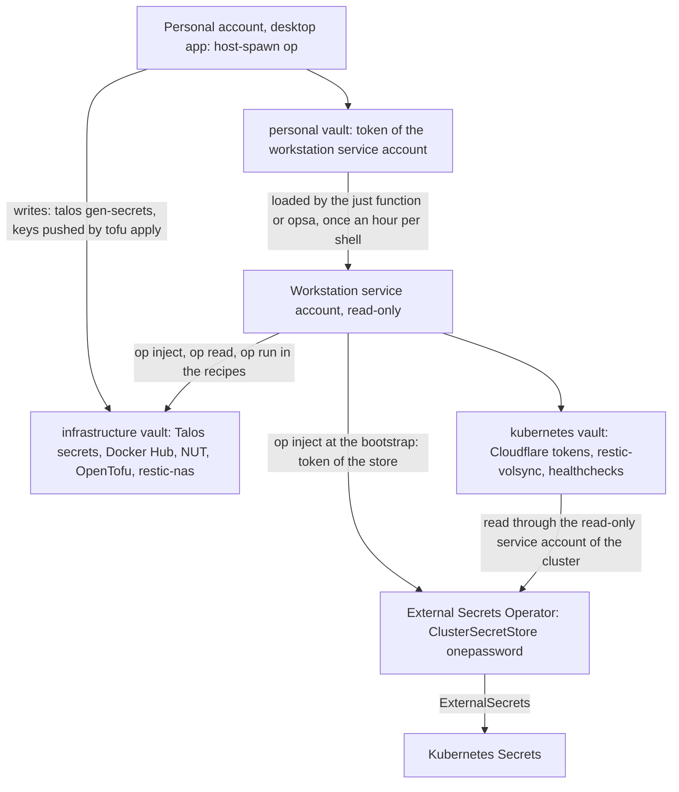

# Secrets: 1Password

Where the secrets live, and how the workstation and the cluster read them. The choices are described below, the alternatives are in [evaluations.md](evaluations.md).

| Document | Content |
| --- | --- |
| [bootstrap.md](bootstrap.md) | First setup: the service accounts and the items to create before the first `just bootstrap cluster`. |
| [runbook.md](runbook.md) | Day-to-day: rotating the workstation token, replacing a token synced to the cluster, 1Password unavailable, the tokens to renew. |
| [evaluations.md](evaluations.md) | The approval prompt problem, the options evaluated, and why a read-only service account was chosen. |

The cluster side is in `kubernetes/apps/external-secrets` (operator and `onepassword` ClusterSecretStore) and `bootstrap/resources/secrets.yaml.j2` (token of the store, injected at the bootstrap). The workstation side is the `op inject` and `op read` calls of the recipes (`talos/mod.just`, `bootstrap/mod.just`, `tofu/mod.just`, `kubernetes/mod.just`), and the shell functions of the toolbox (`just`, `opsa`), which are outside of this repository.

## Status

| Part | Tool | Status |
| --- | --- | --- |
| Secrets of the cluster | External Secrets Operator, `onepassword` ClusterSecretStore, read-only service account on the `kubernetes` vault | Deployed |
| Secrets of the workstation | Read-only service account on the `infrastructure` and `kubernetes` vaults, token cached by the shell for 1 hour | [Decided](#on-the-workstation-a-read-only-service-account), used by every recipe |
| Writes to 1Password | Personal account, through `host-spawn op` (`talos gen-secrets`, `tofu apply`) | In use, one approval per call |
| Rotation of the workstation token | Manual, every 30 days, reminders by `opsa` | [Procedure](runbook.md#rotating-the-workstation-token) |

## Overview

The cluster only ever sees the `kubernetes` vault. The workstation sees both vaults, and only the personal account writes.

## Vaults and items

| Vault | Content | Read by |
| --- | --- | --- |
| `infrastructure` | Secrets of the workstation and of the infrastructure, never synced to the cluster: `talos-secrets` (Talos secrets bundle), `docker-hub-kube-cluster01`, `nas-01-nut-server`, the OpenTofu items (`tofu-state-encryption`, `backblaze-b2-tofu-state`, `backblaze-b2-tofu-admin`, `cloudflare-tofu`), `restic-nas` | The workstation service account |
| `kubernetes` | Secrets synced to the cluster: `1password-external-secrets-operator` (token of the store), `cloudflare-cert-manager`, `cloudflare-external-dns`, `cloudflare-ddns`, `pushover-alertmanager`, `restic-volsync`, `healthchecks`, and `backblaze-b2-cnpg`, `pocket-id-grafana`, `sw-01-snmp` and `ap-01-snmp` later | External Secrets, and the workstation service account |
| `personal` | The token of the workstation service account | The personal account only |

The items of the cluster are described with the tool that uses them: [backups](../backups/README.md#destination-backblaze-b2), [DNS](../dns/README.md#public-external-dns-and-cloudflare-ddns), [certificates](../ingress/README.md#certificate) and [observability](../observability/README.md#alerting). The [Talos secrets bundle](bootstrap.md#2-talos-secrets) is the PKI of the cluster: generated once, never regenerated.

### Naming of the items

Items are named after what they connect, in lowercase with hyphens. Three forms:

| Form | For | Examples |
| --- | --- | --- |
| `<provider>-<app>` | A secret that authenticates a tool of the repository to an external service: the service, then the tool that uses it (the name of its folder in `kubernetes/apps`, or of the component for a release that bundles several, as `alertmanager` in `victoria-metrics-k8s-stack`). When the user is the cluster itself, not a tool, the name of the cluster. | `cloudflare-external-dns`, `cloudflare-cert-manager`, `pushover-alertmanager`, `pocket-id-grafana` (its OIDC client), `backblaze-b2-cnpg`, `backblaze-b2-tofu-admin`, `docker-hub-kube-cluster01` (the nodes pull with it), `1password-external-secrets-operator` (the token of its store) |
| `<host>-<service>` | The credentials of a service exposed by one of our own devices: the host, then the service. | `sw-01-snmp`, `ap-01-snmp`, `nas-01-nut-server` |
| `<tool>-<purpose>` | The settings of a tool for one use, when it is not a connection to a provider. | `restic-volsync`, `restic-nas` (the restic repository of VolSync and of Backrest) |

- **One item per pair**, so that a secret that leaks gives access to one application only. A second application on the same provider gets its own item and its own token, never a shared one ([conventions](../conventions.md#secrets)).
- **The same name everywhere**: the item in 1Password, the `remoteRef.key` of the `ExternalSecret`, and the prerequisite in the `bootstrap.md` of the topic.
- **Fields**: `credential` for the secret itself (token, client secret, password), `username` for its identifier when it has one (the Pushover user key, an OIDC client id). Any other field is named after what it holds (`repository`, `access-key-id`...).
- Some items fit none of the forms, on purpose: `talos-secrets`, `tofu-state-encryption`, and `healthchecks` (a *Secure Note* holding one ping URL per tool, one field per check).

## In the cluster: External Secrets

- External Secrets Operator reads the `kubernetes` vault through the `onepassword` ClusterSecretStore (1Password SDK, no Connect server). ESO keeps the provider replaceable.
- Its service account is read-only and sees **only** the `kubernetes` vault. Its token is the only secret injected by the bootstrap (`op inject` of `bootstrap/resources/secrets.yaml.j2`), everything else is pulled afterwards by `ExternalSecret`s (`remoteRef.key: <item>/<field>`).
- The service accounts have rate limits: keep the refresh intervals of the `ExternalSecret`s long.
- A rotated value reaches the pods that read it at startup only through a restart: [Reloader](../cluster/README.md#reloader) does it for the workloads that opt in.

## On the workstation: a read-only service account

The recipes read 1Password through a service account **read-only on the `infrastructure` and `kubernetes` vaults, without expiration**, whose token is stored in the `personal` vault. The problem it solves (one approval prompt for every `op` call) and the alternatives are in [evaluations.md](evaluations.md). The design choices, as named during the evaluation:

### Where the token lives between two commands — B: a non-exported shell parameter with a TTL

| Option | Approvals | Readable at rest by |
| --- | --- | --- |
| A. Nowhere, read again for every command | 1 per command | nobody |
| **B. Non-exported zsh parameter, 1 h TTL** | **1 per hour and per shell** | **nobody** (zsh memory, see below) |
| C. Kernel keyring `@u` with a timeout | 1 per hour, all terminals | every process of the user, host included |
| D. tmpfs file `0600` | 1 per hour, all terminals | every process of the user |
| E. Secret Service (gnome-keyring, or oo7 from Fedora 45) | 0 after login | every unsandboxed process of the user, through D-Bus; no expiration |

B is the closest to the native behaviour (an approval scoped to one terminal, then reuse for a while). A, and a "lazy A" variant where an `op` wrapper fetches the token only on its first call, were considered: A asks for every command, the lazy variant needs a wrapper and a lock for little gain. With B, a recipe that does not use `op` (`talos schematic-id`) still triggers the approval if the cache of the shell is empty or expired: accepted. oo7 does not change the Secret Service model for processes outside a Flatpak sandbox, which the toolbox is.

### Which processes get the token — 2a: the whole `just` process tree

The token is exported only to the command run through `opsa`: `just` and everything it starts (`bash`, `talosctl`, `yq`, `op`...), for the duration of the command. Injecting it into `op` only (2b) would need it to be readable from a cache shared between processes (C or D), i.e. readable at rest.

### How it is triggered — 3b: a `just` shell function

A zsh function `just` loads the token and runs `command just` with it, only when the current directory is under one of the configured repositories, with at least two arguments not starting with `-` (all the public recipes are in modules: `just`, `just <module>`, `just --list` and the shell completion never ask for an approval). No alias, no prefix to type. Exporting the token in the shell with direnv or the mise `[env]` section (3c) was rejected: it would reach every program started from the repository (editor, `kubectl`, `helm`...).

### Coexistence with the personal account — 4a: two distinct commands

- `op` in the toolbox is the real CLI, it only works with a service account token.
- `host-spawn op` is the explicit way to the personal account through the desktop app (it does not forward the toolbox environment, so never the token). It is used where write access or the `personal` vault is needed: `talos gen-secrets`, Ansible `vault-pass.sh`, service account creation.

A hybrid `op` wrapper (token set: local CLI, otherwise `host-spawn op`) was rejected: it hides which account a command uses.

### Rotation

Manual, every 30 days, [procedure](runbook.md#rotating-the-workstation-token). The token age is the `updated_at` date of its item. Past the maximum age, `opsa` refuses to run and prints the link to the service accounts page and the steps. It warns 5 days before.

### Security

Compared with the native mode (desktop app integration from a host terminal):

- **The cached token is not readable by other processes.** `kernel.yama.ptrace_scope=1` is a prerequisite of `1password-cli`: no process can attach to the zsh process, nor read its memory. Same guarantee as the native mode, where injecting a command into an approved session is blocked by the same setting.
- **While a command runs, the token is in the environment of every process of the `just` tree** (`just`, `bash`, `talosctl`, `tofu`…). `/proc/<pid>/environ` is readable by any process of the same user (Yama only restricts attaching), and the token would end up in a core dump of these processes. `op` processes are the exception: `/usr/bin/op` is setgid `onepassword-cli`, so the kernel marks them non-dumpable, and their `environ` cannot be read (checked: `Permission denied`). This covers the `op daemon` that every `op` command starts and that outlives it (`OP_CACHE=false` does not prevent it, it only disables caching vault data). The daemon likely inherits the token, but no other process of the user can read it.
- **A stolen token stays usable until the next rotation**, from anywhere. In the native mode, a thief only gets the values read during the approved session. Mitigations: read-only access to two vaults, the `personal` vault is out of reach, rotation every 30 days, revocation at any time from the web interface.
- The service account can read the `kubernetes` vault, so the token of the External Secrets service account too: it is a superset of the in-cluster access, not a new privilege.

### Consequences

- One approval per shell and per hour, whatever the recipe does with `op`.
- `talos render-config` no longer needs the single `op inject` and the `awk` split: one `op inject` per template is fine.
- `just tofu run` works: `op run` and `tofu` both run in the toolbox.
- `op` without a token fails in the toolbox: anything outside these recipes that expects the desktop app must call `host-spawn op`.
- Service accounts have rate limits (`op service-account ratelimit`), far above the needs of these recipes.
