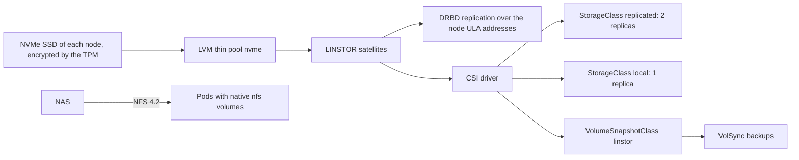

# Storage: Piraeus/LINSTOR

How the applications get persistent volumes: Piraeus/LINSTOR (DRBD 9) on the NVMe SSD of each node, and NFS to the NAS for the bulk data. The manifests are in `kubernetes/apps/piraeus-datastore` and `kubernetes/apps/kube-system/snapshot-controller`, the Talos side (DRBD module, raw volume) in `talos/`. The backups of the volumes are in [backups](../backups/README.md). The decisions are [below](#decisions).

| Document | Content |
| --- | --- |
| [bootstrap.md](bootstrap.md) | First deployment: preparing the nodes, the checks, a volume of each class with a snapshot and a restore, the failover test. |
| [runbook.md](runbook.md) | Day-to-day: orphan volumes, adjusting the replicas, removing a lost node. |
| [evaluations.md](evaluations.md) | The options set aside, and the points to check or watch. |

## Status

| Part | Tool | Status |
| --- | --- | --- |
| Talos prerequisites | `siderolabs/drbd` extension (`talos/schematic.yaml`), kernel modules `drbd` (`usermode_helper=disabled`), `drbd_transport_tcp`, `dm-thin-pool` (`talos/patches/drbd.yaml`), privileged namespace | Done |
| Manifests | Operator, `LinstorCluster`, satellite configurations, storage pool on `/dev/mapper/luks2-r-storage`, StorageClasses, VolumeSnapshotClass, snapshot-controller | Done |
| Deployment | New schematic and config on every node **before** Flux applies the manifests | Done, [checks](bootstrap.md#2-deploy-and-check) |
| Failover test | | [To do](bootstrap.md#3-failover-test) once kube-02 has joined |
| NFS to the NAS | Native `nfs` pod volumes, nothing to deploy | To do: the NAS exports must allow the nodes subnet, check the [read-ahead](../nodes/runbook.md#checking-the-nfs-read-ahead) |

## Overview

## Decisions

Piraeus/LINSTOR (DRBD 9), in `piraeus-datastore`. Chosen over Mayastor (hugepages, dedicated CPU cores, NVMe-oF): in-kernel replication, light on CPU and RAM, CSI snapshots on LVM thin, automatic failover with the HA controller.

- One LVM thin pool `nvme` per node on `/dev/mapper/luks2-r-storage` (whole NVMe SSD, [nodes](../nodes/README.md#hardware)).
- StorageClass `replicated` (default): 2 replicas, diskless access from the other nodes, quorum from an automatic diskless tie-breaker on the third node. 3 replicas rejected: losing 2 nodes means a restore anyway, and every write would cross the single 1 Gb/s NIC twice.
- StorageClass `local`: 1 replica without DRBD, for data replicated by the application or disposable (metrics, logs, caches). TopoLVM only if this does not work out.
- Both classes `reclaimPolicy: Retain`, ext4, `WaitForFirstConsumer`. VolumeSnapshotClass `linstor` (default), snapshot-controller in `kube-system`. The `replicated-temporary` class (`reclaimPolicy: Delete`) is for the temporary volumes of the [backups](../backups/README.md).
- Quorum policy: operator defaults (`suspend-io`), required by the HA controller. DRBD resync capped at 50 MiB/s (single NIC).
- DRBD over the node addresses (satellites in the host network, dual-stack, DRBD over the IPv6 ULA address with `PrefNic`), no dedicated VLAN, no DRBD or LINSTOR TLS (the nodes subnet is trusted).
- No volumes for the bulk data: media, Immich library, Nextcloud data and mail/calendar archives stay on the NAS, mounted with native `nfs` pod volumes (NFS 4.2, no csi-driver-nfs).
- The DRBD module comes from the `siderolabs/drbd` extension and is loaded by Talos (`talos/patches/drbd.yaml`); the satellite module loader is removed (`talos-loader-override`).
