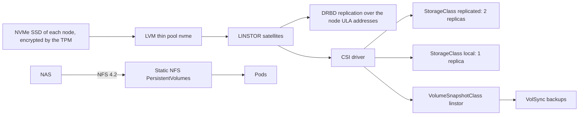

# Storage: Piraeus/LINSTOR

How the applications get persistent volumes: Piraeus/LINSTOR (DRBD 9) on the NVMe SSD of each node, and NFS to the NAS for the bulk data. The manifests are in `kubernetes/apps/piraeus-datastore` and `kubernetes/apps/cluster-tools/snapshot-controller`, the Talos side (DRBD module, raw volume) in `talos/`. The backups of the volumes are in [backups](../backups/README.md). The decisions are [below](#decisions).

| Document | Content |
| --- | --- |
| [bootstrap.md](bootstrap.md) | First deployment: preparing the nodes, the checks, a volume of each class with a snapshot and a restore, the failover test. |
| [runbook.md](runbook.md) | Day-to-day: orphan volumes, adjusting the replicas, removing a lost node, replacing a failed disk, a thin pool filling up, the SELinux label of an existing volume, mounting a NAS share. |
| [evaluations.md](evaluations.md) | The options set aside, and the points to check or watch. |

## Status

| Part | Tool | Status |
| --- | --- | --- |
| Talos prerequisites | `siderolabs/drbd` extension (`talos/schematic.yaml`), kernel modules `drbd` (`usermode_helper=disabled`), `drbd_transport_tcp`, `dm-thin-pool` (`talos/patches/drbd.yaml`), privileged namespace | Done |
| Manifests | Operator, `LinstorCluster`, satellite configurations, storage pool on `/dev/mapper/luks2-r-storage`, StorageClasses, VolumeSnapshotClass, snapshot-controller | Done |
| Deployment | New schematic and config on every node **before** Flux applies the manifests | Done, [checks](bootstrap.md#2-deploy-and-check) |
| Failover test | | [To do](bootstrap.md#3-failover-test) once kube-02 has joined |
| NFS to the NAS | Static NFS PersistentVolumes, nothing to deploy | To do: the NAS exports must allow the nodes subnet, check the [read-ahead](../nodes/runbook.md#checking-the-nfs-read-ahead) |

## Overview

## Decisions

Piraeus/LINSTOR (DRBD 9), in `piraeus-datastore`. Chosen over Mayastor (hugepages, dedicated CPU cores, NVMe-oF): in-kernel replication, light on CPU and RAM, CSI snapshots on LVM thin, automatic failover with the HA controller.

- One LVM thin pool `nvme` per node on `/dev/mapper/luks2-r-storage` (whole NVMe SSD, [nodes](../nodes/README.md#hardware)).
- StorageClass `replicated` (default): 2 replicas, diskless access from the other nodes, quorum from an automatic diskless tie-breaker on the third node. 3 replicas rejected: losing 2 nodes means a restore anyway, and every write would cross the single 1 Gb/s NIC twice.
- StorageClass `local`: 1 replica without DRBD, for data replicated by the application or disposable (metrics, logs, caches). TopoLVM only if this does not work out.
- Both classes `reclaimPolicy: Retain`, ext4, `WaitForFirstConsumer`. VolumeSnapshotClass `linstor` (default), snapshot-controller in `cluster-tools`. The `replicated-temporary` class (`reclaimPolicy: Delete`) is for the temporary volumes of the [backups](../backups/README.md).
- Every class mounts its volumes with the SELinux context `ephemeral_t`, the label of the Talos user volumes, which the pods can read and write (Talos documentation, SELinux, CSI volumes). Without it, the files are `unlabeled_t` and every write of a pod is an AVC denial, refused once Talos is enforcing: Talos does not label the CSI volumes, and the kubelet only mounts with a context for the pods that set `seLinuxOptions`. No pod sets it, the kubelet would add its own `context` to the mount. The CSI node plugin gets an `/etc/selinux/config` from a ConfigMap: Talos has none, and without it `mount` sees SELinux as disabled and silently drops the option. The option is copied into each PV at its creation, the older PVs are [patched by hand](runbook.md#selinux-label-of-an-existing-volume).
- Quorum policy: operator defaults (`suspend-io`), required by the HA controller. DRBD resync capped at 50 MiB/s (single NIC).
- DRBD over the node addresses (satellites in the host network, dual-stack, DRBD over the IPv6 ULA address with `PrefNic`), no dedicated VLAN, no DRBD or LINSTOR TLS (the nodes subnet is trusted). The host firewall leaves the traffic between the nodes open (DRBD TCP 7000-7999, satellites TCP 3366, drbd-reactor TCP 9942), and from the pods only lets the LINSTOR controller reach the satellites. The controller API accepts the other nodes, for the CSI node plugin, which is `hostNetwork` ([network policies](../cluster/README.md#network-policies)).
- No volumes for the bulk data: media, Immich library, Nextcloud data and mail/calendar archives stay on the NAS, mounted through static NFS PersistentVolumes and their PersistentVolumeClaims (NFS 4.2, no csi-driver-nfs, [runbook](runbook.md#mounting-a-nas-share)). The [Pod Security](../cluster/README.md#pod-security) `restricted` profile forbids the inline `nfs` pod volumes.
- The DRBD module comes from the `siderolabs/drbd` extension and is loaded by Talos (`talos/patches/drbd.yaml`); the satellite module loader is removed (`talos-loader-override`).
- Requests, memory limits and classes of the [convention](../conventions.md#resources-and-priorities), in the `podTemplate`s of the `LinstorCluster` and of the `LinstorSatelliteConfiguration` `resources`. The start scripts of LINSTOR set a heap of 8 GiB (controller) and 2 GiB (satellites), above their memory limits: a `-Xmx` at the memory request, the rest of the limit for the rest of the JVM. It goes in the variable of each start script (`CONTROLLER_OPTS`, `SATELLITE_OPTS`, `LINSTOR_CONFIG_OPTS`), read after `JAVA_OPTS`: `JAVA_OPTS` stays the one of the operator. The init container `run-migration` is a JVM too, which loads the database: the values of the controller.
